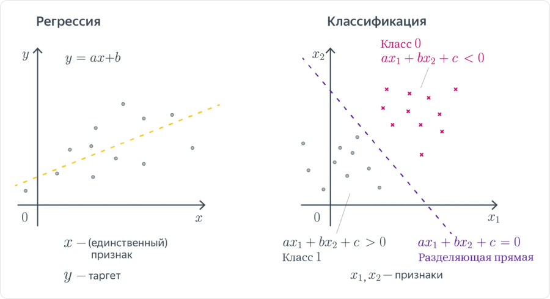
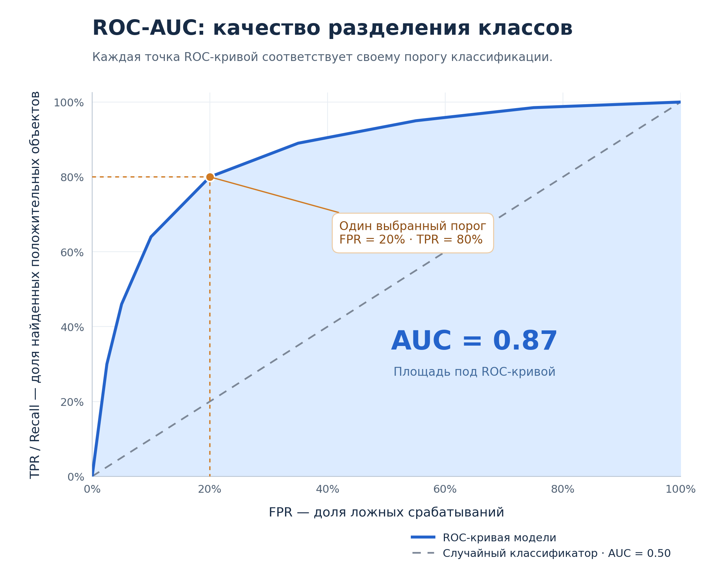

# Оценка качества моделей

**Метрика качества** — число, которое показывает, насколько хорошо модель решает задачу. Для расчёта сравнивают известные таргеты `y` с предсказаниями `ŷ` на данных, которые не использовались для обучения модели.

## Классификация и регрессия



Слева `x` — признак, `y` — численный таргет; справа `x₁` и `x₂` — два признака, а линия разделяет классы.

## Разделение данных

| Выборка | Для чего используется |
|---|---|
| **Обучающая (train)** | Подбор весов модели по примерам |
| **Валидационная (validation)** | Выбор модели, её гиперпараметров и порога классификации |
| **Тестовая (test)** | Итоговая оценка выбранного решения |

Например, данные можно разделить в пропорции `70% / 15% / 15%`. Универсального соотношения нет: в каждой части должно хватать примеров для её задачи.

```text
Train → обучение → Validation → выбор решения → Test → итоговая оценка
```

**Тесты не используют для обучения**: иначе решение подстраивается под него, а оценка становится завышенной.

### Как разделять

- **Независимые объекты** можно разделять случайно. Для классификации стратификация помогает сохранить доли классов.
- **Временные данные** для прогноза будущего разделяют по времени: сначала train, затем validation, затем test.
- **Связанные объекты**, например фотографии одного животного, помещают в одну выборку, чтобы проверять модель на незнакомых животных.

Параметры предобработки, например среднее и масштаб для нормализации, рассчитывают только на train. К validation и test применяют уже найденное преобразование.

**Кросс-валидация** — повторение обучения и оценки на нескольких разбиениях. В обычном `k-fold` данные делят на `k` частей: каждую по очереди используют для валидации, остальные — для обучения. Оценки усредняют. Финальный тест оставляют отдельно; для временных данных используют разбиения с сохранением хронологии.

## Метрики бинарной классификации

Пусть `1` — спам, `0` — обычное письмо. Класс `1` называют **положительным**, `0` — **отрицательным**.

### Матрица ошибок

**Матрица ошибок (confusion matrix)** показывает, какие классы модель определяет верно, а какие путает. Строки соответствуют фактическим классам, столбцы — предсказаниям модели.

| Фактический класс | Предсказано `1` | Предсказано `0` |
|---|---|---|
| `1`: спам | **TP** — спам найден | **FN** — спам пропущен |
| `0`: обычное письмо | **FP** — ложное срабатывание | **TN** — письмо распознано верно |

Обозначения читаются в две части: **True / False** — верен ли прогноз, **Positive / Negative** — какой класс предсказан (`1` или `0`).

- **TP (True Positive)** — модель предсказала спам, и письмо действительно оказалось спамом.
- **TN (True Negative)** — модель предсказала обычное письмо и оказалась права.
- **FP (False Positive)** — обычное письмо ошибочно помечено как спам.
- **FN (False Negative)** — спам ошибочно принят за обычное письмо.

`TP`, `TN`, `FP`, `FN` — количества писем в этих четырёх группах. Например, `FP = 2` означает, что два обычных письма модель ошибочно пометила как спам. По этим количествам рассчитывают метрики ниже.

### Accuracy, precision, recall и F1

| Метрика | Формула | Что измеряет |
|---|---|---|
| **Accuracy** | `(TP + TN) / (TP + TN + FP + FN)` | Долю верных ответов среди всех объектов |
| **Precision** | `TP / (TP + FP)` | Долю настоящего спама среди писем, помеченных как спам |
| **Recall** | `TP / (TP + FN)` | Долю найденного спама среди всего спама |
| **F1** | `2 · precision · recall / (precision + recall)` | Среднее гармоническое precision и recall |

Все четыре метрики лежат в диапазоне `[0; 1]`: больше — лучше. Для F1 также удобно использовать формулу `2TP / (2TP + FP + FN)`.

Например, `TP = 8`, `FP = 2`, `FN = 4`, `TN = 10`:

```text
Accuracy  = (8 + 10) / 24 = 0.75
Precision = 8 / 10        = 0.80
Recall    = 8 / 12        ≈ 0.67
F1        = 16 / 22       ≈ 0.73
```

Если среди 1000 писем только 10 — спам, ответ «всё не спам даст `accuracy = 99%`, но `recall = 0`. Поэтому при дисбалансе классов одной accuracy недостаточно.

Высокий precision нужен, когда важно не отправлять обычные письма в спам; высокий recall — когда важно находить спам. F1 учитывает оба показателя, но не учитывает TN.

Если знаменатель равен нулю, значение метрики требует отдельного соглашения: библиотека может вернуть `0` и предупреждение.

### Порог, ROC-кривая и ROC-AUC

Модель может выдавать оценку вероятности спама `p`. Чтобы получить класс, выбирают **порог `t`**: при `p ≥ t` предсказывают `1`, иначе `0`.

Например, при `p = 0.6` порог `0.5` даст класс `1`, а порог `0.7` — класс `0`. Снижение порога увеличивает число положительных предсказаний: recall не уменьшается, но ложных срабатываний может стать больше.

**ROC-кривая** показывает результат изменения порога:

- по горизонтали — `FPR = FP / (FP + TN)`, доля ложных срабатываний среди отрицательных объектов;
- по вертикали — `TPR = TP / (TP + FN) = recall`.

**ROC-AUC** — площадь под ROC-кривой. `1` означает идеальное разделение; у случайного ранжирования ожидаемое значение — `0.5`.



Условный пример: синяя область — площадь ROC-AUC. При отмеченном пороге модель находит 80% положительных объектов и ошибочно относит к ним 20% отрицательных.

Для расчёта используют вероятности или непрерывные оценки модели, а не готовые метки `0/1`. ROC-AUC оценивает порядок объектов по оценкам; это не доля верных ответов и не проверка точности вероятностей. В оцениваемой выборке должны присутствовать оба класса.

## Метрики регрессии

Пусть `n` — число объектов, `yᵢ` — таргет, `ŷᵢ` — предсказание, `eᵢ = ŷᵢ − yᵢ` — ошибка. Знак `Σ` означает сумму по всем `n` объектам.

| Метрика | Формула | Особенность |
|---|---|---|
| **MAE** | `Σ abs(eᵢ) / n` | Средняя абсолютная ошибка |
| **MSE** | `Σ eᵢ² / n` | Возведение в квадрат усиливает влияние больших ошибок |
| **RMSE** | `√MSE` | Корень из MSE; единицы измерения совпадают с таргетом |

Для всех трёх метрик меньше — лучше; `0` означает отсутствие ошибок. MAE измеряется в единицах таргета, MSE — в их квадрате.

Например, фактические цены — `[100, 200, 300]`, прогнозы — `[110, 180, 330]`:

```text
Ошибки = [10, −20, 30]
MAE    = (10 + 20 + 30) / 3       = 20
MSE    = (100 + 400 + 900) / 3    ≈ 466.67
RMSE   = √466.67                  ≈ 21.60
```

## Метрика и функция потерь

**Функция потерь** задаёт ошибку, которую минимизируют при обучении. **Метрика** служит для оценки результата. Они могут совпадать, например MSE, или различаться: модель обучают с log-loss, а оценивают по F1.

Для сравнения моделей используют одинаковые данные и метрики. Полезно иметь **базовое решение (baseline)**: например, всегда предсказывать самый частый класс. Оно показывает, даёт ли сложная модель улучшение.

## Связанные материалы

- [Яндекс Учебник — «Линейные модели»](https://contest.yandex.ru/tracks/ml/supervised-learning/linear-models)
- [Яндекс Учебник — «Оценка качества моделей»: введение](https://contest.yandex.ru/tracks/ml/model-evaluation/introduction)
- [Яндекс Учебник — «Метрики классификации и регрессии»](https://contest.yandex.ru/tracks/ml/model-evaluation/classification-and-regression-metrics)
- [Яндекс Учебник — «Кросс-валидация»](https://contest.yandex.ru/tracks/ml/model-evaluation/cross-validation)

### Автор:

* [Олег](https://t.me/HocokTopok)
