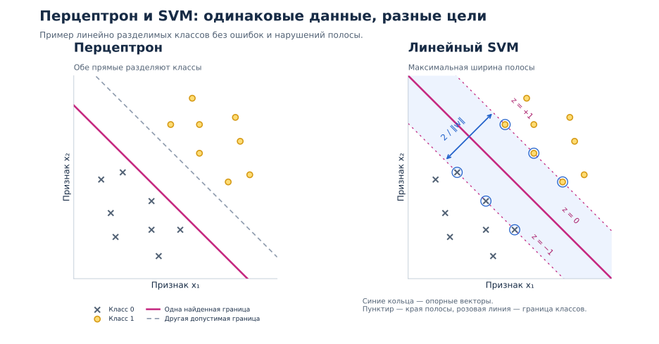

# Линейные модели

## Как устроена линейная модель

Модель вычисляет **взвешенную сумму признаков**:

```text
z = w₁x₁ + w₂x₂ + … + wₖxₖ + b
```

- `x₁, …, xₖ` — численные признаки одного объекта.
- `w₁, …, wₖ` — веса: насколько каждый признак изменяет оценку `z`.
- `b` — свободный член, или смещение: постоянная добавка к оценке.

Например, для квартиры с площадью `40 м²` и одной комнатой при условных весах:

```text
z = 0.15 · площадь + 1 · комнаты + 2
z = 0.15 · 40 + 1 · 1 + 2 = 9
```

Если предсказываем цену в миллионах рублей, прогноз равен `9 млн ₽`. Коэффициенты здесь заданы для примера; при обучении их подбирают по данным.

В регрессии `z` становится численным прогнозом. В классификации по `z` определяют класс или оценивают его вероятность.

## Линейная регрессия

**Линейная регрессия** предсказывает число: `ŷ = z`. При одном признаке это прямая `ŷ = wx + b`.

### Метод наименьших квадратов

**МНК** подбирает веса и смещение так, чтобы сумма квадратов ошибок была минимальной. Деление на число объектов не меняет решение, поэтому можно минимизировать MSE:

```text
L = (1/n) · Σ(ŷᵢ − yᵢ)² → минимум по w и b
```

`n` — число обучающих объектов, `yᵢ` — таргет, `ŷᵢ` — прогноз. `Σ` означает сумму по всем объектам.

Например, точки `(x, y) = (1, 3), (2, 5), (3, 7)` точно описываются моделью `ŷ = 2x + 1`: все ошибки равны нулю. При шумных данных прямая обычно не проходит через каждую точку.

### Аналитическое решение

Для всех объектов прогнозы записывают как `ŷ = Xw`:

- **`X`** — матрица: строки соответствуют объектам, столбцы — признакам. Для смещения добавляют столбец единиц.
- **`w`** — столбец коэффициентов, включая смещение.
- **`y`** — столбец таргетов.

Решение МНК удовлетворяет **нормальным уравнениям**:

```text
XᵀXw = Xᵀy
```

Если столбцы `X` линейно независимы, существует обратная матрица и решение единственно:

```text
w = (XᵀX)⁻¹Xᵀy
```

`Xᵀ` — транспонирование: строки и столбцы меняются местами; `⁻¹` — обратная матрица.

При зависимых столбцах эта формула неприменима, хотя решение МНК существует. На практике используют устойчивые методы на основе QR или SVD, например `numpy.linalg.lstsq`, вместо явного вычисления обратной матрицы. Другой путь — постепенно уменьшать ошибку градиентным спуском.

## Линейная классификация

Для двух классов `y ∈ {0, 1}` простое решающее правило выглядит так:

```text
z = w₁x₁ + … + wₖxₖ + b
ŷ = 1, если z ≥ 0; иначе ŷ = 0
```

**Граница классов** задаётся уравнением `z = 0`: при двух признаках это прямая, при большем числе — гиперплоскость. Разные линейные классификаторы отличаются прежде всего способом подбора этой границы.

### Перцептрон

**Перцептрон** исправляет веса после неверного ответа. Для одного объекта:

```text
ошибка = y − ŷ
wⱼ ← wⱼ + η · ошибка · xⱼ
b  ← b  + η · ошибка
```

`η` — **learning rate**; `←` означает обновление значения. Если ответ верен, параметры не меняются.

Например, при `x = 2`, `w = −1`, `b = 0` получаем `z = −2`, значит `ŷ = 0`. Если таргет `y = 1` и `η = 0.5`, новые параметры — `w = 0`, `b = 0.5`. Теперь для этого объекта `z = 0.5`, и прогноз верен.

Перцептрон не выдаёт вероятность. Если классы нельзя разделить линейно, классическое правило не гарантирует прекращения обновлений.

## Логистическая регрессия

**Логистическая регрессия** решает задачу классификации. Она преобразует оценку `z` в вероятность положительного класса с помощью **сигмоиды**:

```text
p = σ(z) = 1 / (1 + exp(−z))
```

`exp(a)` означает `eᵃ`. При `z = 0` получаем `p = 0.5`; при положительном `z` вероятность больше `0.5`, при отрицательном — меньше.

Для получения класса выбирают порог `t`: `ŷ = 1`, если `p ≥ t`, иначе `0`. При `t = 0.5` граница совпадает с `z = 0`.

### Log-loss

**Log-loss** используют для обучения модели предсказывать вероятности классов. Он делает уверенные ошибки особенно заметными: чем меньшую вероятность модель даёт правильному классу, тем больше штраф. Так при обучении учитывается не только сам факт ошибки, но и уверенность модели.

Для объекта с таргетом `y ∈ {0, 1}`:

```text
ℓ(y, p) = −[y · ln(p) + (1 − y) · ln(1 − p)]
```

`ln` — натуральный логарифм. При обучении минимизируют среднее значение `ℓ` на train.

| Таргет | Вероятность `p = 0.8` | Потеря |
|---|---|---|
| `y = 1` | Верный класс получил высокую вероятность | `−ln(0.8) ≈ 0.223` |
| `y = 0` | Неверный класс получил высокую вероятность | `−ln(0.2) ≈ 1.609` |

Уверенная ошибка штрафуется сильнее. Для расчёта log-loss используют вероятности, а не метки после применения порога.

## Метод опорных векторов: линейный SVM

**Линейный SVM** ищет разделяющую границу с широкой разделяющей полосой, допуская штрафы за её нарушение.

Для формул метки перекодируют в `s ∈ {−1, +1}`: `s = 2y − 1`. **Отступ** объекта — `m = s · z`. При `m > 0` знак оценки соответствует классу; при `m < 0` модель ошибается.

**Hinge loss** — функция потерь для обучения SVM. Она требует не только верного класса, но и достаточного отступа от границы:

- `m ≥ 1` — объект с правильной стороны и вне полосы или на её краю: штрафа нет.
- `0 < m < 1` — класс определён верно, но объект внутри полосы: есть штраф.
- `m < 0` — класс определён неверно: чем дальше объект с неправильной стороны, тем больше штраф.

При `m = 0` объект на границе классов, штраф равен `1`. Формула объединяет эти случаи:

```text
ℓ = max(0, 1 − m)
```

Например, при `m = 2` потеря равна `0`, при `m = 0.4` — `0.6`, при `m = −0.5` — `1.5`. Для получения широкой полосы этот штраф сочетают с L2-регуляризацией весов.

**Опорные векторы** — обучающие объекты, определяющие положение границы; они могут лежать на краю полосы, внутри неё или быть ошибочно классифицированы.

Параметр **`C`** управляет компромиссом: большее значение сильнее штрафует нарушения полосы относительно штрафа за веса. Его выбирают по валидации. Оценка SVM сама по себе не является вероятностью.

С нелинейным ядром, например RBF, SVM может строить нелинейную границу в исходном пространстве признаков.

### Чем SVM отличается от перцептрона



Слева обе прямые дают верные классы: классический перцептрон не требует максимальной ширины полосы. Справа показано решение SVM для тех же линейно разделимых данных без нарушений полосы.

Края полосы заданы уравнениями `z = −1` и `z = +1`, её ширина — `2 / ‖w‖`, где `‖w‖ = √(w₁² + … + wₖ²)`. При пересекающихся классах SVM допускает нарушения полосы и штрафует их.

## Подготовка признаков

### Масштабирование

Численные признаки часто приводят к сопоставимому масштабу. Например, **стандартизация** преобразует признак по формуле:

```text
x′ = (x − μ) / σ
```

`μ` — среднее, `σ` — стандартное отклонение признака на train. Например, при `x = 60`, `μ = 50`, `σ = 10` получаем `x′ = 1`. Постоянные признаки с `σ = 0` обрабатывают отдельно.

Масштабирование особенно важно для градиентного обучения, SVM и регуляризации. Диапазон `[0; 1]` не обязателен. Средние, масштабы и остальные параметры предобработки определяют на train, затем применяют к validation и test.

### One-hot encoding

**One-hot encoding** заменяет категориальный признак бинарными: для каждой категории создают столбец `0/1`. В примере ниже два категориальных признака — вид животного и цвет; вес уже численный:

| Объект | `pet_type` | `color` | `weight` |
|---|---|---|---|
| 0 | parrot | red | 0.600 |
| 1 | cat | black | 3.000 |
| 2 | hamster | brown | 0.800 |
| 3 | cat | gray | 5.000 |
| 4 | dog | black | 7.000 |

Например, `cat` кодируется как `[0, 1, 0, 0]` в столбцах `type_parrot`, `type_cat`, `type_dog`, `type_hamster`. Кодирование видов числами `1, 2, 3, 4` навязало бы линейной модели порядок и равные расстояния между ними.

#### Почему один столбец можно убрать

Пусть `c₁, …, cₘ` — индикаторы категорий одного признака. Для каждого объекта активна ровно одна категория:

```text
c₁ + c₂ + … + cₘ = 1
```

Поэтому эти столбцы **вместе со столбцом единиц для смещения линейно зависимы**. Рассмотрим вклад категорий в модель; `r(x)` — вклад остальных признаков:

```text
z = r(x) + w₁c₁ + … + wₘcₘ + b
```

Выберем категорию `m` базовой и перегруппируем слагаемые:

```text
z = r(x) + (w₁ − wₘ)c₁ + … + (wₘ₋₁ − wₘ)cₘ₋₁
         + wₘ(c₁ + … + cₘ) + b

  = r(x) + (w₁ − wₘ)c₁ + … + (wₘ₋₁ − wₘ)cₘ₋₁ + (b + wₘ)
```

Новые коэффициенты — `w′ⱼ = wⱼ − wₘ`, новое смещение — `b′ = b + wₘ`. Столбец `cₘ` исчез, **а прогнозы остались прежними**. Вычитаем вес базовой категории из других весов, не из значений признаков.

Например, если `b = 10`, а веса трёх категорий — `[2, 5, 8]`, берём третью базовой. Тогда `b′ = 18`, оставшиеся веса — `[−6, −3]`. Прогнозы для категорий по-прежнему равны `[12, 15, 18]`.

#### Таблица после удаления базовых категорий

Для каждого категориального признака убираем по одному столбцу: `type_parrot` и `color_red`. Получаем таблицу:

| Объект | `weight` | `type_cat` | `type_dog` | `type_hamster` | `color_black` | `color_brown` | `color_gray` |
|---|---|---|---|---|---|---|---|
| 0 | 0.600 | 0 | 0 | 0 | 0 | 0 | 0 |
| 1 | 3.000 | 1 | 0 | 0 | 1 | 0 | 0 |
| 2 | 0.800 | 0 | 0 | 1 | 0 | 1 | 0 |
| 3 | 5.000 | 1 | 0 | 0 | 0 | 0 | 1 |
| 4 | 7.000 | 0 | 1 | 0 | 1 | 0 | 0 |

Нули во всех столбцах вида означают попугая, нули во всех столбцах цвета — красный цвет. Информация о базовых категориях не теряется.

Так устраняют зависимость от полного набора индикаторов и смещения; другие зависимости между признаками могут сохраниться. Для обычного МНК это помогает избежать неоднозначности коэффициентов. С регуляризацией удаление категории требуется не всегда.

### Нелинейные зависимости

Можно добавить признаки `x²` или произведение `x₁x₂`. Модель `ŷ = w₁x + w₂x² + b` остаётся линейной по коэффициентам и новым признакам, хотя зависимость от исходного `x` уже нелинейная.

## Связанные материалы

- [Яндекс Учебник — «Линейные модели»](https://contest.yandex.ru/tracks/ml/supervised-learning/linear-models)
- [Документация scikit-learn — линейные модели](https://scikit-learn.org/stable/modules/linear_model.html)
- [Документация scikit-learn — SVM](https://scikit-learn.org/stable/modules/svm.html)
- [Документация scikit-learn — подготовка признаков](https://scikit-learn.org/stable/modules/preprocessing.html)
- [Оценка качества моделей](041-model-evaluation.md)

### Автор:

* [Олег](https://t.me/HocokTopok)
