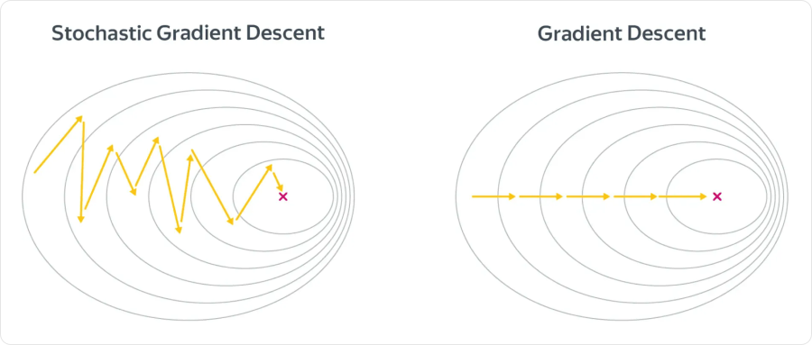
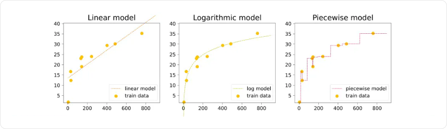
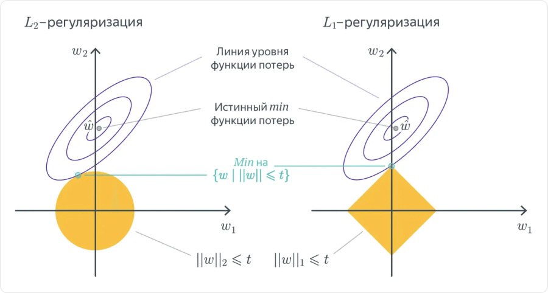

# Обучение моделей и регуляризация

**Обучение** — подбор параметров модели по данным. Например, у линейной модели `ŷ = w₁x₁ + … + wₖxₖ + b` подбираются веса `w` и смещение `b`.

При обучении через минимизацию потерь задают функцию `L`, измеряющую ошибку, и ищут параметры, при которых она меньше. Качество на новых данных проверяют отдельно: маленькая ошибка на train ещё не гарантирует хороший результат.

## Как меняются параметры

```text
Примеры из train → прогноз → функция потерь → градиент → обновление параметров
                                      ↑                         │
                                      └── следующий прогноз ────┘
```

**Градиент** — вектор производных функции потерь по параметрам. Производная `∂L/∂wⱼ` показывает, как небольшое изменение веса `wⱼ` изменит потери, если остальные параметры зафиксированы.

- Положительная производная: небольшое уменьшение веса уменьшает потери.
- Отрицательная: небольшое увеличение веса уменьшает потери.
- Нулевая: в этой точке нет изменения первого порядка; это не обязательно минимум.

### Градиентный спуск

**Градиентный спуск (gradient descent, GD)** обновляет параметры в направлении, противоположном градиенту:

```text
wⱼ ← wⱼ − η · ∂L/∂wⱼ
b  ← b  − η · ∂L/∂b
```

`η` — **learning rate**; `←` означает обновление значения. Все производные для одного шага вычисляют при одних и тех же текущих параметрах.

Например, у функции `L(w) = (w − 3)²` минимум находится при `w = 3`:

```text
Начальный вес:      w = 0
Производная:        dL/dw = 2(w − 3) = −6
Learning rate:     η = 0.1
Новый вес:         w = 0 − 0.1 · (−6) = 0.6
Потери до шага:    L(0) = 9
Потери после шага: L(0.6) = 5.76
```

Для линейной регрессии с MSE производные имеют вид:

```text
eᵢ = ŷᵢ − yᵢ
∂L/∂wⱼ = (2/n) · Σ eᵢxᵢⱼ
∂L/∂b  = (2/n) · Σ eᵢ
```

`n` — число объектов, `xᵢⱼ` — признак `j` объекта `i`; сумма берётся по объектам. Так ошибка каждого прогноза участвует в обновлении весов.

### Влияние learning rate

| Значение | Возможное поведение |
|---|---|
| Слишком маленькое | Потери уменьшаются медленно |
| Подходящее | Обучение продвигается без сильных скачков |
| Слишком большое | Параметры перескакивают минимум; потери колеблются или растут |

У MSE линейной регрессии задача выпуклая: локальный минимум является глобальным. Но даже здесь слишком большой learning rate может привести к расходимости.

Масштабирование признаков часто улучшает поведение градиентного спуска. Оно не гарантирует устранения проблем от сильно зависимых признаков.

## Батчи, шаги и эпохи

Вычислять градиент по всему train на каждом шаге бывает дорого. Вместо этого используют **батч (batch)** — часть обучающих объектов.

| Метод | По каким объектам вычисляют один градиент |
|---|---|
| **Batch GD** | По всей обучающей выборке |
| **SGD** в узком смысле | По одному случайному объекту |
| **Mini-batch SGD** | По небольшой группе объектов |

На практике словом SGD часто называют и вариант с мини-батчами. Градиент по батчу — среднее градиентов его объектов.



Линии на рисунке соединяют точки с одинаковыми потерями; крестик отмечает минимум. Слева градиент оценивают по части данных, поэтому шаги шумнее. Отдельный шаг SGD может увеличить потери на всей выборке.

**Шаг (iteration)** — одно обновление параметров. **Эпоха (epoch)** — один полный проход по train. **Batch size** — число объектов в батче.

Например, при `1000` объектах и `batch size = 100` одна эпоха содержит `10` шагов, а `20` эпох — `200` шагов.

Train обычно перемешивают перед очередной эпохой, если задача это допускает. Для последовательностей сохраняют нужный порядок внутри примера; разделение train, validation и test по времени от перемешивания train не меняется.

## Недообучение и переобучение

**Обобщающая способность** — способность модели работать на новых объектах, а не только на примерах из train.

| Ситуация | Что происходит |
|---|---|
| **Недообучение (underfitting)** | Модель не улавливает зависимость: ошибки велики и на train, и на validation |
| **Хорошее обобщение** | Модель улавливает закономерность и сохраняет качество на validation |
| **Переобучение (overfitting)** | Модель подстраивается под особенности и шум train, которые не повторяются на новых данных |



Слева прямая плохо описывает зависимость. В центре модель передаёт её общий вид. Справа модель повторяет отдельные точки, включая шум.

Сложность не сводится только к числу параметров: важны также признаки, ограничения модели и процедура обучения. Большая ошибка на train может означать как недостаточную гибкость модели, так и проблемы оптимизации.

### Как заметить переобучение

Отслеживают потери или метрики на train и validation по мере обучения. Типичный признак: потери на train продолжают снижаться, а на validation перестают снижаться и затем растут.

Для сравнения используют одну и ту же функцию ошибки. Например, отдельно считают MSE на train и validation, без добавления штрафа регуляризации к одной из кривых. Кратковременный скачок ещё не означает переобучение — важна устойчивая тенденция.

## Регуляризация

**Регуляризация** ограничивает свободу модели, чтобы уменьшить подстройку под шум. Один из способов — добавить штраф за большие веса:

```text
J(w, b) = L₀(w, b) + λ · R(w)
```

`L₀` — потери на данных, `R` — штраф, `λ ≥ 0` — сила регуляризации. Минимизируют всю функцию `J`.

При почти зависимых признаках большие веса могут компенсировать друг друга: прогнозы на train хорошие, но коэффициенты нестабильны. Штраф помогает ограничить такие решения.

### L2-регуляризация

**L2-регуляризация** штрафует сумму квадратов весов. С выбранным здесь множителем:

```text
J = L₀ + (λ/2) · Σ wⱼ²
```

Она сдерживает большие веса; в общем случае не обнуляет их точно. Линейная регрессия с таким штрафом называется **Ridge**.

Производная штрафа по `wⱼ` равна `λwⱼ`, поэтому шаг градиентного спуска:

```text
wⱼ ← wⱼ − η · (∂L₀/∂wⱼ + λwⱼ)
   = (1 − ηλ)wⱼ − η · ∂L₀/∂wⱼ
```

Например, при `η = 0.1`, `λ = 0.2`, `wⱼ = 3` и нулевой производной потерь на данных вес станет `2.94`: его уменьшил именно штраф.

### L1-регуляризация

**L1-регуляризация** штрафует сумму модулей весов:

```text
J = L₀ + λ · Σ abs(wⱼ)
```

Она может делать часть весов **ровно нулевыми**, исключая соответствующие признаки из прогноза. Линейная регрессия с таким штрафом называется **Lasso**. Нулевой вес не доказывает бесполезность признака: например, его информацию мог заменить другой, связанный с ним признак.



Здесь регуляризация показана как ограничение на веса: жёлтая область содержит допустимые значения `(w₁, w₂)`. Среди них ищут точку с наименьшими потерями. У ромба L1 вершины лежат на осях, поэтому решение может попасть в точку с нулевым коэффициентом. `t` на рисунке — размер допустимой области, а не learning rate.

| Штраф | Основной эффект |
|---|---|
| **L2** | Сдерживает величины весов, помогает при связанных признаках |
| **L1** | Может обнулить часть весов и дать разреженную модель |

Смещение `b` обычно не штрафуют. Численные признаки перед регуляризацией приводят к сопоставимым масштабам: величина веса зависит от единиц измерения признака.

### Как выбрать силу регуляризации

- `λ = 0` — дополнительного штрафа нет.
- Слишком большое `λ` — модель чрезмерно ограничена и может недообучиться.
- Подходящее `λ` — компромисс между ошибкой на данных и ограничением весов.

Для каждого значения `λ` модель обучают на train, а выбирают вариант по validation. В некоторых библиотеках вместо `λ` используют обратный по смыслу параметр `C`: большее `C` означает более слабую регуляризацию.

## Когда остановить обучение

**Ранняя остановка (early stopping)** — прекращение обучения, когда выбранная метрика validation некоторое время не улучшается. Параметр **patience** задаёт, сколько проверок ждать; сохраняют и восстанавливают лучшее состояние модели.

Например, если лучшая validation loss была на эпохе `12`, а затем пять эпох улучшения не было, при `patience = 5` обучение можно завершить после эпохи `17` и вернуть веса эпохи `12`. Здесь validation проверяется раз за эпоху.

Также обучение ограничивают максимальным числом эпох или останавливают по малости изменений целевой функции. Достижение такого условия само по себе не доказывает хорошее качество на новых данных.

## Параметры и гиперпараметры

| Что выбираем | Примеры | Как определяем |
|---|---|---|
| **Параметры** | Веса `w`, смещение `b` | Подбираем при обучении на train |
| **Гиперпараметры** | Learning rate, batch size, `λ`, максимальное число эпох, patience | Сравниваем варианты по validation |

После выбора процедуры обучения и настроек выполняют итоговую оценку на test. По результатам test настройки не подбирают.

## Связанные материалы

- [Яндекс Учебник — «Линейные модели»: градиентный спуск и регуляризация](https://contest.yandex.ru/tracks/ml/supervised-learning/linear-models)
- [Яндекс Учебник — «Машинное обучение»: выбор модели и переобучение](https://contest.yandex.ru/tracks/ml/introduction/machine-learning)
- [Яндекс Учебник — «Оптимизация в ML»](https://contest.yandex.ru/tracks/ml/optimization-in-machine-learning/optimization-in-machine-learning)
- [Яндекс Учебник — «Кросс-валидация»](https://contest.yandex.ru/tracks/ml/model-evaluation/cross-validation)
- [Яндекс Учебник — «Тонкости обучения»](https://contest.yandex.ru/tracks/ml/deep-learning-introduction/training-techniques)
- [Оценка качества моделей](041-model-evaluation.md)
- [Линейные модели](042-linear-models.md)

### Автор:

* [Олег](https://t.me/HocokTopok)
