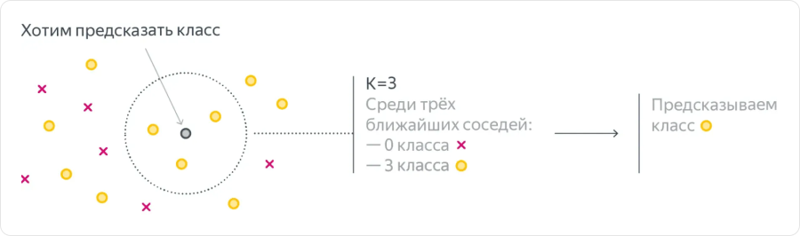

# Метрические методы: k ближайших соседей

**Метод k ближайших соседей (k-nearest neighbors, kNN)** предсказывает ответ по похожим объектам из train. Основное предположение: близким по признакам объектам часто соответствуют похожие таргеты.

Например, цену квартиры можно оценить по ценам квартир с похожей площадью, расположением и другими характеристиками. Важно, чтобы выбранные признаки и расстояние действительно отражали сходство.

## Как работает kNN

1. Задаём расстояние между объектами и число соседей `k`.
2. Для нового объекта вычисляем расстояния до объектов train.
3. Выбираем `k` ближайших.
4. Объединяем их ответы: голосованием для классификации или усреднением для регрессии.

```text
Новый объект → расстояния до train → k ближайших соседей → прогноз
```

При подготовке модели сохраняют train; могут дополнительно строить структуру для быстрого поиска. Веса, как у линейной модели, не подбираются. Такой подход называют **ленивым обучением (lazy learning)**: основная работа выполняется при предсказании. Learning rate и эпохи обычному kNN не нужны.

## Классификация

**Класс выбирают по большинству голосов соседей.** На рисунке все три ближайших соседа серого объекта — жёлтые, поэтому при `k = 3` прогноз тоже жёлтый:



Например, при бинарной классификации соседям соответствуют:

| Сосед | Расстояние | Класс |
|---|---|---|
| 1 | 0.1 | 0 |
| 2 | 0.2 | 1 |
| 3 | 0.3 | 1 |

При `k = 1` ответ — `0`, при `k = 3` — `1`: два голоса против одного.

Долю соседей заданного класса используют как **оценку его вероятности**:

```text
p(y = 1 | x) = (число соседей класса 1) / k
```

В примере `p = 2/3 ≈ 0.67`. Это частота в выбранном окружении, а не гарантия точной вероятности события. Аналогично можно работать с несколькими классами.

При равенстве голосов требуется правило разрешения ничьей. Нечётное `k` исключает ничью только в бинарном случае с одинаковыми весами голосов; одинаковые расстояния на границе выбора соседей всё равно могут потребовать отдельного правила.

## Регрессия

**Прогноз — среднее таргетов соседей**:

```text
ŷ = (y₁ + … + yₖ) / k
```

Например, оцениваем цену квартиры площадью `41 м²`. Для простоты используем только площадь:

| Площадь соседа, м² | Расстояние до 41 м² | Цена, млн ₽ |
|---|---|---|
| 40 | 1 | 8 |
| 43 | 2 | 9 |
| 38 | 3 | 7 |

При `k = 3` прогноз равен `(8 + 9 + 7) / 3 = 8 млн ₽`.

Таргеты соседей используют для ответа, но **не включают в признаки для поиска**. Для новой квартиры цена пока неизвестна.

Обычное среднее не выходит за диапазон таргетов выбранных соседей. Поэтому kNN плохо подходит для экстраполяции: он не продолжает тенденцию за пределы известных значений, как это может делать линейная регрессия.

## Что означает «ближайший»

Близость задаёт **функция расстояния**. Пусть `x` и `v` — векторы признаков двух объектов, `d` — число признаков.

| Расстояние | Формула | Смысл |
|---|---|---|
| **Евклидово** | `√Σ(xⱼ − vⱼ)²` | Длина прямого отрезка между точками |
| **Манхэттенское** | `Σ abs(xⱼ − vⱼ)` | Сумма модулей различий по координатам |

Сумма берётся по признакам `j = 1, …, d`. Для точек `(1, 2)` и `(4, 6)` евклидово расстояние равно `√(3² + 4²) = 5`, манхэттенское — `3 + 4 = 7`.

Здесь слово **«метрика»** означает способ измерять расстояние, а не accuracy или другую метрику качества модели. Функцию расстояния выбирают по результатам валидации.

### Зачем масштабировать признаки

Если один признак измеряется десятками, а другой — тысячами, второй может определять почти всё расстояние. Даже смена единиц измерения меняет соседей: перевод расстояния до центра из километров в метры увеличит его численные различия в 1000 раз.

Численные признаки часто стандартизуют:

```text
x′ⱼ = (xⱼ − μⱼ) / σⱼ
```

`μⱼ` и `σⱼ` — среднее и стандартное отклонение признака на train. Для validation и test используют те же значения. Постоянный признак с `σⱼ = 0` обрабатывают отдельно.

Категории можно кодировать через one-hot, но масштабирование и кодирование сами по себе не гарантируют осмысленную близость: признаки всё равно должны соответствовать задаче.

## Взвешенный kNN

В обычном варианте ближайший и самый далёкий из выбранных соседей имеют одинаковый голос. **Взвешенный kNN** даёт более близким объектам больший вес.

Например, при положительном расстоянии `rᵢ` можно взять:

```text
aᵢ = 1 / rᵢ
```

`aᵢ` — вес голоса соседа, а не обучаемый параметр модели. Для классификации суммируют веса по классам; для регрессии вычисляют взвешенное среднее:

```text
ŷ = Σ(aᵢyᵢ) / Σaᵢ
```

Обе суммы — по выбранным соседям. В таблице классификации выше вес класса `0` равен `1/0.1 = 10`, а класса `1` — `1/0.2 + 1/0.3 ≈ 8.33`. Теперь выигрывает класс `0`, хотя его объектов меньше.

При нулевом расстоянии делить на него нельзя. Один из вариантов — учитывать только совпавших с запросом соседей и объединять их ответы между собой. Правило обработки таких случаев зависит от реализации.

## Как выбрать k

`k` — **гиперпараметр**, а не число классов.

| Значение k | Возможный результат |
|---|---|
| Маленькое, например `1` | Сильная зависимость от отдельных объектов и шума; риск переобучения |
| Умеренное | Более устойчивое локальное усреднение |
| Слишком большое | Смешивание разных областей данных; риск недообучения |

При `k`, равном размеру train, невзвешенная классификация всегда выдаёт самый частый класс, а регрессия — среднее всех таргетов train. Локальность исчезает.

На train без противоречащих друг другу дубликатов `k = 1` может дать нулевую ошибку, потому что объект находит самого себя. Это не показывает качество на новых данных.

Для подбора настроек:

1. Фиксируем разбиение данных.
2. Проверяем несколько `k`, например `3, 5, 11, 21`, не превышающих размер обучающей части.
3. Сравниваем расстояния и варианты весов по метрике validation или кросс-валидации.
4. После выбора настроек оцениваем итоговое решение на test.

При кросс-валидации преобразования признаков каждый раз обучают только на обучающих фолдах. Соседей для validation и test ищут только в соответствующем train.

## Сильные стороны и ограничения

| Сильные стороны | Ограничения |
|---|---|
| Простая логика, легко посмотреть соседей прогноза | Нужно хранить обучающие данные |
| Подходит для классификации и регрессии | Поиск соседей может быть дорогим |
| Может строить нелинейные границы классов | Чувствителен к масштабу, шуму и неинформативным признакам |

При полном переборе для одного запроса вычисляют расстояния до `n` объектов по `d` признакам: это требует порядка `n · d` операций, после чего выбирают ближайших. Для хранения признаков нужно порядка `n · d` чисел.

При большом числе признаков сложнее сохранить осмысленную близость: лишние координаты добавляют шум в расстояния. Большее число признаков не обязательно улучшает kNN.

## Связанные материалы

- [Яндекс Учебник — «Метрические методы»: метод k ближайших соседей](https://contest.yandex.ru/tracks/ml/supervised-learning/metric-methods)
- [Яндекс Учебник — «Подбор гиперпараметров»](https://contest.yandex.ru/tracks/ml/model-evaluation/hyperparameter-tuning)
- [Документация scikit-learn — ближайшие соседи](https://scikit-learn.org/stable/modules/neighbors.html)
- [Оценка качества моделей](041-model-evaluation.md)
- [Линейные модели: подготовка признаков](042-linear-models.md)
- [Обучение моделей и регуляризация](043-model-training.md)

### Автор:

* [Олег](https://t.me/HocokTopok)
