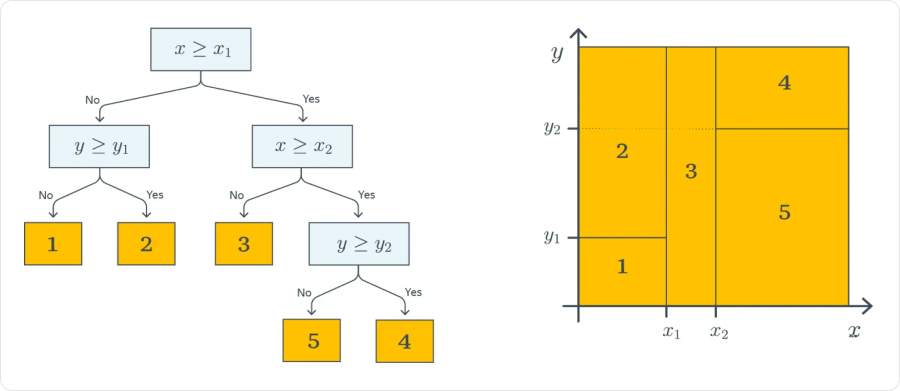
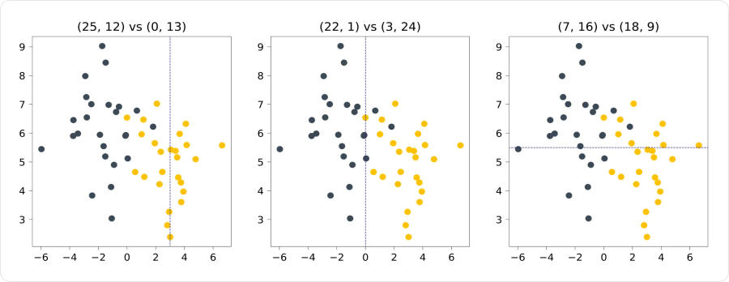
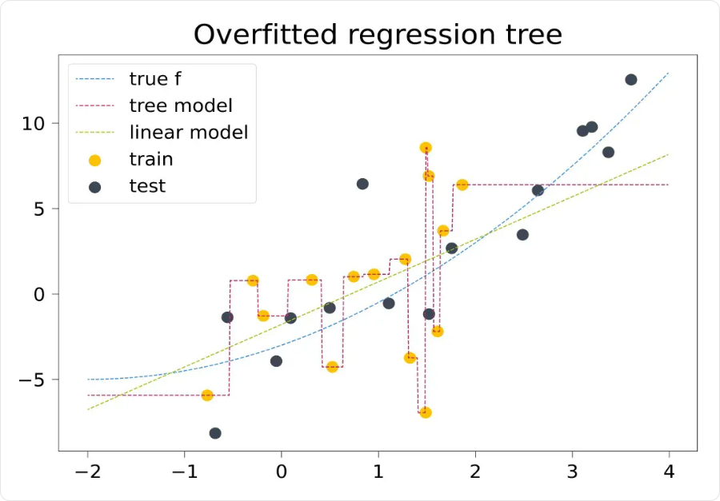

# Решающие деревья

**Решающее дерево (decision tree)** предсказывает ответ с помощью последовательности условий по признакам. Например: «Площадь квартиры не больше 50 м²?» Затем проверяет следующее условие или сразу выдаёт прогноз.

В отличие от линейной модели, дерево не складывает признаки с весами: оно разделяет объекты на группы и задаёт ответ для каждой группы.

## Как устроено дерево

- **Корень** — начальный узел, куда поступают все объекты.
- **Внутренний узел** — условие, например `xⱼ ≤ t`, где `xⱼ` — признак, `t` — порог.
- **Ветви** — переходы в зависимости от результата проверки.
- **Лист** — конечный узел с прогнозом.
- **Глубина** — число переходов от корня; глубина всего дерева — максимальное такое число.

Для предсказания объект проходит от корня до одного листа. Дерево глубины `1` с одним условием называют **решающим пнём (decision stump)**.



На рисунке `x` и `y` — **два признака**, а не признак и таргет. Пороги `x₁`, `x₂`, `y₁`, `y₂` делят пространство на области; номера `1`–`5` — ответы листьев. Например, при `x ≥ x₂` и `y < y₂` объект получает ответ `5`.

Каждая проверка по одному численному признаку разделяет текущую область вдоль одной координаты. Поэтому обычное дерево создаёт прямоугольные области, внутри которых прогноз постоянен.

## Что предсказывается в листе

### Классификация

Для каждого листа сохраняют распределение классов объектов train, которые туда попали. **Прогноз класса — самый частый класс**, оценка вероятности — его доля.

Например, в листе пять объектов: четыре класса `1` и один класса `0`:

```text
Прогноз класса: ŷ = 1
Оценка вероятности: p(y = 1 | лист) = 4/5 = 0.8
```

Одинаковый прогноз получают все новые объекты, пришедшие в этот лист. Частота на маленькой группе может быть ненадёжной: вероятность `1` в листе с одним объектом ещё не означает уверенный прогноз на новых данных.

### Регрессия

Значение листа зависит от функции потерь:

| Потери | Прогноз в листе |
|---|---|
| **MSE** | Среднее таргетов объектов train в листе |
| **MAE** | Медиана этих таргетов |

Например, при ценах `[8, 9, 25]` млн ₽ прогноз для MSE равен `14`, а для MAE — `9`. Медиана слабее реагирует на большое значение `25`.

Обычное дерево со средними или медианами в листьях не продолжает тенденцию за пределы наблюдаемых значений. На крайних участках оно сохраняет константный ответ.

## Как дерево обучается

Обычный алгоритм строит дерево **жадно**: выбирает лучшее разбиение текущего узла, не перебирая все возможные будущие деревья.

1. Берём объекты train, попавшие в текущий узел.
2. Перебираем признаки и допустимые пороги.
3. Для каждого варианта оцениваем качество двух получившихся групп.
4. Выбираем лучшее допустимое разбиение.
5. Повторяем процедуру для дочерних узлов, пока не сработает условие остановки.

Для численного признака достаточно рассматривать пороги между соседними различными значениями: внутри такого промежутка состав групп не меняется.

При обучении подбираются **структура дерева, признаки и пороги условий, ответы в листьях**. Градиентный спуск, learning rate и эпохи для обычного жадного построения дерева не нужны. Жадный выбор не гарантирует оптимальности всего дерева.

## Как выбрать разбиение

**Неоднородность узла (impurity)** измеряет, насколько различаются таргеты внутри него. Для классификации хочется разделить разные классы, для регрессии — получить группы с близкими численными ответами.

Обозначим неоднородность через `H`. Улучшение при разбиении:

```text
Δ = H(родитель) − (nL/n) · H(левый) − (nR/n) · H(правый)
```

`n` — число объектов в родителе, `nL` и `nR` — в дочерних узлах. Чем больше `Δ`, тем полезнее разбиение. Вес `nL/n` учитывает размер группы: маленький чистый лист сам по себе ещё не делает разбиение хорошим.



Центральное разбиение лучше отделяет классы: в обеих группах мало объектов другого цвета. При выборе проверяют несколько вариантов, а не проводят границу на глаз.

### Критерий Джини

Пусть `p_c` — доля класса `c` в узле, а `C` — число классов. **Критерий Джини**:

```text
Gini = 1 − Σ p_c²
```

Сумма берётся по всем `C` классам. В чистом узле все объекты одного класса, поэтому Gini равен `0`. Для двух поровну представленных классов — `1 − 0.5² − 0.5² = 0.5`.

Например, в родителе шесть объектов класса `1` и четыре класса `0`. После разбиения слева один объект класса `1` и четыре класса `0`, справа — пять объектов класса `1`:

```text
Gini родителя = 1 − 0.6² − 0.4² = 0.48
Gini слева    = 1 − 0.2² − 0.8² = 0.32
Gini справа   = 0

После разбиения: (5/10) · 0.32 + (5/10) · 0 = 0.16
Улучшение: Δ = 0.48 − 0.16 = 0.32
```

### Энтропия

**Энтропия** — другой способ измерить смешанность классов:

```text
Entropy = −Σ p_c · log₂(p_c)
```

`log₂` — логарифм по основанию `2`; для отсутствующего класса слагаемое `0 · log₂(0)` принимают равным `0`.

Для чистого узла энтропия равна `0`, для двух равных долей — `1`. И Джини, и энтропия предпочитают более однородные группы, но могут выбрать разные разбиения. Критерий — гиперпараметр.

### Критерий для регрессии

Для MSE неоднородность узла — средний квадрат отклонения от среднего таргета:

```text
H = (1/n) · Σ(yᵢ − ȳ)²
```

`ȳ` — среднее в текущем узле. При выборе разбиения минимизируют взвешенную неоднородность дочерних узлов. Для MAE используют среднее абсолютное отклонение от медианы.

## Переобучение и ограничения дерева

Без ограничений дерево может создавать маленькие области под отдельные объекты и запоминать шум. Ошибка на train уменьшается, но это не гарантирует качество на validation.



Ступенчатая линия подстраивается под жёлтые точки train, включая резкие скачки. За крайними обучающими точками она остаётся горизонтальной, хотя истинная зависимость продолжает меняться.

Основные способы ограничить сложность:

| Гиперпараметр | Что ограничивает |
|---|---|
| **`max_depth`** | Максимальную глубину |
| **`min_samples_leaf`** | Минимальное число объектов в каждом листе |
| **`min_samples_split`** | Минимальное число объектов в узле, который можно делить |
| **`max_leaf_nodes`** | Максимальное число листьев |
| **`min_impurity_decrease`** | Разрешает только достаточно полезные разбиения |

Например, `min_samples_leaf = 10` запрещает разбиение, если хотя бы в одном новом листе окажется меньше десяти объектов. Слишком жёсткие ограничения могут привести к недообучению.

**Pre-pruning** — ограничения во время построения. **Pruning** — последующее удаление ветвей уже построенного дерева. В cost-complexity pruning штрафуют число листьев; большее `ccp_alpha` усиливает упрощение дерева.

Настройки сравнивают по validation или кросс-валидации. Test используют для итоговой оценки.

## Подготовка данных

- **Масштабирование численных признаков обычно не требуется.** При переводе метров в сантиметры меняются пороги, но сохраняется порядок значений и возможные разделения объектов.
- **Категории** можно разделять на группы. Поддержка такого режима зависит от реализации: где-то категории принимаются напрямую, где-то нужно кодирование. Произвольные номера категорий навязывают порядок, который может быть неуместен.
- **Пропуски** можно обрабатывать специальными правилами направления в ветви. Способ и сама поддержка пропусков зависят от библиотеки; нельзя считать, что любое дерево автоматически принимает любые пропуски.

Все преобразования, требующие обучения по данным, настраивают только на train.

## Важность признаков

Один из способов — суммировать **уменьшения неоднородности** в узлах, где использован признак, с учётом числа дошедших до узла объектов. Затем важности нормируют. Такой показатель часто доступен как `feature_importances_`.

Это характеристика конкретного обученного дерева, а не доказательство причинной связи. Показатель может завышать важность признаков с большим числом вариантов разбиения; связанные признаки могут заменять друг друга.

Дополнительно используют **permutation importance**: перемешивают один признак на отложенной выборке и измеряют, насколько ухудшилась метрика. Если ухудшение небольшое, модель мало зависит от этого признака в данной проверке; при связанных признаках такая оценка тоже требует осторожности.

## Сильные стороны и ограничения

| Сильные стороны | Ограничения |
|---|---|
| Можно проследить путь от условий к ответу | Большое дерево трудно читать |
| Подходит для классификации и регрессии | Легко переобучается |
| Учитывает нелинейные зависимости и сочетания признаков | Небольшое изменение train может заметно изменить структуру |
| Обычно не требует масштабирования | Обычное дерево не умеет продолжать численную тенденцию за пределы данных |

## Связанные материалы

- [Яндекс Учебник — «Решающие деревья»](https://contest.yandex.ru/tracks/ml/supervised-learning/decision-trees)
- [Документация scikit-learn — решающие деревья](https://scikit-learn.org/stable/modules/tree.html)
- [Документация scikit-learn — гиперпараметры дерева](https://scikit-learn.org/stable/modules/generated/sklearn.tree.DecisionTreeClassifier.html)
- [Документация scikit-learn — permutation importance](https://scikit-learn.org/stable/modules/permutation_importance.html)
- [Оценка качества моделей](041-model-evaluation.md)
- [Обучение моделей и регуляризация](043-model-training.md)

### Автор:

* [Олег](https://t.me/HocokTopok)
