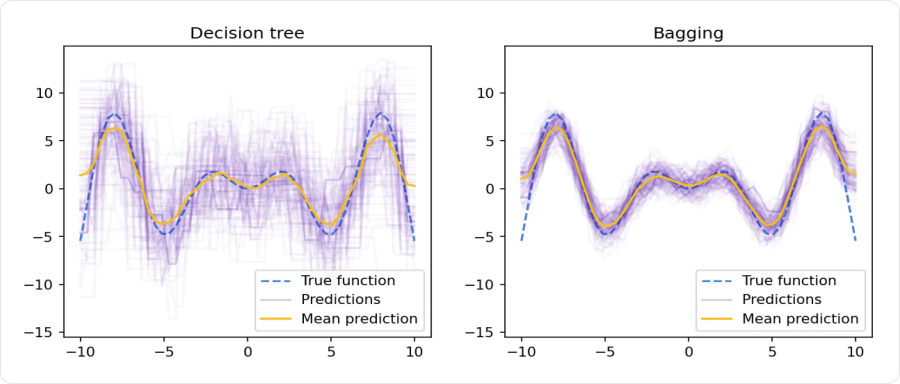
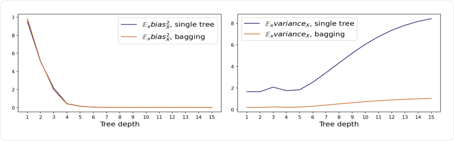

# Ансамбли моделей

**Ансамбль моделей** объединяет прогнозы нескольких базовых моделей в один ответ. Например, вместо одного дерева обучают сто деревьев и усредняют их прогнозы.

Польза возникает, когда модели **ошибаются по-разному**: часть отклонений компенсируется. Сто копий одной и той же модели с одинаковыми ответами не дадут улучшения. Ансамбль не гарантирует качество выше лучшей отдельной модели — это проверяют на отложенных данных.

## Как объединять прогнозы

### Регрессия: усреднение

Для `M` моделей с прогнозами `a₁(x), …, aₘ(x)`:

```text
ŷ(x) = [a₁(x) + … + aₘ(x)] / M
```

Например, модели оценили цену квартиры в `8`, `9` и `10` млн ₽. Прогноз ансамбля — `9 млн ₽`. Вместо одинаковых весов можно использовать разные; их подбирают без обращения к test.

### Классификация: голоса или вероятности

- **Hard voting** — выбираем класс с наибольшим числом голосов. Ответы `[1, 0, 1]` дают класс `1`.
- **Soft voting** — усредняем вероятности каждого класса, затем выбираем класс с наибольшей средней вероятностью. Для бинарной задачи можно задать другой порог по валидации.

Эти способы могут дать разные ответы:

| Модель | Вероятность класса `1` | Класс при пороге `0.5` |
|---|---|---|
| 1 | 0.51 | 1 |
| 2 | 0.51 | 1 |
| 3 | 0.01 | 0 |

Голосование даёт `1`, но средняя вероятность — `(0.51 + 0.51 + 0.01) / 3 ≈ 0.343`, поэтому soft voting при пороге `0.5` даёт `0`. При усреднении важны не только классы, но и уверенность моделей; качество их вероятностей тоже имеет значение.

## Смещение и разброс

Представим, что одну и ту же процедуру обучения повторяют на разных train-выборках из одного распределения и каждый раз предсказывают ответ для **одного и того же объекта**.

| Компонента | Что означает | Пример |
|---|---|---|
| **Смещение (bias)** | Насколько средний прогноз отличается от истинной зависимости | Прямая систематически не описывает кривую |
| **Разброс (variance)** | Насколько прогноз меняется при смене train | Глубокое дерево сильно меняет ответ после замены нескольких объектов |
| **Шум** | Случайная часть таргета, которую нельзя предсказать по имеющимся признакам | Разные цены при одинаковых известных характеристиках |

Для регрессии с квадратичной ошибкой существует разложение:

```text
Ожидаемая квадратичная ошибка = смещение² + разброс + шум
```

Здесь усредняют по возможным обучающим выборкам и случайности таргета. Это теоретическое объяснение ошибки, а не способ разложить одно наблюдаемое значение MSE на три числа. Смещение здесь не означает свободный член `b` линейной модели.

**Бэггинг** в первую очередь уменьшает разброс, а **бустинг** позволяет последовательно усложнять модель и уменьшать смещение. Эти ориентиры не заменяют оценку качества.

## Бутстреп и бэггинг

**Бутстреп (bootstrap)** создаёт новую выборку случайным выбором объектов **с возвращением**: выбранный объект остаётся доступен и может попасть туда повторно.

Например, из train `[A, B, C, D, E]` можно получить:

```text
Выборка 1: [A, C, C, E, A]
Выборка 2: [B, E, D, B, C]
```

Размер каждой выборки тот же, но некоторые объекты повторяются, а другие отсутствуют. **Бэггинг (bagging, bootstrap aggregation)** использует такие выборки для обучения ансамбля:

1. Создаём `M` бутстреп-выборок из train.
2. На каждой независимо обучаем отдельную базовую модель.
3. Для нового объекта объединяем их прогнозы усреднением или голосованием.

```text
            → бутстреп 1 → модель 1 → прогноз 1 ┐
train       → бутстреп 2 → модель 2 → прогноз 2 ├→ общий ответ
            → бутстреп 3 → модель 3 → прогноз 3 ┘
```

Модели можно обучать параллельно: результат одной не нужен для обучения другой. При этом их ошибки могут быть связаны — они используют пересекающиеся данные и решают одну задачу.

### Почему усреднение помогает

Пусть для фиксированного объекта прогнозы моделей имеют одинаковый разброс `σ²` и одинаковую попарную корреляцию `ρ`. Тогда:

```text
Var(среднего прогноза) = σ² · [ρ + (1 − ρ) / M]
```

`Var` — дисперсия, `M` — число моделей. При некоррелированных прогнозах (`ρ = 0`) разброс уменьшается в `M` раз. При одинаковых прогнозах (`ρ = 1`) усреднение не помогает.

Например, при `σ² = 9`, `M = 10` и `ρ = 0.5` дисперсия ансамбля равна `4.95`, а не `0.9`. **Важно не только количество моделей, но и различие их ошибок.**



Слева каждая сиреневая линия — прогноз дерева, обученного на очередной случайной выборке; справа — прогноз целого ансамбля при очередном обучении. Синяя пунктирная линия — истинная зависимость, жёлтая — средний прогноз по повторениям эксперимента. Справа линии лежат плотнее: бэггинг сделал ответ устойчивее.

### Какие модели подходят

Бэггинг особенно полезен для **неустойчивых моделей**, например глубоких деревьев: небольшой сдвиг train может заметно изменить их прогнозы.

Линейные модели тоже можно объединять, но выигрыш часто меньше, если они и так устойчивы. Усреднение не добавит им нелинейности: среднее нескольких функций `wᵀx + b` остаётся линейной функцией тех же признаков.

## Случайный лес

**Случайный лес (Random Forest)** — бэггинг над деревьями с дополнительной случайностью при выборе признаков.

Для каждого дерева:

1. Создаём бутстреп-выборку из train.
2. **В каждом узле заново выбираем случайное подмножество признаков.**
3. Ищем лучшее разбиение среди выбранных признаков.
4. Продолжаем построение до условий остановки.

Например, при `20` признаках в одном узле можно проверять `4` случайных признака, в следующем — другой набор из `4`. Это не один фиксированный набор на всё дерево.

Если один признак особенно полезен, обычный бэггинг может выбирать его почти во всех деревьях. Ограничение кандидатов заставляет деревья использовать разные варианты разбиений и помогает уменьшить корреляцию их прогнозов.

В регрессии ответы деревьев усредняют. Для классификации возможны голосование или усреднение вероятностей. В `RandomForestClassifier` из scikit-learn усредняются вероятности классов, затем выбирается класс с наибольшим значением.

### Глубина и число деревьев



По горизонтали — глубина. Слева квадрат смещения дерева и бэггинга почти совпадает и уменьшается с глубиной. Справа разброс одного дерева сильно растёт, а у ансамбля остаётся значительно ниже.

Поэтому в случайном лесе часто используют **глубокие деревья**: они могут описывать сложную зависимость, а усреднение уменьшает их неустойчивость. Но подходящую глубину и размер листа всё равно выбирают по валидации.

| Гиперпараметр | На что влияет |
|---|---|
| **`n_estimators`** | Число деревьев: больше — обычно стабильнее ответ, но выше затраты времени и памяти |
| **`max_features`** | Число признаков-кандидатов в узле: меньше — разнообразнее деревья, но каждое может стать слабее |
| **`max_depth`** | Максимальная глубина каждого дерева |
| **`min_samples_leaf`** | Минимальный размер листа; увеличение сглаживает прогнозы |
| **`max_samples`** | Размер бутстреп-выборки при включённом бутстрепе |

После некоторого числа деревьев улучшение обычно становится небольшим: похожие ошибки не исчезают от добавления новых деревьев. Рост леса сам по себе не означает неизбежного переобучения, но и не гарантирует улучшения метрики при каждом добавлении.

### Оценка Out-of-Bag

**Out-of-Bag (OOB)** — оценка по объектам train, которые не попали в бутстреп-выборку конкретного дерева.

При `n` независимых выборах с возвращением из `n` объектов вероятность не выбрать заданный объект:

```text
P(объект не выбран) = (1 − 1/n)ⁿ ≈ 0.368 при большом n
```

То есть примерно `36.8%` исходных объектов отсутствуют в выборке одного дерева. Для каждого объекта объединяют прогнозы **только тех деревьев, которые его не использовали при обучении**, затем считают метрику по полученным ответам. В scikit-learn эту оценку включает `oob_score=True` при `bootstrap=True`.

OOB полезна для обычных независимых объектов, но не заменяет итоговый test. Для временных рядов и групп случайный бутстреп может нарушить схему проверки: например, дерево обучится на будущем относительно оцениваемого объекта.

## Бустинг

**Бустинг (boosting)** обучает базовые модели **последовательно**. Каждая следующая добавляет поправку к уже построенному ансамблю, чтобы уменьшить его функцию потерь.

```text
Начальный прогноз → модель-поправка 1 → модель-поправка 2 → …
```

В бэггинге модели учатся независимо, а здесь очередная модель зависит от результатов предыдущих. В градиентном бустинге часто используют неглубокие деревья; их вклад регулирует **learning rate**.

Для регрессии с MSE поправки можно обучать на остатках `y − ŷ`. Для других функций потерь правило другое: утверждение «бустинг всегда учится на обычных ошибках» неточно. Подробный алгоритм — отдельная тема следующего конспекта.

## Стекинг

**Стекинг (stacking)** обучает **метамодель**, которая получает прогнозы базовых моделей как признаки и учится выдавать итоговый ответ. Базовые модели могут быть разными: например, линейная регрессия, kNN и случайный лес.

```text
Признаки квартиры → линейная модель → 8.2 ┐
                  → kNN             → 9.0 ├→ метамодель → итоговая цена
                  → случайный лес   → 8.6 ┘
```

Главная опасность — обучить метамодель на слишком хороших прогнозах моделей по их собственному train. На новых данных эти прогнозы будут хуже, и метамодель получит другой характер входных данных.

Для обучения используют **out-of-fold (OOF) прогнозы**:

1. Делим train на `K` частей — фолдов.
2. Обучаем базовые модели на `K − 1` частях и предсказываем оставшуюся.
3. Повторяем для всех частей. Каждый объект получает прогноз от модели, которая не обучалась на нём.
4. Обучаем метамодель на этих прогнозах и настоящих таргетах train.
5. Переобучаем базовые модели на всём train. Для нового объекта их ответы подаём готовой метамодели.

Например, при `5` фолдах для каждого объекта признаки метамодели получены без его участия в обучении базовых моделей. Предобработку тоже обучают внутри соответствующего фолда. Для временных данных обучающая часть должна предшествовать той, для которой строятся прогнозы; обычные случайные фолды не подходят.

**Блендинг (blending)** — более простой вариант: базовые модели обучают на одной части train, а метамодель — на их прогнозах по другой. Он требует меньше обучений, но оставляет базовым моделям меньше данных. Test в обоих случаях сохраняют для итоговой оценки.

## Сравнение методов

| Метод | Как обучаются модели | Как получается общий ответ |
|---|---|---|
| **Бэггинг** | Независимо, на бутстреп-выборках | Усреднение или голосование |
| **Случайный лес** | Как в бэггинге, плюс случайные признаки в каждом узле дерева | Усреднение ответов или вероятностей; возможно голосование |
| **Бустинг** | Последовательно, с учётом текущего ансамбля | Складываются прогнозы с заданными весами |
| **Стекинг** | Базовые модели и затем метамодель на OOF-прогнозах | Ответ обученной метамодели |

Ансамбли наследуют требования базовых моделей: лес обычно не требует масштабирования, а стекинг с kNN или линейными моделями может его требовать. Больше моделей — больше затрат на обучение, хранение и предсказание; прирост качества сравнивают с этими затратами на validation.

## Связанные материалы

- [Яндекс Учебник — «Ансамбли в машинном обучении»](https://contest.yandex.ru/tracks/ml/supervised-learning/ensembles-in-machine-learning)
- [Документация scikit-learn — ансамбли, бэггинг, голосование и стекинг](https://scikit-learn.org/stable/modules/ensemble.html)
- [Документация scikit-learn — RandomForestClassifier](https://scikit-learn.org/stable/modules/generated/sklearn.ensemble.RandomForestClassifier.html)
- [Решающие деревья](045-decision-trees.md)
- [Оценка качества моделей](041-model-evaluation.md)

### Автор:

* [Олег](https://t.me/HocokTopok)
