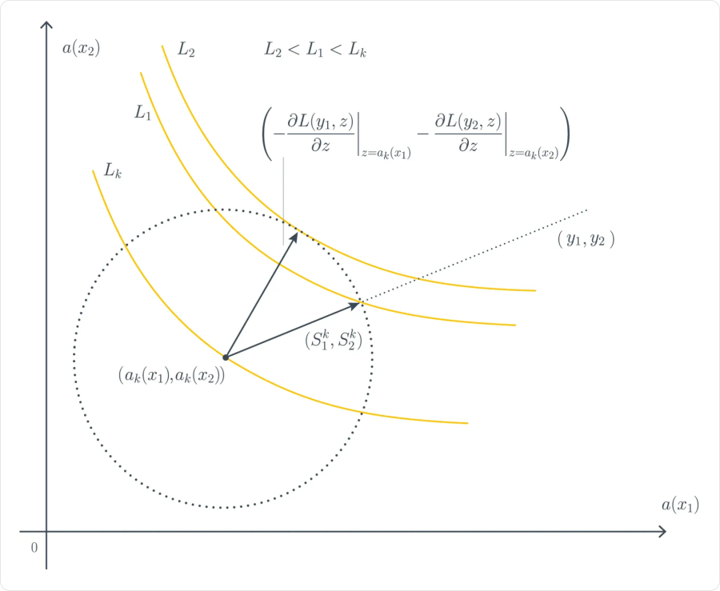
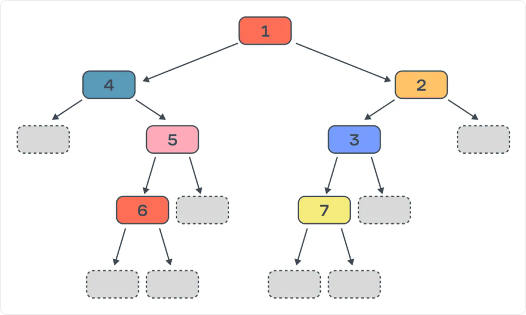
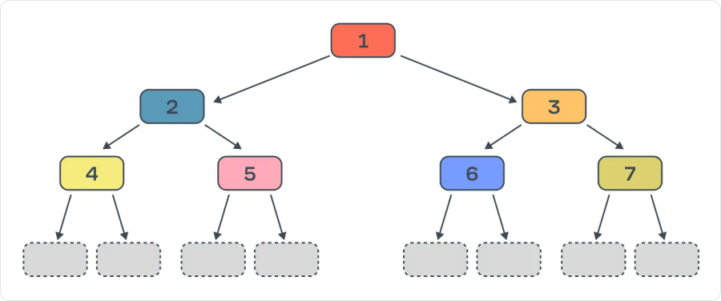
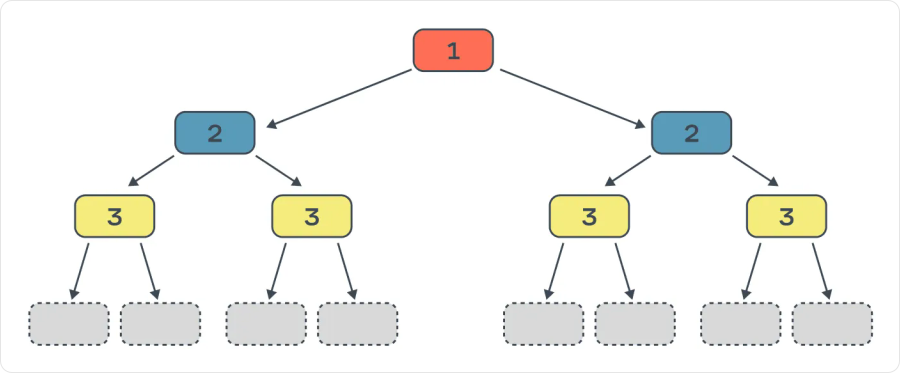

# Градиентный бустинг

**Градиентный бустинг (gradient boosting)** строит ансамбль последовательно: каждая новая модель добавляет поправку к текущему прогнозу. Направление поправки определяют по **антиградиенту функции потерь** — направлению её локального уменьшения.

Чаще всего базовые модели — решающие деревья. Такой ансамбль называют **GBDT (Gradient Boosting on Decision Trees)**. Он подходит для табличных данных с численными и категориальными признаками и учитывает нелинейные зависимости и сочетания признаков.

## Как складывается прогноз

Обозначим текущий ансамбль через `Fₘ`, новое дерево — через `hₘ`:

```text
Fₘ(x) = Fₘ₋₁(x) + η · hₘ(x)

Fₘ(x) = F₀(x) + η · [h₁(x) + … + hₘ(x)]
```

- **`x`** — признаки объекта.
- **`F₀`** — начальный прогноз, часто одинаковая константа для всех объектов.
- **`m`** — номер шага добавления дерева.
- **`hₘ(x)`** — численная поправка нового дерева.
- **`η`** — **learning rate**: какую долю поправки добавляем.

Для новой квартиры ансамбль вычисляет начальный прогноз, пропускает её признаки через все деревья и складывает их поправки. Делить сумму на число деревьев, как при усреднении случайного леса, не нужно.

## Регрессия: обучение на остатках

При квадратичной ошибке новая модель учится приближать **остатки** — разности между таргетами и текущими прогнозами:

```text
rᵢ = yᵢ − Fₘ₋₁(xᵢ)
```

Если прогноз завышен, остаток отрицательный и поправка должна уменьшить ответ. Если занижен — увеличить.

Один шаг обучения:

1. Вычисляем прогнозы текущего ансамбля на train.
2. Для каждого объекта считаем остаток `rᵢ`.
3. Обучаем новое регрессионное дерево на парах **`(xᵢ, rᵢ)`**.
4. Добавляем `η · hₘ(x)` к текущему ансамблю.
5. Пересчитываем остатки для следующего шага.

Исходные признаки остаются теми же. Меняется временный таргет для очередного дерева. Предыдущие деревья в базовой схеме уже не переобучаются.

### Пример одного шага

Пусть есть один признак `x` и четыре объекта. Начальный прогноз для MSE — среднее таргетов: `F₀ = 5`.

| `x` | Таргет `y` | Начальный прогноз | Остаток `y − F₀` |
|---|---|---|---|
| 1 | 2 | 5 | −3 |
| 2 | 4 | 5 | −1 |
| 3 | 6 | 5 | 1 |
| 4 | 8 | 5 | 3 |

Обучим дерево глубины `1`: слева объекты с `x ≤ 2.5`, справа — остальные. При обучении с MSE ответ листа равен среднему остатков:

```text
h₁(x) = −2, если x ≤ 2.5
h₁(x) =  2, если x > 2.5
```

При `η = 0.5` получаем:

| Объект | Новый прогноз `F₁ = 5 + 0.5 · h₁(x)` | Новый остаток |
|---|---|---|
| `x = 1` | 4 | −2 |
| `x = 2` | 4 | 0 |
| `x = 3` | 6 | 0 |
| `x = 4` | 6 | 2 |

MSE уменьшилась с `5` до `2`. Следующее дерево будет приближать уже **`[−2, 0, 0, 2]`**, а не прежние остатки. Отдельное дерево не обязано исправить каждый объект: один лист задаёт общую поправку целой группе.

## Почему бустинг называется градиентным

Остатки работают для квадратичной ошибки. Для другой функции потерь правильное направление поправки может отличаться.

Пусть `ℓ(y, z)` — потеря одного объекта, где `z` — текущий численный выход ансамбля. Вместо обычного остатка вычисляем:

```text
rᵢ = −∂ℓ(yᵢ, z) / ∂z  при z = Fₘ₋₁(xᵢ)
```

**`∂ℓ/∂z`** показывает, как меняется потеря при небольшом увеличении выхода модели. Минус перед производной задаёт направление уменьшения. Значения `rᵢ` называют **псевдоостатками**: это временные таргеты нового дерева.

Для удобства возьмём половину квадрата ошибки:

```text
ℓ(y, z) = ½ · (y − z)²
∂ℓ/∂z = z − y
−∂ℓ/∂z = y − z
```

Антиградиент совпал с обычным остатком. Множитель `½` не меняет оптимальный прогноз; без него производная была бы вдвое больше.

### Градиент по прогнозам, а не по порогам дерева

В обычном градиентном спуске меняют параметры модели. Здесь рассматривают **вектор прогнозов на объектах train** и ищут, как его изменить для уменьшения потерь.

Напрямую задать отдельную поправку каждому будущему объекту нельзя. Поэтому обучают дерево, которое по исходным признакам приближает нужные поправки и затем умеет выдавать их для новых объектов.



Оси здесь — **прогнозы для двух фиксированных объектов**, а не признаки. Жёлтые линии соответствуют одинаковым значениям потерь; `L₂ < L₁ < Lₖ`. Направление прямо к `(y₁, y₂)` и антиградиент могут различаться: функция потерь определяет, какие изменения сейчас полезнее. Рисунок иллюстрирует локальный выбор направления, а не гарантирует уменьшение потерь при любом размере шага.

В базовом алгоритме дерево обучают приближать псевдоостатки с помощью MSE. **Это внутренняя задача регрессии**, даже если исходная задача — классификация. После выбора структуры значения листьев могут дополнительно уточнять по исходной функции потерь; конкретное правило зависит от реализации.

## Бинарная классификация

Для меток `y ∈ {0, 1}` удобно обучать ансамбль с **log-loss**. Его численный выход `F(x)` преобразуют в вероятность сигмоидой:

```text
p = σ(F) = 1 / (1 + exp(−F))
ℓ = −[y · ln(p) + (1 − y) · ln(1 − p)]
```

Производная по **`F`**, с учётом сигмоиды:

```text
∂ℓ/∂F = p − y
r = y − p
```

Например, объект класса `1` получил вероятность `0.2`: псевдоостаток равен `0.8`, поэтому нужна положительная поправка к `F`. Для объекта класса `0` с той же вероятностью псевдоостаток равен `−0.2`.

Дерево предсказывает поправку **к численной оценке `F`**, а не сразу к вероятности. После сложения всех поправок снова применяют сигмоиду. Нельзя просто прибавить `0.8` к вероятности `0.2`.

В качестве начальной константы можно взять логарифм отношения долей классов:

```text
F₀ = ln[π / (1 − π)]
```

`π` — доля класса `1` на train, `0 < π < 1`. Например, при `π = 0.2` получаем `F₀ ≈ −1.386`, а после сигмоиды — начальную вероятность `0.2` для всех объектов.

Для получения класса выбирают порог по валидации. **ROC-AUC и accuracy могут быть метриками проверки, но функция потерь для обучения при этом — log-loss.** Обычный градиентный бустинг нельзя напрямую обучать по accuracy: она не даёт полезной производной по численным прогнозам.

## Learning rate и переобучение

Learning rate уменьшает вклад каждого нового дерева. При `η = 0.1` поправка `hₘ(x) = 3` изменяет прогноз на `0.3`.

Небольшой learning rate позволяет уточнять ансамбль постепенно, но обычно требует больше шагов. Слишком маленький learning rate при фиксированном числе деревьев может привести к недообучению. Маленький шаг сам по себе не исключает переобучение.

| Настройка | Что меняет |
|---|---|
| **Число шагов**: `n_estimators`, `iterations` | Сколько поправок добавляем; слишком много шагов может подстроить ансамбль под шум |
| **`learning_rate`** | Величину вклада каждой поправки; выбирают вместе с числом шагов |
| **Глубина или число листьев** | Сложность зависимостей, которые может выучить одно дерево |
| **Минимальный размер листа** | Не даёт строить поправки по слишком маленьким группам |
| **Подвыборки объектов и признаков** | Добавляют случайность и могут уменьшать переобучение |
| **Регуляризация значений листьев** | Ограничивает величину поправок; доступные штрафы зависят от библиотеки |

Названия и смысл конкретных параметров различаются между реализациями. При бинарной задаче один шаг обычно добавляет одно дерево; в многоклассовом режиме деревьев за шаг может быть несколько.

### Early stopping

После каждого шага считаем выбранную метрику на **validation**. Если она не улучшается заданное число шагов, останавливаем обучение. Например, лучшее качество было на шаге `240`, затем `30` шагов улучшений не было — обучение завершится около `270`-го шага.

Для итоговой модели используют состояние с лучшим результатом: сохранение или выбор нужного числа деревьев настраивается в библиотеке. **Последний построенный ансамбль не обязательно лучший.**

Validation участвует в выборе числа шагов, поэтому её оценка уже не полностью независима от настройки. Test оставляют для итоговой проверки. Для временных данных validation должна идти после train во времени.

Шаг бустинга — добавление новой модели. Это не эпоха, в которой заново обновляются параметры всех уже построенных деревьев.

## Реализации и формы деревьев

**XGBoost, LightGBM и CatBoost** реализуют бустинг над деревьями. Они различаются способами поиска разбиений, обработки категорий, регуляризации и роста деревьев. Важные варианты роста:

### LightGBM: leaf-wise

На каждом шаге роста дерева делится лист с наибольшим ожидаемым уменьшением потерь. Одна ветвь может стать значительно глубже другой.



Числа показывают порядок разбиений. Например, правая ветвь получает разбиения `2` и `3` раньше, чем левая — `4`. Гибкость помогает уменьшать ошибку train, но требует контроля числа листьев и глубины, особенно на небольших данных.

### XGBoost: depth-wise

При стратегии `depthwise` сначала делят узлы ближе к корню, продвигаясь по уровням.



Условия в разных узлах одного уровня могут различаться. Рисунок показывает полное дерево, но ограничения могут остановить отдельные ветви раньше. XGBoost поддерживает и другую стратегию — `lossguide`, поэтому рост по уровням не является обязательным свойством любого XGBoost.

### CatBoost: симметричные деревья

В стандартном режиме `SymmetricTree` **во всех узлах одного уровня используется одно условие**: одинаковые признак и порог.



Здесь одинаковые числа обозначают одинаковые условия, а не очередность отдельных разбиений. Такая структура ограничивает сложность дерева и удобна для быстрого вычисления прогнозов. CatBoost поддерживает и другие стратегии роста; на рисунке показан именно симметричный режим.

## Подготовка данных и важность признаков

- **Масштабирование численных признаков обычно не нужно** для бустинга над деревьями.
- **Обработка категорий и пропусков зависит от реализации.** CatBoost умеет работать с явно указанными категориальными признаками; универсальное требование заранее применять one-hot ко всем категориям здесь не подходит.
- **Утечки данных остаются утечками:** бустинг не исправляет признаки, рассчитанные с использованием будущего или таргетов validation/test.
- **Важность признаков** можно оценивать по улучшениям разбиений или через permutation importance на отложенных данных. Встроенные показатели разных библиотек имеют разный смысл; высокая важность не доказывает причинную связь.

Ансамбль труднее прочитать, чем одно небольшое дерево. Число деревьев и их глубина влияют на память и время предсказания. Качество, скорость и размер модели сравнивают на своей задаче; универсально лучшей библиотеки нет.

## Связанные материалы

- [Яндекс Учебник — «Градиентный бустинг»](https://contest.yandex.ru/tracks/ml/supervised-learning/gradient-boosting)
- [Документация scikit-learn — градиентный бустинг](https://scikit-learn.org/stable/modules/ensemble.html#gradient-boosted-trees)
- [Документация XGBoost — параметры и стратегии роста деревьев](https://xgboost.readthedocs.io/en/stable/parameter.html)
- [Документация LightGBM — устройство алгоритма](https://lightgbm.readthedocs.io/en/stable/Features.html)
- [Документация CatBoost — настройка и стратегии роста деревьев](https://catboost.ai/docs/en/concepts/parameter-tuning)
- [Ансамбли моделей](046-ensembles.md)
- [Решающие деревья](045-decision-trees.md)
- [Обучение моделей и регуляризация](043-model-training.md)

### Автор:

* [Олег](https://t.me/HocokTopok)
