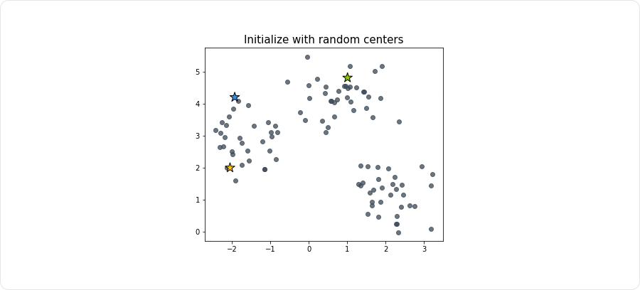
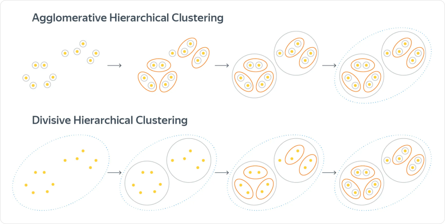
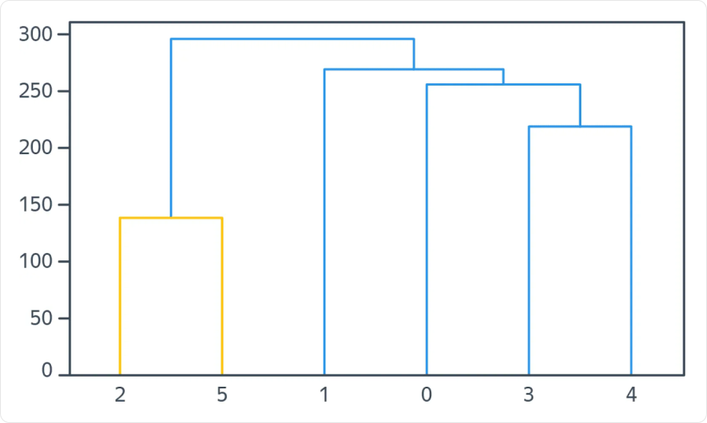
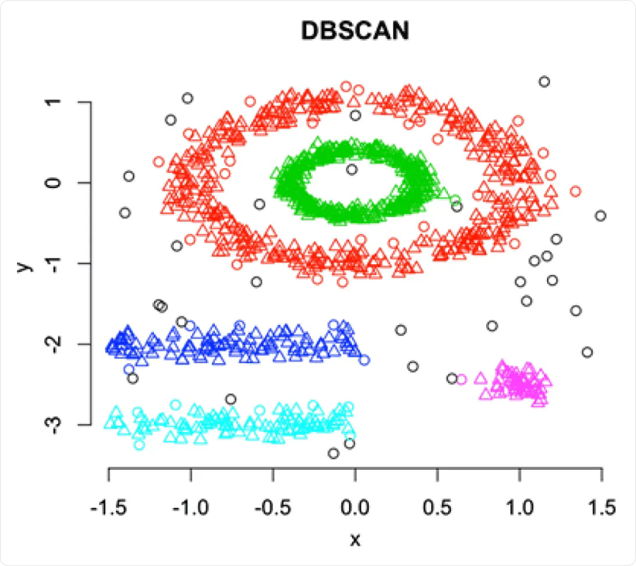

# Кластеризация: k-means, DBSCAN и BIRCH

**Кластеризация (clustering)** объединяет похожие объекты в группы — **кластеры**. Это обучение без учителя: признаки есть, но правильные метки групп для обучения не заданы.

Например, покупателей можно сгруппировать по частоте покупок и среднему чеку. Алгоритм найдёт группы в выбранных признаках, а их смысл — «редкие крупные покупки», «частые небольшие» — нужно интерпретировать отдельно.

В классификации классы известны заранее. В кластеризации группы зависят от признаков, расстояния, алгоритма и его настроек. Номера кластеров условны: перестановка меток `0` и `1` не меняет само разбиение.

## Что означает «похожие»

Перед обучением нужно определить, какие различия между объектами важны. Если один признак измеряется единицами, а другой — тысячами, без масштабирования второй может почти полностью определять расстояние.

- **Евклидово расстояние** учитывает различия по координатам: `d(x, v) = √Σ(xⱼ − vⱼ)²`.
- **Манхэттенское расстояние** складывает модули различий: `d(x, v) = Σ abs(xⱼ − vⱼ)`.
- **Косинусная близость** сравнивает направления ненулевых векторов. Большее значение означает большую близость; это не само расстояние.

Численные признаки часто стандартизуют. Категории требуют осмысленного представления: произвольные номера категорий создают искусственные расстояния. Ненужные признаки и большая размерность могут сделать близость малоинформативной.

**Выбор представления данных — часть задачи.** Масштабирование не гарантирует полезных кластеров, если признаки не отражают нужное сходство.

## K-means: метод k средних

**K-means** ищет `k` центров и относит каждый объект к ближайшему. Число кластеров задают заранее.

1. Выбираем начальные центры.
2. Относим каждый объект к ближайшему центру.
3. Пересчитываем каждый центр как среднее признаков объектов его кластера.
4. Повторяем шаги, пока изменения не станут малы или не достигнут лимит итераций.



Цвет обозначает принадлежность к кластеру. Центры смещаются после пересчёта, и часть объектов может перейти в другую группу. Это два разных шага одной итерации.

### Что оптимизируется

Алгоритм уменьшает сумму квадратов евклидовых расстояний до центров:

```text
J = Σ по кластерам c [Σ по объектам xᵢ из Cc ‖xᵢ − μc‖²]
μc = (сумма векторов объектов кластера Cc) / |Cc|
```

`Cc` — множество объектов кластера, `μc` — его центр, `|Cc|` — число объектов. Критерий часто называют **inertia**. Центр не обязан совпадать с существующим объектом.

Например, для одномерных данных `[1, 2, 8, 9]` при разбиении `[1, 2]` и `[8, 9]` центры равны `1.5` и `8.5`, а `J = 4 · 0.5² = 1`.

При фиксированных центрах выгодно выбирать ближайший; при фиксированных группах сумма квадратов минимальна в среднем. Поэтому оба шага не увеличивают критерий. **Глобально лучшее разбиение не гарантируется.** Произвольная замена евклидова расстояния при сохранении пересчёта средних уже не даёт этой же схемы оптимизации.

### Инициализация и выбор k

Разные начальные центры могут привести к разным результатам. **K-means++** выбирает первый центр случайно из объектов, а следующие — с вероятностью, пропорциональной квадрату расстояния до ближайшего уже выбранного центра. Это помогает разнести начальные центры, но не гарантирует оптимума.

Полезно делать несколько запусков и сравнивать их критерий. При увеличении `k` наилучшее достижимое значение inertia не растёт: например, при отдельном кластере для каждого объекта оно равно нулю. Поэтому **минимальная inertia сама по себе не выбирает полезное число кластеров**. Метод локтя, силуэт и смысл групп дают дополнительные ориентиры.

**Mini-batch k-means** обновляет центры по небольшим порциям объектов. Это удобно на больших данных, но результат может отличаться от обычного k-means.

### Ограничения

K-means лучше подходит для компактных групп сопоставимого масштаба. Он чувствителен к выбросам, не выделяет шум отдельно и плохо описывает кольца или длинные изогнутые группы. Разбиение на ближайшие центры не обязано совпадать с интересующей нас структурой данных.

## Иерархическая кластеризация

**Агломеративная кластеризация** начинает с отдельных объектов и постепенно объединяет ближайшие кластеры. В результате получается иерархия вложенных групп.



Схему читаем слева направо: **сверху** отдельные объекты объединяются в небольшие группы, затем — в более крупные; **снизу** показан обратный подход — **дивизивная кластеризация**, которая последовательно делит общую группу на части.

Расстояние между группами задаёт правило **linkage**:

| Правило | Как сравниваются два кластера |
|---|---|
| **Single linkage** | Минимальное расстояние между парой объектов из разных кластеров |
| **Complete linkage** | Максимальное расстояние между такой парой |
| **Average linkage** | Среднее расстояние по всем таким парам |
| **Ward** | Прирост суммы квадратов отклонений внутри кластеров при объединении; применяется с евклидовым расстоянием |

Single linkage может соединить далеко расположенные области цепочкой промежуточных объектов. Complete linkage сильнее ограничивает растянутость группы. Выбор правила влияет на итоговые кластеры.

### Дендрограмма

**Дендрограмма** показывает порядок объединений и высоты, на которых они произошли.



Внизу — номера объектов, по вертикали — высота объединения по выбранному правилу. Например, объекты `2` и `5` объединились раньше остальных. Горизонтальный срез на высоте `200` оставит пять групп: `[2, 5]` и четыре отдельных объекта.

Число кластеров можно выбрать срезом дерева, но «правильная» высота не всегда существует. Для больших выборок построение полной иерархии часто дорого по времени и памяти.

## DBSCAN: группы по плотности

**DBSCAN** находит плотные области, соединённые цепочками близких объектов, и оставляет часть точек шумом. Число кластеров заранее задавать не нужно.

Основные параметры:

- **`eps` (`ε`)** — радиус окрестности объекта.
- **`min_samples`** — сколько объектов должно быть в окрестности для признания её плотной. В scikit-learn учитывается и сам рассматриваемый объект.

Точки делятся на три типа:

| Тип | Условие |
|---|---|
| **Основная (core)** | В радиусе `eps` не меньше `min_samples` объектов, включая её саму |
| **Граничная (border)** | Не основная, но находится в радиусе `eps` хотя бы одной основной |
| **Шумовая (noise)** | Не основная и не соседствует с основной |

Например, при `min_samples = 4` точка с тремя другими соседями в своей окрестности — основная. Точка с одним соседом, который является основным, может быть граничной.

### Как образуются кластеры

1. Находим основные точки.
2. Соединяем основные точки, если расстояние между ними не больше `eps`.
3. Компоненты связности этого графа образуют основу кластеров.
4. Присоединяем граничные точки к соседним основным; остальные оставляем шумом.

Граничная точка не соединяет два кластера через себя. Если она соседствует с основными точками разных кластеров, её отнесение может зависеть от порядка обхода. Шум в scikit-learn обозначается меткой `−1`.



Цвета соответствуют кластерам, чёрные точки — шуму. В отличие от k-means, здесь можно разделить внутреннее и внешнее кольца.

Слишком маленький `eps` дробит группы и увеличивает количество шума; слишком большой может объединить разные группы. **`eps` не ограничивает диаметр кластера**: цепочка основных точек может быть длинной. Один набор параметров плохо описывает области с сильно различающейся плотностью. Высокая размерность и большие окрестности могут заметно увеличить затраты вычислений и памяти.

## BIRCH: сжатие данных перед кластеризацией

**BIRCH (Balanced Iterative Reducing and Clustering using Hierarchies)** обрабатывает объекты последовательно и сохраняет компактные сводки близких точек. Затем эти подгруппы можно объединить в итоговые кластеры.

Основная идея:

```text
Много объектов → CF-дерево со сводками подкластеров
              → кластеризация подкластеров → итоговые группы
```

Вместо постоянной работы со всеми исходными точками алгоритм использует **Clustering Feature (CF)** — сводку подкластера. Это сжатие с потерей части информации о расположении отдельных объектов.

### Что хранится в CF

Для численных векторов удобно использовать три величины:

```text
CF = (N, LS, SS)

N  — число объектов
LS = Σ xᵢ       — вектор суммы признаков
SS = Σ ‖xᵢ‖²   — сумма квадратов длин векторов, одно число
```

По ним вычисляются центр и среднеквадратичный радиус:

```text
μ = LS / N
R = √[(1/N) · Σ ‖xᵢ − μ‖²] = √[SS/N − ‖μ‖²]
```

`R` описывает среднюю растянутость подкластера относительно центра. **Это не максимальное расстояние до самой дальней точки.**

Сводки складываются покомпонентно: для объединения двух групп достаточно сложить их `N`, `LS` и `SS`. Перебирать исходные точки для этого не нужно.

### CF-дерево и добавление объекта

**CF-дерево** — сбалансированная структура со сводками. Внутренние записи описывают содержимое дочерних узлов, в листьях находятся сводки небольших подкластеров.

Упрощённо вставка в реализации scikit-learn выглядит так:

1. Спускаемся от корня, выбирая ближайшие центры сводок.
2. В листе находим ближайший подкластер.
3. Проверяем радиус, который получился бы после добавления объекта.
4. Если он не превышает `threshold`, обновляем сводку; иначе создаём новую.
5. При переполнении узел делится, изменения распространяются к корню.

Это **не решающее дерево с условиями вида `xⱼ ≤ t`**. Оно организует и сжимает данные, а не обучается предсказывать известный таргет. Его внутренние узлы также не обязаны соответствовать осмысленным итоговым группам.

### Пример порога радиуса

Для одномерного подкластера `[1, 3]`:

```text
N = 2, LS = 4, SS = 10
μ = 2
R = √(10/2 − 2²) = 1
```

Пусть `threshold = 1.2`. Проверим два возможных добавления к этому же исходному подкластеру:

| Новый объект | Подкластер после добавления | Новый радиус | Решение |
|---|---|---|---|
| `2` | `[1, 3, 2]` | `√(14/3 − 2²) ≈ 0.816` | Добавить в подкластер |
| `8` | `[1, 3, 8]` | `√(74/3 − 4²) ≈ 2.944` | Создать отдельный подкластер |

Проверяется радиус **всей обновлённой группы**, а не просто расстояние от нового объекта до старого центра. Поэтому `threshold` в BIRCH и `eps` в DBSCAN имеют разный смысл.

### Параметры и итоговые кластеры

| Параметр scikit-learn | Смысл |
|---|---|
| **`threshold`** | Максимальный допустимый радиус при добавлении объекта в листовой подкластер; меньший порог обычно создаёт больше подкластеров |
| **`branching_factor`** | Максимальное число записей подкластеров в одном узле; влияет на размер и форму дерева |
| **`n_clusters`** | Настройка заключительной кластеризации подкластеров, а не число записей CF-дерева |

При `n_clusters=None` отдельный заключительный этап не выполняется. Если указано целое число, scikit-learn применяет агломеративную кластеризацию к центрам листовых подкластеров. Затем объект получает итоговую метку ближайшего центра подкластера.

Метод `partial_fit` позволяет добавлять данные порциями. Схема масштабирования при этом должна оставаться согласованной между порциями.

**BIRCH полезен для больших численных наборов, когда близкие объекты можно сильно сжать.** Но выигрыш зависит от количества получившихся подкластеров: слишком маленький порог может почти не дать сжатия. Результат чувствителен к масштабу и порядку объектов; в высокой размерности компактные группы выделять труднее. BIRCH не следует ожидать автоматического выделения шума с меткой `−1`, как у DBSCAN.

## Как оценивать качество

Без разметки нет универсального «процента правильных кластеров». Проверяют геометрию, устойчивость результата и полезность групп для задачи.

### Без известных классов

- **Внутрикластерное расстояние** характеризует компактность: меньше — объекты ближе внутри групп.
- **Межкластерное расстояние** характеризует разделённость групп. Значение зависит от выбранного способа сравнения.
- **Силуэт (silhouette)** сопоставляет близость к своей группе и к ближайшей чужой.

Для объекта `i`:

```text
aᵢ — среднее расстояние до остальных объектов своего кластера
bᵢ — минимальное среднее расстояние до объектов другого кластера
sᵢ = (bᵢ − aᵢ) / max(aᵢ, bᵢ)
```

Силуэт разбиения — среднее `sᵢ`. Значения лежат от `−1` до `1`: ближе к `1` — объект хорошо отделён, около `0` — группы пересекаются, отрицательное значение — другая группа в среднем ближе. Например, при `a = 2`, `b = 5` силуэт равен `0.6`.

Для одиночного кластера из одного объекта его силуэт принимают равным `0`; для расчёта силуэта разбиения нужно от `2` до `n − 1` кластеров. Метрика предпочитает определённую геометрию и не обязана хорошо оценивать, например, вложенные кольца.

Компактность отдельно тоже недостаточна: разбиение на отдельные точки даст нулевые внутрикластерные расстояния. Сравнивать нужно несколько характеристик.

### Если есть эталонная разметка

Её можно использовать для оценки, даже если при обучении алгоритм её не видел:

| Метрика | Что проверяет |
|---|---|
| **Гомогенность (homogeneity)** | Каждый кластер содержит объекты только одного эталонного класса |
| **Полнота (completeness)** | Все объекты одного эталонного класса собраны в одном кластере |
| **V-мера** | Гармоническое среднее гомогенности и полноты |

Метрики лежат от `0` до `1`; больше — лучше. Если разложить каждый объект в отдельный кластер, гомогенность будет идеальной, но полнота обычно пострадает. Если собрать всех в одну группу — наоборот. Они сравнивают состав групп и не требуют совпадения числовых номеров кластеров с метками классов.

Для DBSCAN дополнительно показывают **долю шума**. Если считать метрики только по нешумовым объектам, это нужно явно указать: хороший результат на небольшой отобранной части ещё не означает хорошую кластеризацию всей выборки.

## Как выбирать метод

| Метод | Когда удобен | Основной компромисс |
|---|---|---|
| **K-means / Mini-batch k-means** | Нужны `k` компактных групп; особенно полезен быстрый вариант для больших данных | Число групп задано, нет отдельного шума, важны масштаб и инициализация |
| **Иерархическая кластеризация** | Нужна структура вложенных групп и возможность выбирать уровень разбиения | Чувствительна к linkage, полная иерархия может быть дорогой |
| **DBSCAN** | Группы сложной формы и отдельные шумовые объекты | Чувствителен к плотности, `eps`, размерности и стоимости поиска соседей |
| **BIRCH** | Большой набор численных объектов, который можно сжать в небольшие подгруппы | Сжатие теряет информацию, результат зависит от порога и порядка данных |

Сравнивают не только одну метрику, но и размеры групп, устойчивость к изменению настроек и содержательный смысл. Если кластеризацию используют как часть модели с учителем, масштабирование и саму кластеризацию обучают на train, чтобы признаки validation/test не влияли на подготовку модели.

## Связанные материалы

- [Яндекс Учебник — «Кластеризация»](https://contest.yandex.ru/tracks/ml/practical-topics/clustering)
- [Документация scikit-learn — кластеризация и оценка качества](https://scikit-learn.org/stable/modules/clustering.html)
- [Документация scikit-learn — BIRCH](https://scikit-learn.org/stable/modules/generated/sklearn.cluster.Birch.html)
- [Zhang, Ramakrishnan, Livny — BIRCH: An Efficient Data Clustering Method for Very Large Databases](https://sigmodrecord.org/publications/sigmodRecord/9606/pdfs/235968.233324.pdf)
- [Метрические методы: k ближайших соседей](044-nearest-neighbors.md)
- [Оценка качества моделей](041-model-evaluation.md)

### Автор:

* [Олег](https://t.me/HocokTopok)
