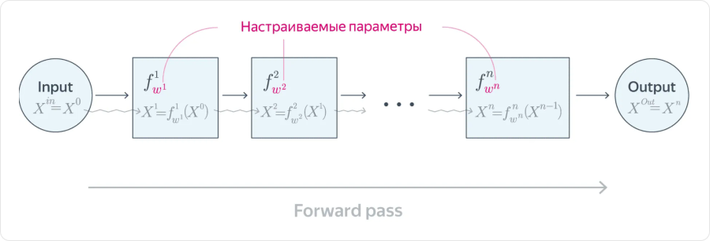
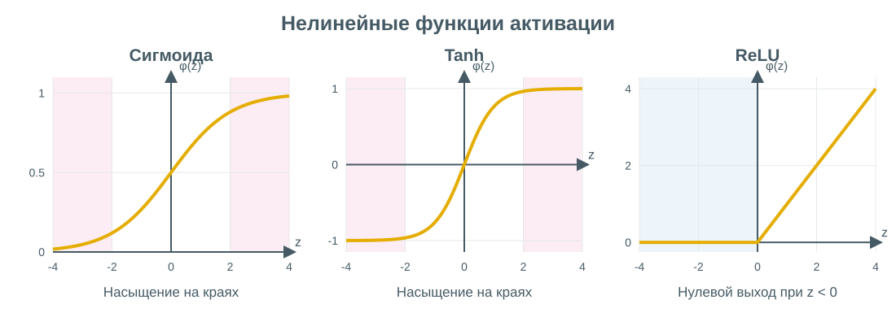

# Нейронные сети и их обучение

**Нейронная сеть** — модель, которая последовательно преобразует входные признаки в ответ. Преобразования называют **слоями**. Их параметры обучаются совместно: ошибка итогового ответа влияет и на последние, и на ранние слои.

Например, на вход поступают характеристики квартиры. Первый слой вычисляет их комбинации, следующий преобразует получившиеся значения, а последний выдаёт цену. Промежуточные признаки сеть подбирает при обучении, а не получает в виде заранее придуманных правил.

## От нейрона к слою

Простейший нейрон сначала вычисляет взвешенную сумму, затем применяет функцию активации:

```text
z = w₁x₁ + … + wₙxₙ + b
h = φ(z)
```

- **`x₁, …, xₙ`** — входные значения.
- **`w₁, …, wₙ`** — обучаемые веса.
- **`b`** — обучаемое смещение.
- **`z`** — значение до активации.
- **`φ`** — функция активации; `h` — результат нейрона.

Например, при `x = [2, 1]`, `w = [0.5, −1]`, `b = 0.5` получаем `z = 0.5`. Если `φ = ReLU`, то `h = max(0, 0.5) = 0.5`.

**Полносвязный слой (fully connected, dense)** содержит несколько таких нейронов. Каждый получает все координаты входа и имеет собственные веса и смещение.

### Матричная запись

Для одного объекта считаем векторы столбцами:

```text
z = Wx + b
h = φ(z)

x: n входных значений
W: матрица m × n
b, z, h: по m значений
```

Каждая строка `W` — веса одного нейрона. Активация применяется к каждой координате `z` отдельно. Преобразование `Wx + b` обычно называют **линейным слоем**, хотя при ненулевом смещении математически оно аффинное.

Число параметров такого слоя — `mn + m`. Например, переход из `4` признаков в `3` нейрона содержит `12` весов и `3` смещения — всего `15` параметров. Размер батча на это число не влияет: для всех объектов используются одни и те же параметры.

## Многослойная сеть

**MLP (Multilayer Perceptron)** — сеть из полносвязных слоёв, между которыми стоят нелинейные активации:

```text
x → линейный слой → активация → линейный слой → … → выход
```

Первый вход — исходные данные. Результаты промежуточных слоёв — **скрытые представления**. Скрытыми их называют потому, что готовых правильных значений для них обычно нет: известен только желаемый итоговый ответ.



На схеме данные проходят слева направо: `X⁰` — вход, `X¹, …, Xⁿ` — результаты последовательных преобразований. `f¹, …, fⁿ` — слои, а `w¹, …, wⁿ` — их обучаемые параметры, выделенные розовым. Верхние индексы обозначают номер слоя, а не степень. Во время предсказания параметры фиксированы: меняется вход, и сеть вычисляет новый ответ.

**End-to-end обучение** означает, что все обучаемые части настраиваются по общей функции потерь. Это не означает, что у всех слоёв одинаковые веса или градиенты.

### Зачем нужны нелинейности

Если убрать активации, два линейных слоя свернутся в один:

```text
W₂(W₁x + b₁) + b₂ = (W₂W₁)x + (W₂b₁ + b₂)
```

Сколько бы таких слоёв мы ни добавили, зависимость останется аффинной. **Нелинейность между слоями позволяет описывать более сложные зависимости.**

Например, один линейный классификатор не разделяет XOR: точки `(0, 0)` и `(1, 1)` относятся к одному классу, а `(0, 1)` и `(1, 0)` — к другому. Скрытый слой с нелинейностью позволяет построить подходящее преобразование.

## Функции активации



На всех трёх графиках по горизонтали отложено значение **до** активации `z`, по вертикали — результат `φ(z)`. Масштабы осей различаются.

| Функция | Формула | Что важно |
|---|---|---|
| **ReLU** | `max(0, z)` | Для положительных значений производная `1`, для отрицательных — `0` |
| **Leaky ReLU** | `z` при `z ≥ 0`, иначе `αz` | Малый фиксированный `α > 0` сохраняет ненулевой наклон слева |
| **PReLU** | Как Leaky ReLU | Наклон `α` обучается |
| **Sigmoid** | `σ(z) = 1 / (1 + exp(−z))` | Результат между `0` и `1`; удобна для вероятности положительного класса |
| **Tanh** | `tanh(z)` | Результат между `−1` и `1`, ноль переходит в ноль |
| **ELU** | `z` при `z > 0`, иначе `α(exp(z) − 1)` | Отрицательная ветвь гладко насыщается; обычно `α > 0` |

ReLU не ограничена сверху. Она не является вероятностью и не нормирует значения в `[0, 1]`.

У сигмоиды и tanh на больших по модулю входах производная мала — это **насыщение**. Через цепочку таких преобразований градиент может почти исчезнуть. У ReLU другая проблема: нейрон, который всё время получает отрицательный вход, может перестать обучаться по приходящему через него сигналу. Механизм этих эффектов разбирается в следующем конспекте.

## Выход сети зависит от задачи

Скрытые слои строят представление, а **выходной слой** переводит его в нужный формат ответа.

### Регрессия

Обычно последний слой выдаёт число без дополнительной ограничивающей активации:

```text
ŷ = wᵀh + b
L = (1/B) · Σ(ŷᵢ − yᵢ)²
```

`B` — число объектов в батче. При нескольких численных таргетах выход содержит несколько координат. Если по смыслу ответ имеет ограничения, например должен быть положительным, выходное преобразование выбирают с их учётом.

### Бинарная классификация

Последний линейный слой выдаёт **логит** `z` — произвольное вещественное число. Сигмоида преобразует его в вероятность класса `1`:

```text
p = σ(z)
ℓ = −[y · ln(p) + (1 − y) · ln(1 − p)]
```

При `z = 0` получаем `p = 0.5`; при `z ≈ 1.386` — `p ≈ 0.8`. Log-loss сильнее штрафует уверенный неправильный ответ. Класс получают применением порога к вероятности; порог выбирают по валидации.

### Несколько взаимоисключающих классов

Для `C` классов сеть выдаёт `C` логитов. **Softmax** превращает их в распределение:

```text
p_c = exp(z_c) / Σⱼ exp(zⱼ)
ℓ = −ln(p правильного класса)
```

Вероятности положительны и в сумме дают `1`. Если логиты равны `[ln 2, 0, 0]`, вероятности равны `[0.5, 0.25, 0.25]`.

Softmax связывает координаты: увеличение одного логита меняет вероятности всех классов. Это отличается от поэлементной активации скрытого слоя. Для численной устойчивости из всех логитов перед экспонентой можно вычесть их максимум — вероятности не изменятся.

Если у объекта может быть сразу несколько независимых меток, постановка другая: обычно используют отдельные сигмоиды, а не один softmax.

## Как сеть обучается

Один шаг обучения:

1. Берём батч объектов и известных таргетов.
2. Выполняем **прямой проход (forward propagation)**: получаем промежуточные значения и выход.
3. Вычисляем скалярную функцию потерь `L`.
4. Выполняем **обратный проход (backpropagation)**: находим производные `L` по параметрам.
5. Оптимизатор обновляет параметры. В простейшем случае: `θ ← θ − η · ∇θL`.

`θ` обозначает все обучаемые веса и смещения, `η` — **learning rate**. Backpropagation вычисляет градиенты, а оптимизатор использует их для обновления — это разные действия.

Сеть не получает правильные значения скрытых нейронов. Она получает только ошибку итогового ответа, а производные показывают, как параметры разных слоёв влияют на эту ошибку.

**Функция потерь и метрика качества не обязаны совпадать.** Например, сеть обучают по log-loss, а проверяют по F1 или ROC-AUC. Уменьшение потерь на train не гарантирует улучшения на новых данных.

## Что определяет возможности сети

- **Ширина** — размеры скрытых представлений.
- **Глубина** — число последовательных преобразований.
- **Активации и связи между слоями** — какие функции может выражать архитектура.
- **Данные, регуляризация и обучение** — какую из доступных функций она в итоге выучит.

Возможность приблизить сложную функцию не означает, что сеть найдёт её по небольшой выборке. Увеличение числа параметров может помочь, но одновременно усложняет обучение и повышает риск подстройки под шум.

## Связанные материалы

- [Яндекс Учебник — «Нейронные сети»](https://contest.yandex.ru/tracks/ml/deep-learning-introduction/neural-networks)
- [Яндекс Учебник — «Первое знакомство с полносвязными нейросетями»](https://contest.yandex.ru/tracks/ml/deep-learning-introduction/fully-connected-neural-networks)
- [Особенности обучения нейронных сетей](050-neural-network-training.md)
- [Оптимизаторы](051-optimizers.md)
- [Линейные модели](042-linear-models.md)

### Автор:

* [Олег](https://t.me/HocokTopok)
