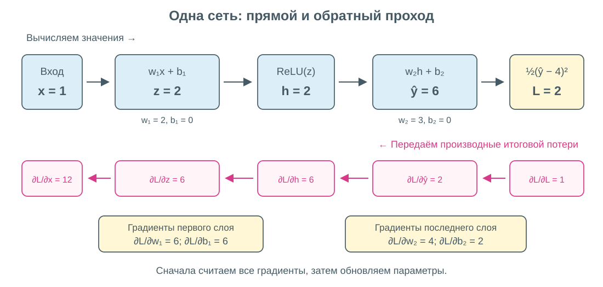
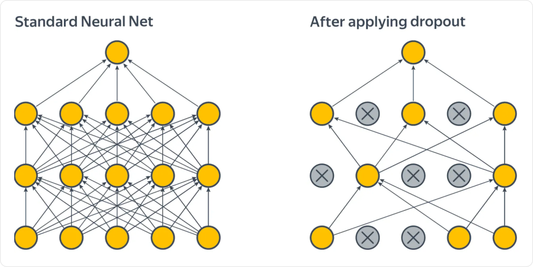
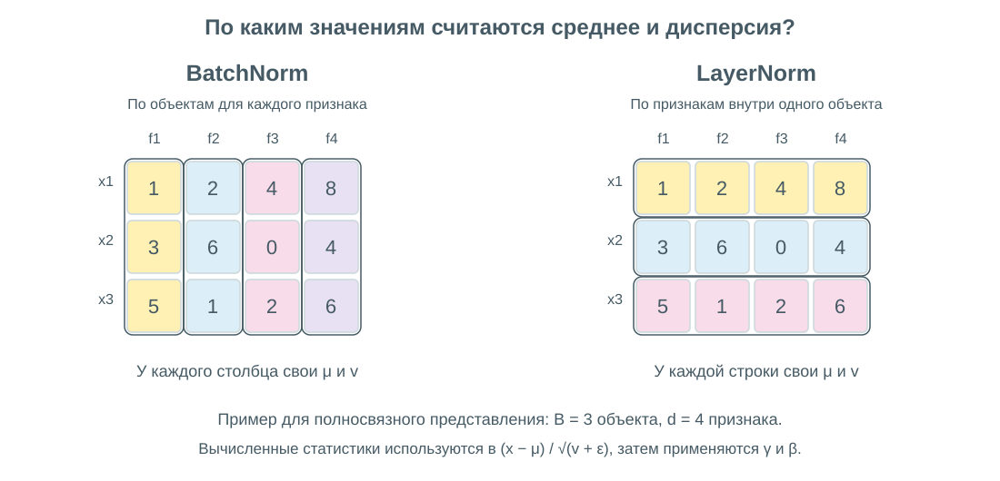

# Особенности обучения нейронных сетей

Обучение сети состоит из повторения трёх действий: **вычислить ответ, найти градиенты, обновить параметры**. Backpropagation отвечает за второе: переносит информацию о чувствительности итоговой ошибки от выхода к более ранним вычислениям.

## Что передаётся назад

Пусть `z = f(x)`, а итоговая потеря зависит от `z`. Правило цепочки:

```text
dL/dx = (dL/dz) · (dz/dx)
```

- **`dL/dz`** — насколько изменится итоговая потеря при малом изменении `z`.
- **`dz/dx`** — локальная производная самого преобразования.
- Их произведение — влияние `x` на итоговую потерю.

Например, `z = 3x`, `L = z²`. При `x = 2` получаем `z = 6`, затем `dL/dz = 12`, а `dL/dx = 12 · 3 = 36`. Не нужно заново дифференцировать всю сеть: каждый блок преобразует пришедший градиент с помощью своего локального правила.

Слово «ошибка» в названии алгоритма не означает, что назад передают только разность `ŷ − y`. Передаются **производные потерь**; их вид зависит от функции потерь и промежуточных преобразований.

## Численный пример: вся цепочка

Возьмём сеть с одним скрытым нейроном, ReLU и линейным выходом:

```text
z = w₁x + b₁
h = ReLU(z)
ŷ = w₂h + b₂
L = ½ · (ŷ − y)²
```

Параметры и данные: `x = 1`, `y = 4`, `w₁ = 2`, `b₁ = 0`, `w₂ = 3`, `b₂ = 0`.



Сверху показаны вычисленные значения. Снизу — производные **итоговой потери** по этим значениям. Красные стрелки идут справа налево; числа на них не являются новыми ответами сети.

### Прямой проход

```text
z = 2 · 1 + 0 = 2
h = ReLU(2) = 2
ŷ = 3 · 2 + 0 = 6
L = ½ · (6 − 4)² = 2
```

Сохраняем `x`, `z` и `h`: они понадобятся при вычислении производных.

### Обратный проход

| Шаг | Вычисление | Результат |
|---|---|---|
| Потери → выход | `∂L/∂ŷ = ŷ − y` | `2` |
| По весу последнего слоя | `∂L/∂w₂ = (∂L/∂ŷ) · h` | `4` |
| По его смещению | `∂L/∂b₂ = ∂L/∂ŷ` | `2` |
| Выход → скрытое значение | `∂L/∂h = (∂L/∂ŷ) · w₂` | `6` |
| Через ReLU | `∂L/∂z = (∂L/∂h) · ReLU′(z)` | `6`, так как `z > 0` |
| По первому весу | `∂L/∂w₁ = (∂L/∂z) · x` | `6` |
| По первому смещению | `∂L/∂b₁ = ∂L/∂z` | `6` |

Градиент первого веса зависит и от последнего слоя. Именно так ранний слой узнаёт, полезно ли его представление для конечного ответа.

### Обновление

После вычисления **всех** градиентов сделаем шаг обычного градиентного спуска с learning rate `η = 0.01`:

```text
w₁ = 2 − 0.01 · 6 = 1.94       b₁ = 0 − 0.01 · 6 = −0.06
w₂ = 3 − 0.01 · 4 = 2.96       b₂ = 0 − 0.01 · 2 = −0.02
```

Новый прямой проход даёт `h = 1.88`, `ŷ = 5.5448`, `L ≈ 1.193`. Потеря уменьшилась с `2`, хотя ответ ещё не равен таргету `4`.

**Во время обратного прохода используем те веса, с которыми был сделан прямой проход.** Нельзя сначала заменить `w₂`, а затем подставить новый вес в расчёт старого градиента первого слоя.

## Как считаются производные слоя

Для одного объекта используем столбцы: `x ∈ Rⁿ`, `z ∈ Rᵐ`, `W ∈ Rᵐˣⁿ`.

### Линейный слой

Пусть `z = Wx + b`, а с последующих слоёв уже пришёл вектор `δ = ∂L/∂z`:

```text
∂L/∂W = δxᵀ        размер m × n
∂L/∂b = δ           размер m
∂L/∂x = Wᵀδ        размер n
```

`δxᵀ` — внешнее произведение. Элемент градиента веса равен `δⱼ · xₖ`: влияние нейрона `j` умножается на вход, который проходил через этот вес. При передаче градиента на вход **складываются вклады всех выходных нейронов**, зависящих от данной координаты.

### Поэлементная активация

Для `h = φ(z)`:

```text
∂L/∂z = (∂L/∂h) ⊙ φ′(z)
```

`⊙` — поэлементное умножение. Для ReLU производная равна `1` при `z > 0` и `0` при `z < 0`; в нуле выбирают соглашение, часто `0`. Поэтому положительные координаты пропускают градиент, отрицательные обнуляют его.

Для сигмоиды `σ′(z) = σ(z)(1 − σ(z))`, для tanh — `1 − tanh²(z)`. Нужные значения уже можно взять из прямого прохода.

### Ветвления и общие параметры

Если одно значение используется несколькими последующими блоками, пришедшие по разным путям градиенты **суммируются**. Например, для `L = x² + x` при `x = 2` два пути дают `4` и `1`, итог — `5`.

Если одни и те же веса используются несколько раз, их вклад тоже суммируется по всем применениям. Это важно для свёрток и рекуррентных сетей.

### Выходная активация и потери

Для бинарной классификации с `p = σ(z)` и log-loss получается простое выражение `∂ℓ/∂z = p − y`. Для softmax с кросс-энтропией — `∂ℓ/∂z_c = p_c − y_c`, где `y_c` — one-hot метка класса.

Это производные **по логитам** уже с учётом активации. Если используем эти готовые выражения, ещё раз умножать их на производную сигмоиды или softmax не нужно.

## Батчи и эпохи

Для среднего по батчу `L = (1/B) · Σℓᵢ` градиент — среднее градиентов отдельных объектов. Деление на `B` должно быть учтено один раз, а не отдельно после каждого слоя.

- **Батч** — порция объектов для одного обновления параметров.
- **Итерация / шаг** — вычисление градиента и обновление по одному батчу.
- **Эпоха** — полный проход по train.

Если в train `1000` объектов, а размер батча `100`, одна эпоха содержит `10` шагов. Большие батчи обычно дают менее шумную оценку градиента, но требуют больше памяти. Универсально лучшего размера батча нет.

Backpropagation — эффективное применение правила цепочки к вычислительному графу. **Автоматическое дифференцирование** выполняет эти правила программно; это не численная оценка производных через маленькие возмущения параметров.

## Затухающие и взрывающиеся градиенты

При прохождении многих слоёв производные перемножаются. На одном пути повторение множителя `0.5` двадцать раз даёт около `10⁻⁶`, а множителя `2` — около `10⁶`.

- **Затухание:** ранние слои получают слишком слабый сигнал и почти не меняются.
- **Взрыв:** обновления становятся чрезмерными, обучение неустойчиво, возможно численное переполнение.

В настоящей сети участвуют матрицы и несколько путей, но принцип накопления множителей сохраняется. Помогают подходящие активации, инициализация, нормировки и остаточные связи.

**Gradient clipping** ограничивает большой градиент. Например, ограничение общей нормы:

```text
g ← g · min(1, τ / ‖g‖), если ‖g‖ > 0
```

`τ > 0` — порог. Направление при таком масштабировании сохраняется. Clipping защищает от слишком большого шага, но не восстанавливает уже затухший градиент.

## Инициализация весов

Если одинаковые скрытые нейроны начать с одинаковых весов, они могут получать одинаковые градиенты и оставаться одинаковыми. Вместо нескольких разных признаков получится повторение одного. Поэтому скрытые веса обычно инициализируют случайно; **смещения при этом часто допустимо начинать с нуля**.

Важен и масштаб случайных весов. Слишком большие значения могут раздувать активации или насыщать sigmoid/tanh, слишком маленькие — ослаблять сигнал.

| Инициализация | Типичный масштаб дисперсии весов | Назначение |
|---|---|---|
| **Xavier / Glorot** | `2 / (fan_in + fan_out)` | Баланс масштабов прямого и обратного сигналов; часто подходит для tanh |
| **He / Kaiming** | `2 / fan_in` | Учитывает обнуление отрицательной части ReLU |

`fan_in` и `fan_out` — число входов и выходов преобразования. В таблице указана **дисперсия**, не стандартное отклонение; для нормального распределения стандартное отклонение — её квадратный корень. Это ориентиры для соответствующих условий, а не гарантия стабильности любой глубокой сети.

## Dropout

**Dropout** во время обучения случайно обнуляет часть активаций. Так сеть меньше полагается на одну конкретную комбинацию скрытых признаков.



Серые перечёркнутые нейроны не участвуют в текущем вычислении. Это временная маска: нейроны не удаляются из архитектуры и могут участвовать на следующем шаге.

Пусть `p` — вероятность отключения. В распространённой схеме **inverted dropout**:

```text
mⱼ = 0 с вероятностью p, иначе 1
h̃ⱼ = mⱼ · hⱼ / (1 − p)
```

При `p = 0.5` уцелевшая активация `2` становится `4`, а отключённая — `0`. В среднем значение сохраняется. **При предсказании dropout выключен**, дополнительное масштабирование в этой схеме не нужно. Сильный dropout может привести к недообучению; это не обязательный слой каждой сети.

## Нормировки: BatchNorm и LayerNorm

Нормировка меняет масштаб промежуточных значений. После неё обычно стоят обучаемые коэффициенты масштаба `γ` и сдвига `β`:

```text
x̂ = (x − μ) / √(v + ε)
y = γ ⊙ x̂ + β
```

`μ` и `v` — среднее и дисперсия **по выбранной группе координат**, `ε > 0` — добавка для численной устойчивости. Нормировка не обязана оставлять итоговые значения с нулевым средним и единичной дисперсией: `γ` и `β` могут это изменить.



На схеме строки — объекты, столбцы — признаки. Цветом выделены группы значений, для которых считается одна пара `μ, v`.

### BatchNorm

Для полносвязного слоя статистики каждого признака вычисляются **по объектам текущего батча**. Например, столбец `[1, 3]` имеет среднее `2` и дисперсию `1`; до `γ` и `β` нормированные значения примерно равны `[−1, 1]`.

В стандартном режиме при предсказании используют накопленные на train статистики, а не заново вычисленные по текущему батчу. Поэтому поведение при обучении и предсказании различается. На маленьких батчах статистики могут быть шумными. В свёрточных слоях обычно объединяют объекты и пространственные позиции отдельно для каждого канала.

### LayerNorm

Статистики считаются **внутри одного объекта по выбранным координатам представления**. Для последовательностей это часто признаки отдельного шага. Другие объекты батча не нужны; механизм вычисления статистик одинаков при обучении и предсказании.

Нормировки часто облегчают оптимизацию, но не заменяют правильный learning rate и проверку качества. Объяснение их пользы не сводится только к «исправлению изменения распределений».

## Переобучение и контроль обучения

- **L2-регуляризация** добавляет штраф за большие веса к функции потерь; **weight decay** уменьшает веса при обновлении. Для адаптивных оптимизаторов это разные операции — подробнее в 051.
- **Early stopping** выбирает состояние с лучшей метрикой validation, а не обязательно последнюю эпоху.
- **Аугментации** создают допустимые варианты входа с сохранением смысла таргета. Преобразование, меняющее правильный ответ, нельзя применять без изменения разметки.
- **Размер сети и dropout** настраивают по validation; test оставляют для итоговой оценки.

Потери на train и validation полезно смотреть одновременно. Снижение train при росте validation — признак возможного переобучения. Нестабильная или вовсе не убывающая train-loss сначала требует проверки данных, формул, learning rate и градиентов.

## Связанные материалы

- [Яндекс Учебник — «Метод обратного распространения ошибки»](https://contest.yandex.ru/tracks/ml/deep-learning-introduction/backpropagation)
- [Яндекс Учебник — «Тонкости обучения»](https://contest.yandex.ru/tracks/ml/deep-learning-introduction/training-techniques)
- [Ba, Kiros, Hinton — Layer Normalization](https://arxiv.org/abs/1607.06450)
- [Нейронные сети и их обучение](049-neural-networks.md)
- [Оптимизаторы](051-optimizers.md)
- [Архитектуры нейронных сетей: CNN, RNN и LSTM](052-neural-network-architectures.md)

### Автор:

* [Олег](https://t.me/HocokTopok)
