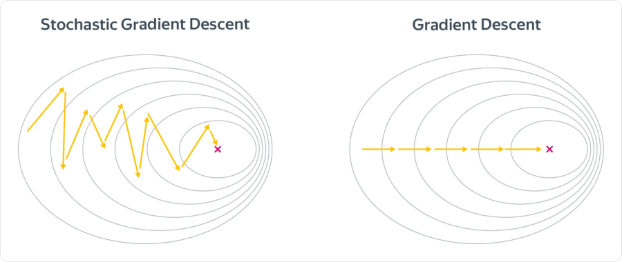
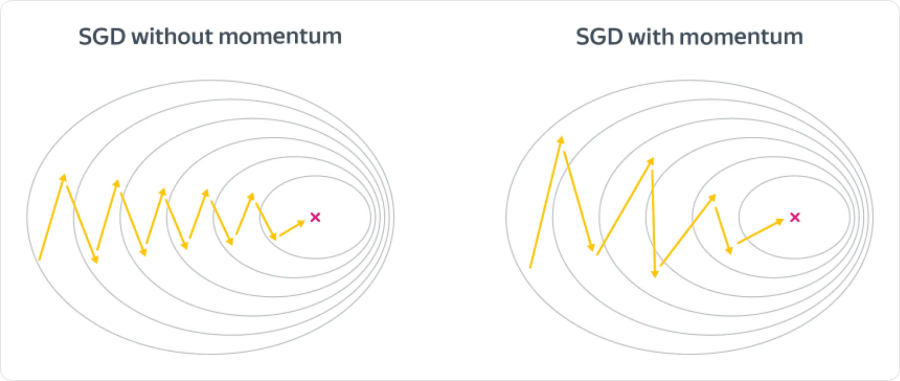
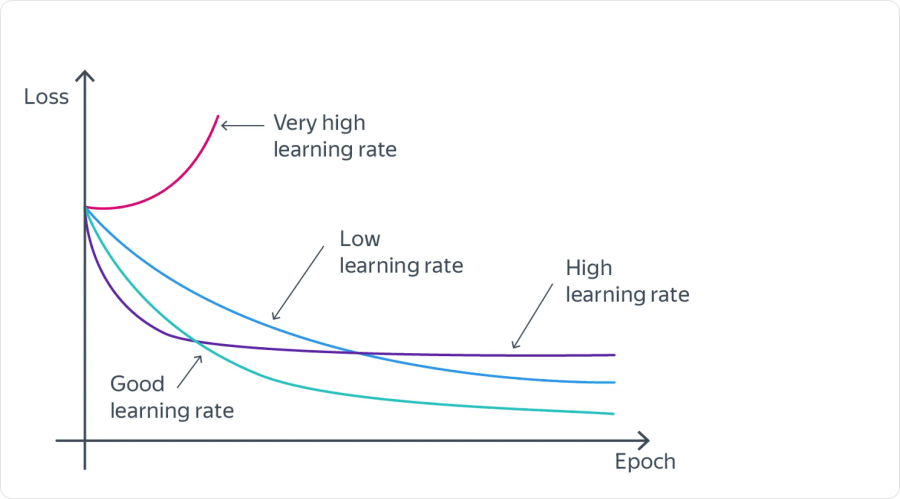
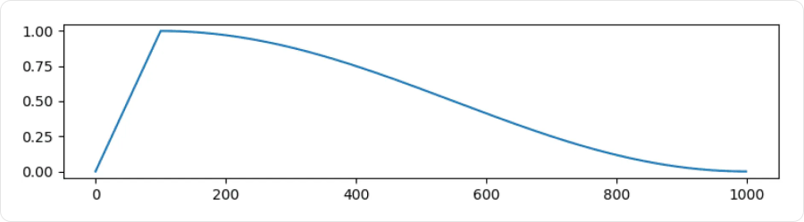

# Оптимизаторы

**Оптимизатор** определяет, как изменить параметры модели после вычисления градиента. Один и тот же градиент разные оптимизаторы превращают в разные обновления: одни учитывают предыдущие направления, другие отдельно масштабируют шаг по каждой координате.

Backpropagation отвечает на вопрос **«каковы производные?»**, оптимизатор — **«как использовать их для следующего шага?»**.

## Общие обозначения

- **`θₜ`** — вектор всех параметров после шага `t`.
- **`gₜ`** — градиент потерь, вычисленный в текущих параметрах `θₜ₋₁`.
- **`ηₜ`** — **learning rate** на шаге `t`.
- **`ε > 0`** — небольшая добавка для численной устойчивости.

Возведение в квадрат, квадратный корень и деление в формулах адаптивных методов выполняются **по координатам**. Начальные накопители равны нулю, если не оговорено другое.

## Градиентный спуск: GD и SGD

Обычное обновление:

```text
θₜ = θₜ₋₁ − ηₜ · gₜ
```

Для функции `L(θ) = θ²` при `θ = 2` градиент равен `4`. При `η = 0.1` новое значение — `1.6`, а потери уменьшаются с `4` до `2.56`.

Антиградиент задаёт направление **локального** уменьшения. Слишком большой шаг может перескочить в область с большей потерей.

Различие GD и SGD — в расчёте `gₜ`:

| Метод | По каким данным вычисляется градиент |
|---|---|
| **GD / full-batch** | По всей обучающей выборке |
| **SGD** | В строгом смысле — по одному случайному объекту |
| **Mini-batch SGD** | По небольшой порции объектов; обычно именно этот вариант называют SGD при обучении сетей |

Для среднего по батчу `gₜ = (1/B) · Σ∇θℓᵢ`. Случайный батч даёт приближённую, шумную оценку полного градиента. Один шаг дешевле, но потери могут не уменьшаться на каждом шаге.



Линии уровня показывают одинаковые значения потерь, крестик — минимум. Шумная траектория SGD колеблется, полный градиент даёт более определённое направление. Это иллюстрация идеи: настоящий GD тоже может идти зигзагами, а скорость обоих методов зависит от функции и learning rate.

## Momentum: учитывать предыдущие направления

**Momentum** накапливает направление движения:

```text
vₜ = β · vₜ₋₁ + gₜ
θₜ = θₜ₋₁ − ηₜ · vₜ
```

`vₜ` — накопленный импульс, `0 ≤ β < 1` — доля сохраняемой истории. При `β = 0` получается обычный SGD. Здесь используется соглашение без множителя `(1 − β)` перед `gₜ`; встречается и другая, масштабированная запись.

Если градиенты несколько раз указывают в одну сторону, импульс растёт. Если знак часто меняется, часть вкладов компенсируется. Это помогает двигаться вдоль вытянутой долины, меньше реагируя на колебания поперёк неё.



На схеме добавление импульса делает движение более направленным. Но Momentum не гарантирует ускорения: накопленное движение может и пронести модель мимо подходящей области.

Например, для градиентов `[2, 2, −2]` при `β = 0.9` накопители равны `[2, 3.8, 1.42]`. На третьем шаге текущий градиент уже отрицательный, но накопленное направление ещё положительное.

### Nesterov Momentum

В одном из представлений метода градиент считают не в текущей точке, а **после мысленного шага по старому импульсу**:

```text
θlook = θₜ₋₁ − η · β · vₜ₋₁
vₜ = β · vₜ₋₁ + ∇L(θlook)
θₜ = θₜ₋₁ − η · vₜ
```

Это позволяет скорректировать направление с учётом того, куда уже несёт накопленный импульс. Формулы приведены для постоянного `η`; эквивалентные записи могут хранить состояние иначе. В стохастическом случае градиент в точке `θlook` также оценивают по батчу.

## AdaGrad: свой масштаб для каждой координаты

**AdaGrad** накапливает квадраты всех прошлых градиентов:

```text
sₜ = sₜ₋₁ + gₜ²
θₜ = θₜ₋₁ − η · gₜ / (√sₜ + ε)
```

Если по координате часто приходят большие градиенты, знаменатель растёт и её эффективный learning rate уменьшается. По редко активным координатам уменьшение может быть слабее.

Например, на первом шаге `g = [10, 1]`, `η = 0.1`, `ε` пренебрежимо мало:

| Метод | Изменение параметров |
|---|---|
| SGD | `[−1, −0.1]` |
| AdaGrad | `[−0.1, −0.1]` |

AdaGrad выровнял масштабы первого обновления. Это не означает, что шаги всегда должны быть равными: на следующих итерациях знаменатели зависят от всей истории.

Недостаток — `sₜ` не убывает. Эффективный learning rate может со временем стать слишком маленьким.

## RMSProp: постепенно забывать старые масштабы

**RMSProp** вместо суммы использует экспоненциальное скользящее среднее квадратов:

```text
sₜ = ρ · sₜ₋₁ + (1 − ρ) · gₜ²
θₜ = θₜ₋₁ − η · gₜ / (√sₜ + ε)
```

`0 ≤ ρ < 1` управляет памятью. Давние градиенты постепенно теряют влияние, поэтому знаменатель может и уменьшаться. Метод сохраняет идею отдельных масштабов координат, но не накапливает квадраты без ограничения, как AdaGrad.

Адаптивность не отменяет выбора базового `η`: RMSProp тоже может сходиться медленно или расходиться при неподходящем learning rate.

## Adam: направление и масштаб вместе

**Adam** хранит две статистики:

```text
mₜ = β₁ · mₜ₋₁ + (1 − β₁) · gₜ
vₜ = β₂ · vₜ₋₁ + (1 − β₂) · gₜ²
```

- **`mₜ`** усредняет сам градиент: знак и устойчивое направление.
- **`vₜ`** усредняет квадрат градиента: масштаб по каждой координате.

`vₜ` — второй момент, **не дисперсия** градиента: квадрат среднего из него не вычтен.

### Зачем нужна коррекция смещения

Накопители начинаются с нуля. В начале обучения их величины систематически занижены. Adam компенсирует это:

```text
m̂ₜ = mₜ / (1 − β₁ᵗ)
v̂ₜ = vₜ / (1 − β₂ᵗ)
θₜ = θₜ₋₁ − ηₜ · m̂ₜ / (√v̂ₜ + ε)
```

Первые два выражения — **bias correction**. Например, при первом градиенте `g₁ = 2`, `β₁ = 0.9`, `β₂ = 0.999` получаем:

```text
m₁ = 0.2       → m̂₁ = 0.2 / 0.1 = 2
v₁ = 0.004     → v̂₁ = 0.004 / 0.001 = 4
```

При `η = 0.1` и малом `ε` первый шаг равен примерно `−0.1 · 2/2 = −0.1`. Типичные исходные значения коэффициентов — `β₁ = 0.9`, `β₂ = 0.999`, но подходящие настройки зависят от задачи.

Adam часто удобен, однако не гарантирует лучшего качества, чем SGD с Momentum. Кроме параметров, ему нужно хранить ещё два массива того же размера — `m` и `v`.

## AdamW: отделить weight decay от градиента

L2-регуляризация добавляет к потерям штраф:

```text
Ltotal = Ldata + (λ/2) · ‖θ‖²
∇Ltotal = g + λθ
```

В обычном SGD без Momentum это приводит к:

```text
θnew = (1 − ηλ) · θ − ηg
```

То есть L2-штраф эквивалентен уменьшению весов. Но в Adam добавка `λθ` попадёт в накопители и будет масштабироваться адаптивно. Это уже не то же самое, что независимо уменьшить веса.

**AdamW** выполняет weight decay отдельно:

```text
θₜ = (1 − ηₜλ) · θₜ₋₁ − ηₜ · m̂ₜ / (√v̂ₜ + ε)
```

Здесь `m` и `v` рассчитаны по градиенту `Ldata`, без добавления L2-штрафа. `λ` — сила weight decay. Например, при `θ = 2`, `η = 0.1`, `λ = 0.01` одно только затухание уменьшит вес до `1.998`.

В этой записи weight decay применяется к рассматриваемому параметру. На практике для разных групп параметров могут задавать разные правила, например исключать смещения и параметры нормировок.

## Learning rate и расписания



По горизонтали — обучение, по вертикали — потери. Большой learning rate может вызвать расходимость или колебания, маленький — слишком медленное уменьшение. Рисунок схематичный: форму кривых нельзя использовать как точный диагноз без проверки данных и градиентов.

**Расписание (schedule)** меняет базовый `ηₜ` в ходе обучения:

| Подход | Как меняется learning rate |
|---|---|
| **Step decay** | Уменьшается в заданные моменты |
| **Exponential decay** | Постепенно убывает по экспоненте |
| **Cosine decay** | Плавно убывает по части косинусной кривой |
| **Warmup** | Сначала растёт от небольшого значения до рабочего уровня |
| **Reduce on plateau** | Уменьшается, если выбранная метрика перестала улучшаться |



На этом графике по вертикали отложен **learning rate, а не loss**. Сначала шаг увеличивается, затем уменьшается. Warmup часто комбинируют с дальнейшим снижением.

Адаптация координат в Adam/RMSProp и расписание базового learning rate решают разные задачи и могут использоваться одновременно. Расписание можно отсчитывать в шагах или эпохах — это нужно явно различать.

## Что выбирать и проверять

| Метод | Что хранит сверх параметров и текущего градиента | Основная идея |
|---|---|---|
| **SGD** | Ничего | Идти по текущему градиенту |
| **Momentum / Nesterov** | Один накопитель | Учитывать устойчивое направление |
| **AdaGrad** | Суммы квадратов | Ослаблять часто активные координаты |
| **RMSProp** | Средние квадратов | Адаптировать масштаб с забыванием истории |
| **Adam / AdamW** | Первые и вторые моменты | Совмещать усреднение направления и адаптацию масштаба |

При сравнении оптимизаторов для каждого подбирают learning rate. Одинаковое число `η` не означает одинаковой величины обновлений. Оценивают не только train-loss, но и качество на validation, время и расход памяти.

Для продолжения обучения важны не только веса модели, но и состояние оптимизатора: накопители, номер шага, состояние расписания. Иначе продолжение начнётся с другой динамикой обновлений.

## Связанные материалы

- [Яндекс Учебник — «Оптимизация в ML»](https://contest.yandex.ru/tracks/ml/optimization-in-machine-learning/optimization-in-machine-learning)
- [Kingma, Ba — Adam: A Method for Stochastic Optimization](https://arxiv.org/abs/1412.6980)
- [Loshchilov, Hutter — Decoupled Weight Decay Regularization](https://arxiv.org/abs/1711.05101)
- [Особенности обучения нейронных сетей](050-neural-network-training.md)
- [Обучение моделей и регуляризация](043-model-training.md)

### Автор:

* [Олег](https://t.me/HocokTopok)
