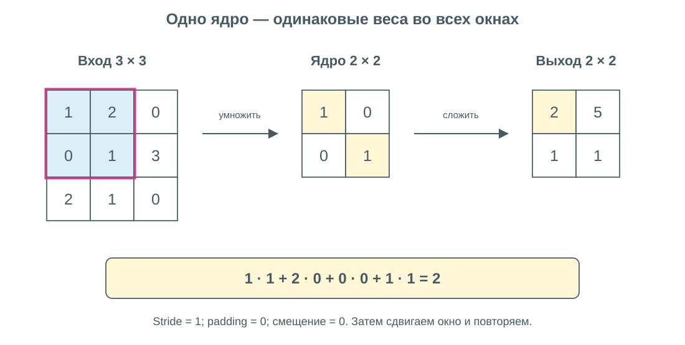
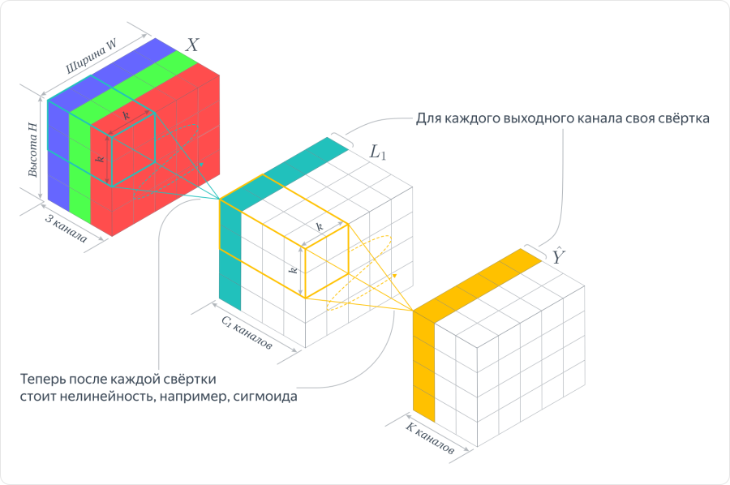
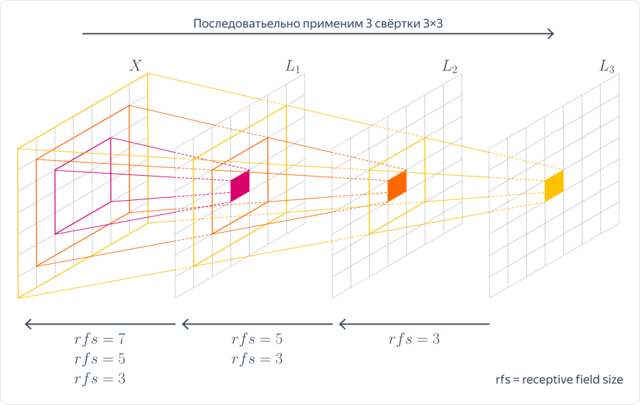
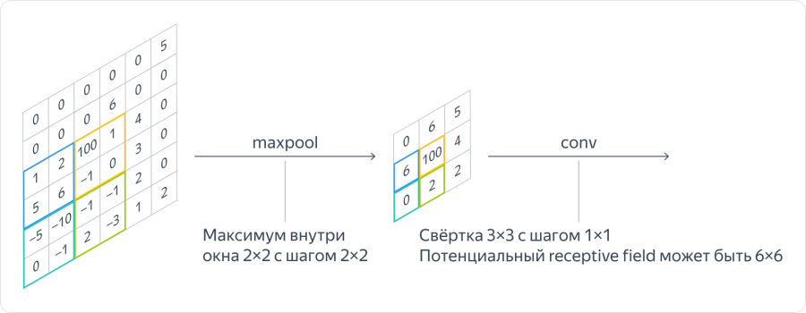
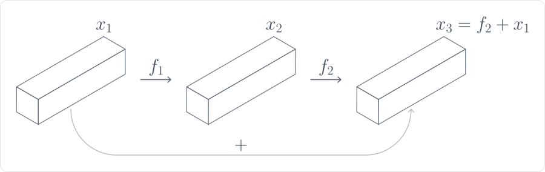
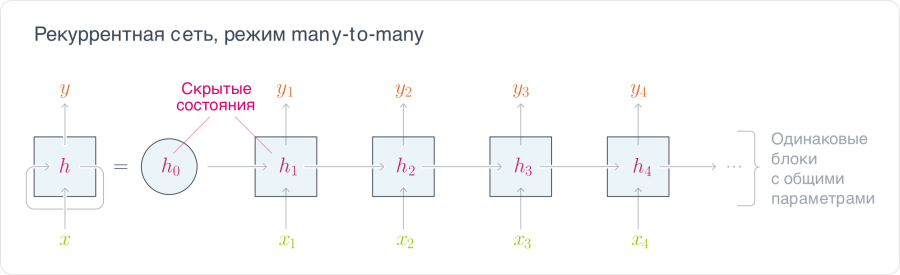
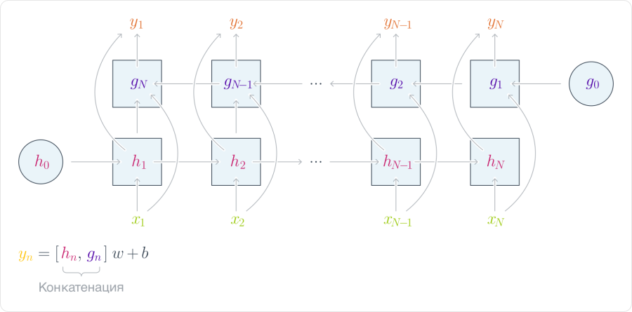
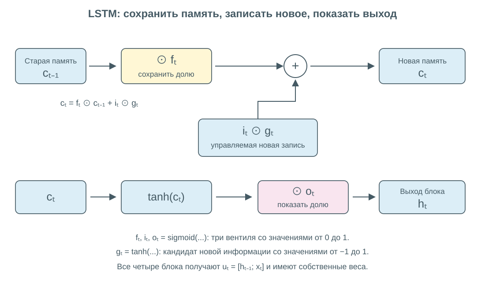
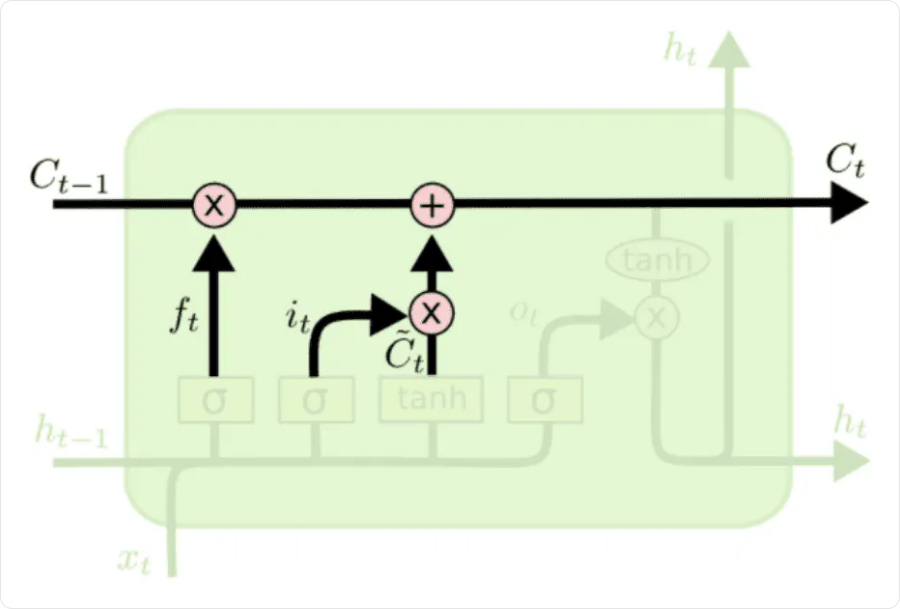

# Архитектуры нейронных сетей: CNN, RNN и LSTM

Архитектура определяет, **какие связи между данными сеть учитывает заранее**. Полносвязный слой соединяет все входы со всеми выходами. CNN использует локальность и повторение одних весов в разных позициях, RNN — порядок элементов и перенос состояния между шагами. LSTM — разновидность рекуррентной сети с управляемой памятью.

| Архитектура | Основной механизм | Типичные входы |
|---|---|---|
| **CNN** | Один обучаемый фильтр применяется к разным локальным окнам | Изображения, сигналы, временные ряды |
| **RNN** | Один рекуррентный блок повторяется по шагам последовательности | Последовательности векторов |
| **LSTM** | Рекуррентный блок с отдельным состоянием памяти и вентилями | Последовательности с зависимостями между удалёнными шагами |

## CNN: свёрточные нейронные сети

### Зачем нужна свёртка

Изображение содержит соседние пиксели, и эта структура важна. Если развернуть картинку `H × W × C` в один вектор, полносвязный слой не будет отличать соседние пиксели от далёких. Кроме того, число его весов быстро растёт с разрешением.

**Свёрточный слой** применяет небольшой набор обучаемых весов — **ядро / фильтр** — ко всем допустимым положениям окна. В одной позиции он перемножает значения окна и веса, складывает результаты и добавляет смещение.



Для первого окна: `1·1 + 2·0 + 0·0 + 1·1 = 2`. При сдвиге окна используются **те же веса**. На схеме шаг равен `1`, дополнения по краям нет, смещение равно нулю.

В нейросетях эту операцию называют свёрткой, хотя обычно ядро не переворачивают, как в строгом математическом определении свёртки. Название такой операции без переворота — cross-correlation.

### Каналы и карты признаков

В RGB-изображении три входных канала. Один фильтр обрабатывает окно **сразу по всем входным каналам** и создаёт один выходной канал. Несколько фильтров создают несколько **карт признаков (feature maps)**.

Например, слой с `16` фильтрами превращает вход с `3` каналами в выход с `16` каналами. Каждый новый канал — результат своего набора весов, а не один из исходных цветов.



Полученные карты передаются следующему слою как новый многоканальный вход. Между свёртками обычно применяют нелинейность; без неё последовательность линейных операций не получает преимуществ нелинейной сети.

Для обычной свёртки с окном `Kh × Kw`, `Cin` входными и `Cout` выходными каналами:

```text
Число параметров = Kh · Kw · Cin · Cout + Cout
```

Последнее слагаемое — по одному смещению на выходной канал. При `3 × 3`, `Cin = 3`, `Cout = 16` получаем `448` параметров. Они не зависят от ширины и высоты входа: веса общие для всех позиций. Но вычислений на большом изображении больше.

### Stride, padding и dilation

| Параметр | Смысл |
|---|---|
| **Kernel size** | Размер локального окна |
| **Stride `S`** | На сколько позиций сдвигается окно |
| **Padding `P`** | Сколько позиций добавляется по краям, например нулями |
| **Dilation `D`** | Шаг между соседними элементами ядра во входе; при `D = 1` окно сплошное |

Размер по одной пространственной оси при симметричном padding:

```text
Hout = floor[(Hin + 2P − D(K − 1) − 1) / S] + 1
```

`floor` — округление вниз. Для ширины формула аналогична. Например, при `Hin = 32`, `K = 3`, `D = 1`, `S = 1` без padding получим `30`, а при `P = 1` — `32`. Если при `P = 1` взять `S = 2`, получится `16`.

### Поле восприятия

**Receptive field** — область исходного входа, от которой может зависеть выбранная выходная координата.



Для трёх свёрток `3 × 3` с шагом `1` и dilation `1` теоретическое поле восприятия растёт до `7 × 7`. Следующий слой объединяет уже обработанные локальные окна. Если меняются stride или dilation, правило роста тоже меняется.

Общие веса дают **эквивариантность к сдвигу** в подходящих условиях: сдвиг входа сдвигает карту признаков. Это не то же самое, что неизменный ответ всей сети. Края, padding и stride могут нарушать точное соответствие; устойчивость к поворотам и масштабу автоматически не возникает.

### Pooling

**Max pooling** берёт максимум в каждом окне. Например, окно `[[1, 4], [2, 3]]` превращается в `4`. У такой операции нет обучаемых весов.



Pooling уменьшает пространственное разрешение и отбрасывает часть информации о точном положении. Он может дать устойчивость к небольшим локальным смещениям, но не гарантирует полной инвариантности. Уменьшать разрешение можно и свёрткой со stride больше `1`.

**Global average pooling** усредняет все пространственные позиции каждого канала. Карта `H × W × C` превращается в вектор из `C` чисел, который удобно передать классификатору.

### Остаточная связь

**Residual connection** добавляет вход блока к результату преобразования:

```text
y = x + F(x)
```



Блок может учить поправку `F(x)`, а не всё отображение целиком. Прямой путь также облегчает передачу градиента. Для сложения размеры должны совпадать; при необходимости вход преобразуют отдельной проекцией. Наличие остаточной связи не отменяет остальных требований к обучению.

Свёрточные сети обучаются тем же backpropagation. Поскольку фильтр используется во многих позициях, градиент каждого его веса складывается из вкладов всех этих позиций.

### Свёртки для последовательностей

В **1D-свёртке** окно движется по одной оси, например по времени. Координаты вектора каждого шага выступают входными каналами. Для прогноза по прошлому нужна **каузальная** схема: выход шага не должен использовать будущие значения. Обычное симметричное окно само по себе это не обеспечивает.

## Эмбеддинги: как подать элементы последовательности в сеть

**Эмбеддинг (embedding)** — численный вектор, представляющий отдельный элемент: слово, категорию или другой объект. Вместо самого слова сеть получает несколько чисел, которые учится использовать для решения задачи.

Для слов удобно завести **обучаемую таблицу**: каждому слову соответствует строка с его вектором. Например:

| Слово | ID | Эмбеддинг, условные значения |
|---|---|---|
| `кот` | `0` | `[0.2, 0.7, −0.1]` |
| `пёс` | `1` | `[0.3, 0.6, −0.2]` |
| `спит` | `2` | `[−0.4, 0.1, 0.8]` |

Последовательность «кот спит» превращается в два вектора: `[0.2, 0.7, −0.1]`, затем `[−0.4, 0.1, 0.8]`. Сеть обрабатывает их как последовательность входов.

```text
Слово → его ID → строка таблицы эмбеддингов → входной вектор
```

ID — только адрес строки: близкие номера не означают близкий смысл. Таблица с `V` словами и векторами длины `d` содержит `V·d` обучаемых чисел. При обучении её значения меняются через backpropagation вместе с остальными параметрами.

**One-hot** лишь отмечает номер категории. Эмбеддинг даёт ей плотный вектор признаков; выбор строки таблицы равносилен умножению one-hot на эту таблицу. Создавать полный one-hot для этого не нужно.

Начальный эмбеддинг одного слова одинаков при разных вхождениях. После обработки последовательности сеть может получить разные представления слова с учётом окружения — **контекстные представления**.

Эмбеддинги можно учить вместе с конечной моделью или предварительно. Например, **word2vec** учит векторы по соседним словам: вариант **CBOW** предсказывает слово по окружению, **Skip-gram** — окружение по слову.

Если вход уже численный, например набор измерений датчика, можно подать сами признаки или преобразовать их линейным слоем в вектор нужной длины.

## RNN: рекуррентные нейронные сети

RNN обрабатывает последовательность `x₁, …, xT` и на каждом шаге обновляет **скрытое состояние** `hₜ`:

```text
hₜ = tanh(Wx · xₜ + Wh · hₜ₋₁ + b)
ŷₜ = Wy · hₜ + c
```

Последняя формула — пример линейного выхода; преобразование выхода зависит от задачи. `hₜ` хранит вычисленное сетью представление уже обработанной части последовательности.



Блоки на разных шагах используют **одни и те же `Wx`, `Wh`, `b`**. Это несколько применений одного блока, а не несколько независимо обучаемых сетей.

Если вход имеет размер `d`, состояние — `h`, то `Wx` имеет размер `h × d`, `Wh` — `h × h`. Более длинная последовательность не требует новых наборов весов, но требует больше вычислений и памяти для сохранения промежуточных состояний при обучении.

### Небольшой пример состояния

Для одного входа и одного скрытого значения возьмём `Wx = 1`, `Wh = 0.5`, `b = 0`, `h₀ = 0`, последовательность `[1, 0]`:

```text
h₁ = tanh(1 + 0.5 · 0) ≈ 0.762
h₂ = tanh(0 + 0.5 · 0.762) ≈ 0.363
```

Хотя второй вход равен нулю, второе состояние не нулевое: оно зависит от первого шага. Начальное состояние `h₀` можно задать нулевым — это не создаёт ту же проблему симметрии, что одинаковая инициализация всех скрытых весов.

### Как использовать выходы

- **Many-to-one:** вся последовательность → один ответ; например, признаки нескольких измерений → итоговая оценка. Можно использовать последнее состояние.
- **Many-to-many:** каждому входному шагу соответствует выход; например, последовательность измерений → метка для каждого шага.
- **Encoder–decoder:** одна сеть кодирует входную последовательность, другая последовательно создаёт выход, длина которого может отличаться.

При объединении последовательностей разной длины в батч нужно учитывать padding и маски: добавленные пустые позиции не должны превращаться в реальные наблюдения или участвовать в потере как правильные данные.

### Двунаправленная RNN

**Bidirectional RNN** содержит две сети: одна читает вход слева направо, другая — справа налево. Их состояния объединяют, например конкатенацией.



Это полезно, когда весь вход уже известен. Для оценки позиции внутри ряда обратное направление использует и последующие элементы входа. При прогнозировании нельзя включать реальные будущие значения, неизвестные в момент прогноза. При этом обработать двумя направлениями целиком известное историческое окно допустимо.

## Обучение RNN: backpropagation through time

**BPTT** — обычный backpropagation по сети, развёрнутой во времени. Если ошибка возникла на последнем шаге, градиент проходит через цепочку состояний к более ранним шагам. Для общих весов суммируются вклады всех их применений.

В простой RNN переход назад содержит множитель:

```text
∂hₜ/∂hₜ₋₁ = diag(1 − hₜ²) · Wh
```

`diag` создаёт диагональную матрицу из указанных координат. При переходе через много шагов такие матрицы перемножаются — отсюда затухание или взрыв градиента. Сеть может плохо учиться учитывать далёкое прошлое, хотя формально путь зависимости существует.

Gradient clipping помогает ограничивать взрывы. **Truncated BPTT** обрывает обратное распространение после некоторого числа шагов: старое состояние можно передать дальше как значение, но градиент через границу не идёт. Это экономит ресурсы, одновременно ограничивая обучение дальним зависимостям.

## LSTM: управляемая память

**LSTM (Long Short-Term Memory)** хранит два вектора одинаковой скрытой размерности:

- **`cₜ` — cell state:** состояние памяти, которое переносится и обновляется.
- **`hₜ` — hidden state:** выход блока, который получает следующий шаг или следующий слой.

Вместо одного преобразования используются **три вентиля** и блок формирования новой информации. Вентиль выдаёт значения между `0` и `1` и поэлементно регулирует пропускаемую долю сигнала.



На схеме верхняя линия — путь памяти `c`. Все вентили и кандидат `gₜ` вычисляются по текущему входу и предыдущему скрытому состоянию. Знак `⊙` обозначает поэлементное умножение.

### Четыре вычисления внутри блока

Сначала объединим предыдущий выход и текущий вход: `uₜ = [hₜ₋₁; xₜ]`. Квадратные скобки с `;` здесь означают конкатенацию векторов.

```text
fₜ = σ(Wf uₜ + bf)      вентиль забывания: сколько старой памяти сохранить
iₜ = σ(Wi uₜ + bi)      входной вентиль: сколько новой информации записать
gₜ = tanh(Wg uₜ + bg)   кандидат: какую новую информацию можно записать
oₜ = σ(Wo uₜ + bo)      выходной вентиль: сколько показать наружу
```

`f`, `i`, `o` — три вентиля. **`g` не вентиль**: это кандидат со значениями от `−1` до `1`. Каждый из четырёх блоков имеет собственные обучаемые веса и смещения.

### Обновление памяти и выхода

```text
cₜ = fₜ ⊙ cₜ₋₁ + iₜ ⊙ gₜ
hₜ = oₜ ⊙ tanh(cₜ)
```

Первое слагаемое сохраняет часть старой памяти, второе добавляет новую. Выходной вентиль ограничивает видимую часть преобразованного состояния, но сам по себе не стирает память `cₜ`.



На оригинальной схеме кандидат `gₜ` обозначен `C̃ₜ`. Для одной координаты пусть `cₜ₋₁ = 2`, `fₜ = 0.9`, `iₜ = 0.2`, `gₜ = 0.5`, `oₜ = 0.8`:

```text
cₜ = 0.9 · 2 + 0.2 · 0.5 = 1.9
hₜ = 0.8 · tanh(1.9) ≈ 0.765
```

Память и видимый выход различаются. Вентили могут принимать промежуточные значения; это не только переключатели «включено / выключено».

### Почему LSTM помогает с дальними зависимостями

Между состояниями памяти есть путь с умножением и **сложением**, а не обязательным новым tanh на каждом переносе. По прямому пути при фиксированных вентилях производная по предыдущей памяти равна `fₜ`. Если координата `fₜ` близка к `1`, соответствующий сигнал может переноситься дольше.

Полная производная включает и другие пути через вентили. Поэтому LSTM **облегчает** обучение длинным зависимостям, но не гарантирует сохранение любой информации на любой длине. Если вентили забывания долго близки к нулю, сигнал всё равно теряется.

Начальные `h₀` и `c₀` часто задают нулями. Между независимыми последовательностями состояние обычно сбрасывают; между последовательными частями одного потока его можно переносить по выбранной схеме обучения.

**GRU** — более компактная рекуррентная альтернатива: использует вентили обновления и сброса, но не разделяет состояние на `c` и `h`. Выбор между RNN, LSTM и GRU проверяют на задаче; усложнение блока само по себе не гарантирует лучшего качества.

## Сопоставление архитектур

| Свойство | CNN | Простая RNN | LSTM |
|---|---|---|---|
| Где повторяются веса | В разных пространственных или временных позициях | На разных шагах последовательности | На разных шагах последовательности |
| Как учитывается контекст | Через локальные окна и их композицию | Через скрытое состояние | Через скрытое состояние и управляемую память |
| Далёкие зависимости | Нужно достаточное поле восприятия | Часто трудно обучаются | Есть более удобный путь переноса памяти |
| Обработка позиций | Многие позиции можно вычислять параллельно внутри слоя | Есть последовательная зависимость состояний | Есть последовательная зависимость состояний |

Для всех архитектур сохраняются общие требования: корректная функция потерь, подходящая инициализация, контроль градиентов и оценка на отложенных данных. Attention и трансформеры развивают способы работы с контекстом и рассматриваются отдельно.

## Связанные материалы

- [Нейчев — Word Embeddings](https://github.com/neychev/made_nlp_course/tree/master/week02_word_embeddings)
- [Яндекс Учебник — «Свёрточные нейросети»](https://contest.yandex.ru/tracks/ml/deep-learning-architectures/convolutional-neural-networks)
- [Яндекс Учебник — «Нейросети для работы с последовательностями»](https://contest.yandex.ru/tracks/ml/deep-learning-architectures/neural-networks-for-sequences)
- [Christopher Olah — Understanding LSTM Networks](https://colah.github.io/posts/2015-08-Understanding-LSTMs/)
- [Нейронные сети и их обучение](049-neural-networks.md)
- [Особенности обучения нейронных сетей](050-neural-network-training.md)
- [Оптимизаторы](051-optimizers.md)

### Автор:

* [Олег](https://t.me/HocokTopok)
