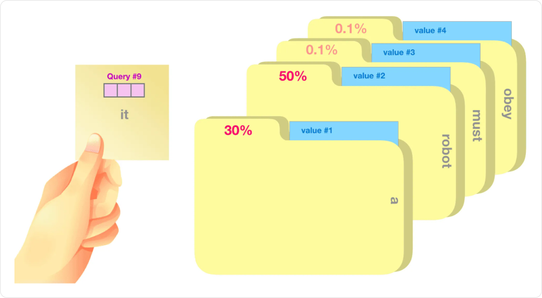
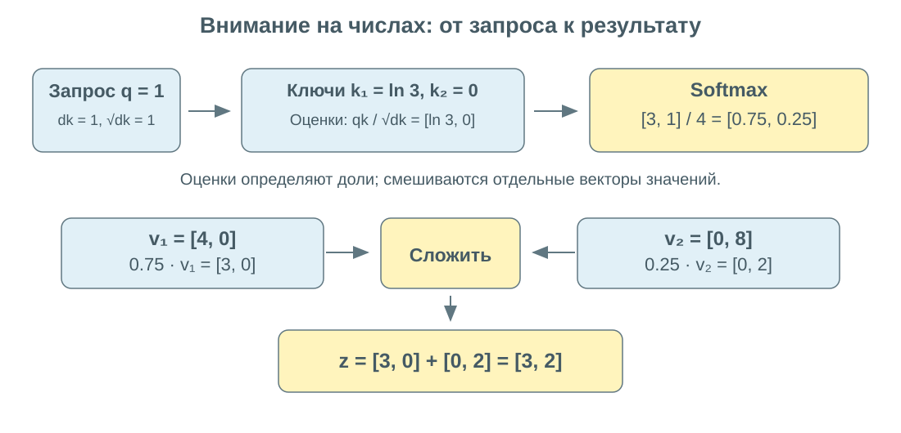
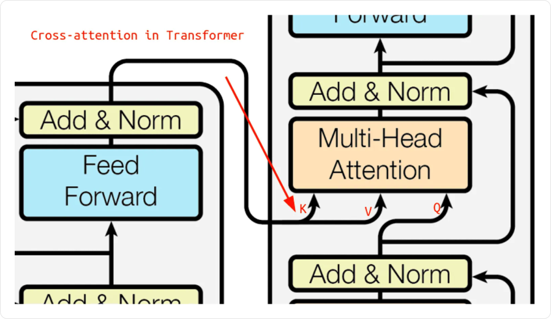
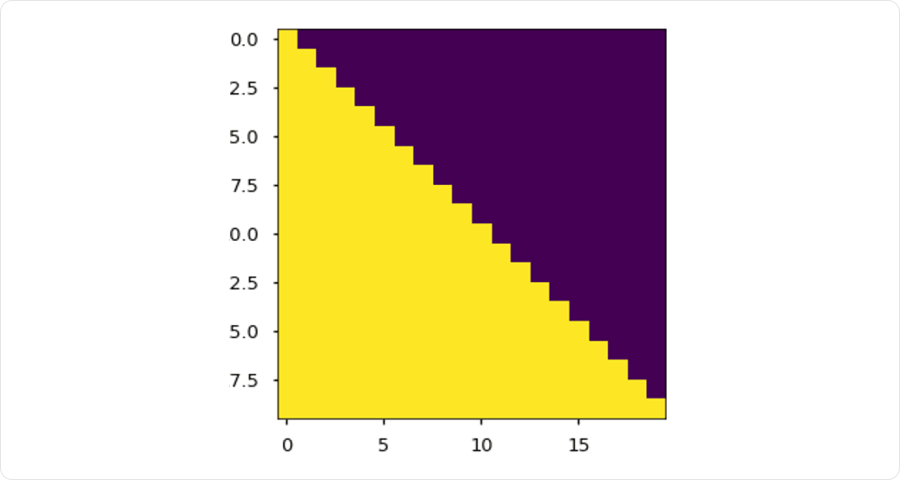
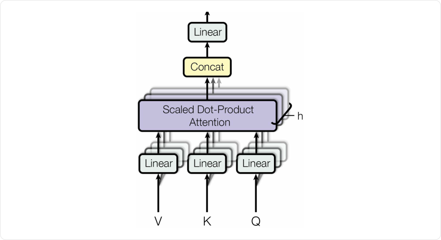
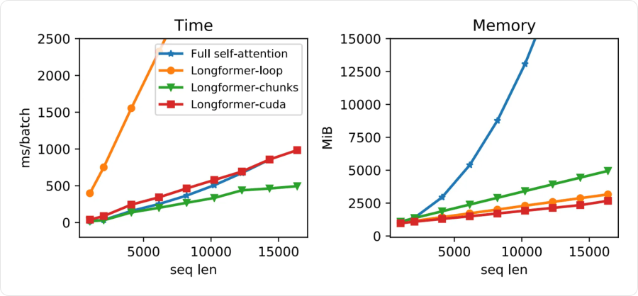

# Механизм внимания: Attention и Self-Attention

**Внимание (attention)** собирает новое представление из нескольких векторов: каждому назначается вес, затем векторы складываются с этими весами. Веса зависят от текущего запроса и доступного контекста.

Например, при переводе очередного слова полезно обратиться к разным частям исходного предложения. При анализе временного ряда текущему наблюдению могут быть полезны несколько предыдущих участков. Модель учится определять, какую информацию из них использовать.

## Зачем понадобилось внимание

В простом encoder–decoder на RNN энкодер сжимает весь вход в последнее скрытое состояние. Декодер должен восстановить по нему ответ. Для длинного входа такой единственный вектор становится **информационным узким местом**.

Внимание позволяет сохранить представления **всех входных позиций** и на каждом шаге декодера собирать из них свой контекст. При этом внимание можно добавить к RNN: сам механизм не требует трансформера.

В трансформере **self-attention** также заменяет рекуррентный перенос состояния: позиции одного слоя непосредственно обмениваются информацией. Для обращения к далёкой позиции не нужно пройти через цепочку всех промежуточных состояний. Однако смешивание векторов всё равно может терять информацию.

## Query, Key и Value

Три роли в механизме внимания:

| Обозначение | Название | Роль |
|---|---|---|
| **`q`** | Query, запрос | Какую информацию ищет текущая позиция |
| **`kⱼ`** | Key, ключ | По каким признакам сравнить позицию `j` с запросом |
| **`vⱼ`** | Value, значение | Какую информацию взять из позиции `j` |



На рисунке проценты показывают веса использования значений. Запрос не выбирает одну карточку: несколько значений могут внести вклад одновременно. Видимые карточки — аналогия; в сети `q`, `k`, `v` являются численными векторами.

Для одного и того же входного вектора `x` можно получить три разных представления:

```text
q = xWQ     k = xWK     v = xWV
```

Здесь и далее **векторы записаны строками**. `WQ`, `WK`, `WV` — разные обучаемые матрицы. Они учатся совместно с остальной сетью по конечной функции потерь; готовую разметку «на какую позицию смотреть» обычно не задают.

## Scaled dot-product attention по шагам

### 1. Сравнить запрос с ключами

```text
sⱼ = (q · kⱼ) / √dk
```

`q · kⱼ` — скалярное произведение, `dk` — число координат запроса и ключа. Чем больше `sⱼ` относительно других оценок, тем больший вес получит позиция.

Это обучаемая совместимость, а не обязательно косинусная близость: длины векторов тоже влияют на скалярное произведение.

### 2. Превратить оценки в веса

```text
αⱼ = exp(sⱼ) / Σₗ exp(sₗ)
```

**Softmax** применяется по всем доступным ключам для одного запроса. Веса неотрицательны и в сумме равны `1`. Для численной устойчивости из оценок перед экспонентой вычитают максимум.

### 3. Собрать значения

```text
z = Σⱼ αⱼvⱼ
```

На выходе — вектор той же размерности, что и `vⱼ`. Веса вычислены через **ключи**, а смешиваются **значения**. Это разные роли даже тогда, когда оба представления получены из одного входа.

### Пример на числах

Возьмём одномерные запрос и ключи, но двумерные значения:

```text
q = 1        k₁ = ln 3        k₂ = 0        dk = 1
v₁ = [4, 0]                  v₂ = [0, 8]
```



```text
s = [ln 3, 0]
exp(s) = [3, 1]
α = [3/4, 1/4] = [0.75, 0.25]
z = 0.75 · [4, 0] + 0.25 · [0, 8] = [3, 2]
```

Размерности ключей и значений могут различаться. Запрос должен совпадать по размерности с ключом; результат имеет размерность значения.

## Зачем делить на √dk

Если координаты запроса и ключа примерно независимы, имеют нулевое среднее и единичную дисперсию, дисперсия их скалярного произведения растёт примерно как `dk`.

Большие по модулю оценки делают softmax очень резким: почти весь вес может достаться одному ключу, а производные станут малы. Деление на `√dk` удерживает характерный масштаб оценок примерно постоянным. Это нормировка **оценок совместимости**, а не длины последовательности.

### Другие оценки совместимости

Скалярное произведение — один из вариантов. В **аддитивном внимании** оценку вычисляет небольшая нейросеть:

```text
s(q, k) = tanh(qUQ + kUK + b)uᵀ
```

`UQ` и `UK` переводят запрос и ключ в общее пространство; `b` — смещение, а вектор `u` превращает результат в одно число. Все эти параметры обучаются. Дальше шаги те же: softmax по ключам и взвешенная сумма значений. Именно выбор функции оценки отличает этот вариант от dot-product attention; деление на `√dk` не является обязательным правилом любого внимания.

## Матричная запись и размеры

Для `n` запросов и `m` ключей:

```text
Q: n × dk      K: m × dk      V: m × dv
S = QKᵀ / √dk                  размер n × m
A = softmax(S)                 размер n × m, по строкам
Z = AV                         размер n × dv
```

Строка `i` матрицы `A` отвечает на вопрос: **из каких позиций собрать ответ на запрос `i`?** Столбец `j` соответствует одному ключу и его значению. Сумма по строке равна `1`; сумма по столбцу такой быть не обязана.

Все запросы можно обработать матричными операциями одновременно. Полученные на одном слое ответы не вычисляются последовательно друг из друга.

## Self-attention и Cross-attention

| Вид | Откуда запросы | Откуда ключи и значения | Результат |
|---|---|---|---|
| **Self-attention** | Из последовательности `X` | Из той же `X` | Новые представления её позиций |
| **Cross-attention** | Из последовательности `Y` | Из другой последовательности `X` | Каждая позиция `Y` собирает контекст из `X` |

В self-attention общим является источник, а не сами векторы: обычно `Q ≠ K ≠ V`, поскольку матрицы проекций разные. Позиция может учитывать и саму себя, если это разрешено маской.



На рисунке стрелки `K` и `V` идут от энкодера, а `Q` — от текущего представления декодера. Если вход имеет длину `m`, а выход — `n`, матрица cross-attention имеет размер `n × m`; длины не обязаны совпадать.

## Маски: какие связи разрешены

Маска добавляется **к оценкам до softmax**:

```text
A = softmax(QKᵀ / √dk + M)
Mᵢⱼ = 0, если связь разрешена; −∞, если запрещена
```

После softmax запрещённая позиция получает вес `0`. Просто заменить запрещённую оценку на `0` недостаточно: `exp(0) = 1`.

### Каузальная маска

В авторегрессивном декодере позиция `i` может использовать входные позиции `j ≤ i`. Будущие позиции `j > i` запрещены:

```text
         Ключ: 1   2   3   4
Запрос 1       0  −∞  −∞  −∞
       2       0   0  −∞  −∞
       3       0   0   0  −∞
       4       0   0   0   0
```



Жёлтым показаны разрешённые связи. Строка — запрос, столбец — ключ; в каждой следующей строке доступно на одну позицию больше. Вход декодера при обучении также **сдвигают относительно таргета** — пример в 056.

### Padding mask

Если короткие последовательности дополнены пустыми позициями до общей длины батча, реальные запросы не должны собирать информацию из этих добавленных ключей. Для этого используется отдельная маска padding; её можно совместить с каузальной.

Потери на добавленных выходных позициях тоже исключают из расчёта. Полностью запрещённая строка softmax не определена, поэтому такие строки требуют отдельной обработки; для реальных запросов должен оставаться допустимый контекст.

## Multi-head attention

**Несколько голов внимания** вычисляют несколько вариантов смешивания с разными обучаемыми проекциями:

```text
headᵣ = Attention(XWQᵣ, XWKᵣ, XWVᵣ)
MHA(X) = Concat(head₁, …, headₕ)WO
```



`h` на рисунке — число голов. `Concat` соединяет координаты результатов, `Linear` смешивает их общей выходной матрицей `WO`. Результаты **не просто усредняются**. Если каждая голова выдаёт `dv` координат, размер `WO` — `(h·dv) × d_model`.

Например, при `d_model = 8` и `h = 4` часто берут `dk = dv = 2` для каждой головы. Четыре результата длины `2` объединяются в вектор длины `8`, после чего `WO` возвращает представление размерности `d_model`.

Головы могут выделять разные зависимости, но им заранее не назначают роли вроде «эта отвечает за грамматику». Одна голова тоже способна учитывать несколько зависимостей; несколько проекций делают механизм выразительнее.

## Стоимость и длинный контекст

Для полного self-attention матрица оценок содержит `n²` элементов **на одну голову**. При удвоении длины число пар позиций увеличивается в четыре раза.

Для фиксированного числа голов и сопоставимых размерностей вычисление взаимодействий стоит порядка `O(n²d_model)`. Проекции дополнительно стоят `O(nd_model²)`. При обычном хранении всех матриц внимания память растёт как `O(hn²)`; у cross-attention вместо `n²` возникает `nm`.



Слева — время, справа — память; по горизонтали длина последовательности. Это результаты конкретного сравнения, а не универсальные значения для любого устройства.

- **Разреженное внимание**, например Longformer, ограничивает набор связей локальным окном и отдельными глобальными позициями. При фиксированном размере окна и числе глобальных позиций число связей растёт линейно с длиной.
- **FlashAttention** организует вычисления полного внимания блоками и уменьшает обмен с памятью. Полную матрицу весов хранить не обязательно, но набор связей остаётся полным, а квадратичная вычислительная работа сохраняется.

Внимание даёт прямые связи между позициями и удобное распараллеливание. Это не гарантирует, что далёкий контекст будет использован правильно: качество зависит от обучения, представлений и доступных данных. Сами веса внимания также не являются полным объяснением причин предсказания.

## Связанные материалы

- [Яндекс Учебник — «Трансформеры», слой внимания](https://contest.yandex.ru/tracks/ml/deep-learning-architectures/transformers#sloj-vnimaniya)
- [Нейчев — неделя 5: машинный перевод и attention](https://github.com/neychev/made_nlp_course/tree/master/week05_machine_translation)
- [Нейчев — неделя 6: Self-Attention](https://github.com/neychev/made_nlp_course/tree/master/week06_SelfAttention_and_NMT_practice)
- [Мария Тихонова — миникурс, часть 1](https://www.youtube.com/watch?v=c0qR2NhqTxU)
- [Vaswani et al. — Attention Is All You Need](https://arxiv.org/abs/1706.03762)
- [Dao et al. — FlashAttention](https://arxiv.org/abs/2205.14135)
- [Трансформеры](054-transformers.md)
- [Обучение и применение трансформеров](056-transformer-training-and-applications.md)

### Автор:

* [Олег](https://t.me/HocokTopok)
