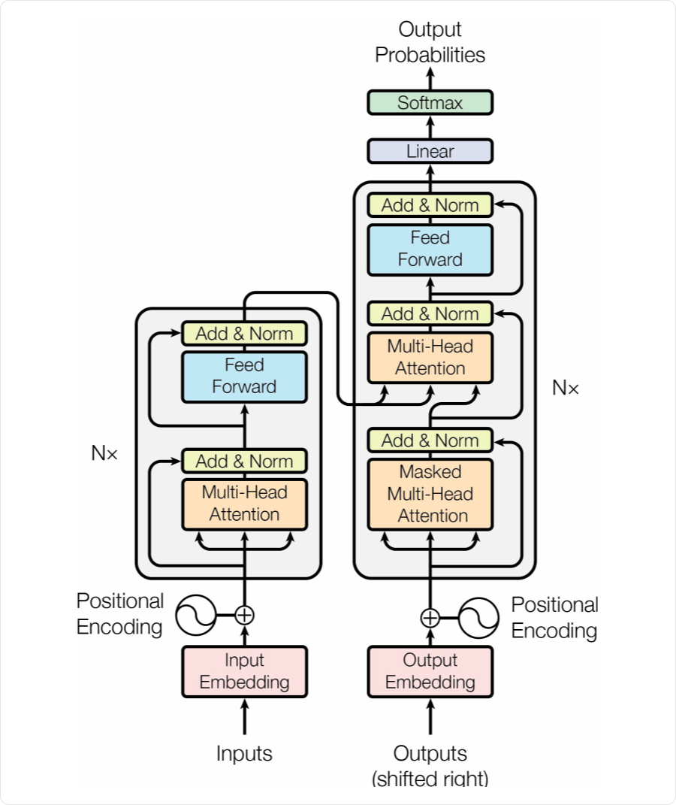
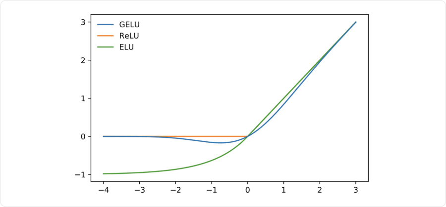
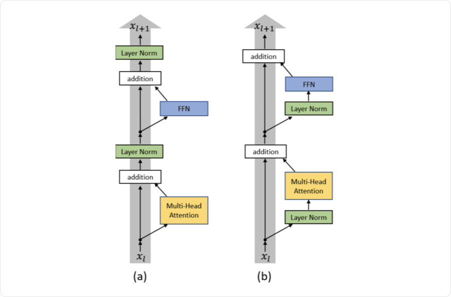

# Трансформеры

**Трансформер (Transformer)** — архитектура, которая чередует обмен информацией между позициями через внимание и преобразование признаков каждой позиции через полносвязную сеть. Остаточные связи и нормировки помогают обучать цепочку таких блоков.

Исходная архитектура решала задачу перевода одной последовательности в другую. Из неё выросли три распространённых варианта: **encoder-only, decoder-only и encoder–decoder**. Текст — один из возможных входов; блоки работают с последовательностью численных векторов.

## Общий путь данных

Для входа длины `n` каждую позицию представляют вектором длины `d_model`. Получается матрица `X` размера `n × d_model`. Все позиции имеют общую размерность, чтобы их можно было обрабатывать одними матрицами и складывать в остаточных связях.

```text
Исходные данные → векторы позиций → информация о порядке
               → несколько transformer-блоков → выходная голова
```

Подготовка векторов и кодирование порядка разобраны в 055. Здесь считаем, что входная матрица уже подготовлена. Используем **векторы-строки**, как в конспекте про внимание.



**Схема читается снизу вверх.** Слева поступает исходный вход, справа — уже известная часть выходной последовательности. Стрелки между стеками передают представления энкодера в cross-attention декодера. `N×` означает повторение блоков; их параметры обычно разные.

## Блок энкодера

Внутри два основных преобразования:

1. **Multi-head self-attention** — каждая позиция собирает информацию из разрешённых позиций входа.
2. **Feed-forward network (FFN)** — отдельно преобразует полученное представление каждой позиции.

В исходной схеме после каждого преобразования стоит **Add & Norm**: прибавить вход ветви и нормировать результат.

```text
H = LayerNorm(X + MHA(X))
Y = LayerNorm(H + FFN(H))
```

Это вариант **Post-LN**. Для краткости dropout не показан. Все три матрицы `X`, `H`, `Y` имеют размер `n × d_model`.

Энкодер возвращает **по одному контекстному вектору на каждую позицию**, а не обязательно один общий вектор. Следующий блок получает все эти векторы и может учитывать уже более сложные зависимости.

## Что делает FFN

FFN — двухслойная полносвязная сеть с нелинейностью:

```text
FFN(x) = φ(xW₁ + b₁)W₂ + b₂

x: 1 × d_model
W₁: d_model × d_ff        b₁: d_ff
W₂: d_ff × d_model        b₂: d_model
```

Первый слой расширяет представление, второй возвращает исходную размерность. Частый выбор — `d_ff = 4d_model`, но это настройка архитектуры.

**Одни и те же веса FFN применяются ко всем позициям.** Разные строки здесь не смешиваются. Обмен между позициями делает внимание, а FFN нелинейно перерабатывает признаки внутри каждой строки.

Например, при `d_model = 8`, `d_ff = 32` путь одной позиции имеет размеры `8 → 32 → 8`. С учётом смещений FFN содержит `8·32 + 32 + 32·8 + 8 = 552` параметра, независимо от длины входа.

### ReLU и GELU

В исходном Transformer использовалась ReLU. Другой распространённый вариант — **GELU**:

```text
ReLU(x) = max(0, x)
GELU(x) = x · Φ(x)
```

`Φ(x)` — функция распределения стандартного нормального распределения: число от `0` до `1`. GELU плавно ослабляет отрицательные значения вместо жёсткого обнуления всей отрицательной половины.



По горизонтали — вход активации, по вертикали — выход. У GELU возможны небольшие отрицательные значения. Выбор активации — часть архитектуры, а не изменение механизма внимания.

## Остаточные связи и нормировка

**Residual connection** имеет вид `x + F(x)`. Она оставляет прямой путь для представления и градиента, а ветвь `F` учится добавлять поправку. Для сложения размеры должны совпадать — поэтому внимание и FFN возвращают `d_model` координат.

**LayerNorm** нормирует выбранные признаки **одной позиции**, а затем применяет обучаемые масштаб и сдвиг. В стандартном transformer-блоке статистики не усредняются по разным объектам или по всем временным шагам. Механика нормировки разобрана в 050.

### Post-LN и Pre-LN

Положение LayerNorm меняет путь прохождения градиента:

| Схема одной ветви | Формула | Где стоит нормировка |
|---|---|---|
| **Post-LN** | `y = LN(x + F(x))` | После сложения |
| **Pre-LN** | `y = x + F(LN(x))` | На входе преобразующей ветви |



Схемы читаются снизу вверх. В Pre-LN прямой путь не проходит через нормировку после каждого сложения. Это часто облегчает обучение глубоких стеков. В конце Pre-LN-стека обычно добавляют итоговую LayerNorm.

Полный Pre-LN-блок энкодера:

```text
H = X + MHA(LN(X))
Y = H + FFN(LN(H))
```

Pre-LN и Post-LN — разные вычисления; переставлять нормировку в уже обученной модели без переобучения нельзя. Подходящая схема не отменяет выбора learning rate, инициализации и контроля градиентов.

## Блок декодера в encoder–decoder

Декодер исходной архитектуры содержит **три** ветви:

1. **Каузальное self-attention** обрабатывает известный префикс ответа.
2. **Cross-attention** обращается к представлениям исходного входа.
3. **FFN** преобразует признаки каждой выходной позиции.

Для варианта Post-LN, без записи dropout:

```text
H₁ = LN(D + MaskedSelfAttention(D))
H₂ = LN(H₁ + CrossAttention(Q из H₁, K и V из E))
Y  = LN(H₂ + FFN(H₂))
```

`D` — вход текущего блока декодера длины `m`, `E` — итоговый выход энкодера длины `n`. Запись «Q из H₁» означает применение обучаемой query-проекции к `H₁`; аналогично ключи и значения получаются проекциями `E`.

Каузальная маска нужна **в self-attention декодера**: будущий ответ неизвестен. Cross-attention обычно видит весь исходный вход, поскольку в задаче перевода он уже целиком доступен. При потоковой обработке или прогнозировании доступность исходных позиций проверяют отдельно.

**Один проход декодера может выдать представления для всего известного префикса.** Последовательной остаётся генерация неизвестных новых элементов: сначала нужно выбрать следующий элемент, чтобы использовать его при следующем шаге.

## Из представления — в ответ

Стек блоков возвращает векторы, а не готовые слова, вероятности или цены. Формат ответа задаёт **выходная голова (head)**.

| Задача | Что делают с представлением |
|---|---|
| Предсказать следующий токен | Линейный слой в размер словаря, затем softmax |
| Классифицировать каждую позицию | Классификатор над каждой строкой |
| Классифицировать весь вход | Общий вектор через pooling или специальную позицию, затем классификатор |
| Предсказать число | Регрессионный выход над выбранным представлением |

Для словаря размера `Vocab`:

```text
logits = hWout + bout
Wout: d_model × Vocab
p = softmax(logits)
```

Это **softmax по вариантам ответа**, а softmax внутри внимания идёт **по ключам**. У них разные оси и разный смысл. Внимание «какую информацию взять» само по себе не выбирает следующий токен.

В бинарной задаче можно использовать один логит и sigmoid; в обычной регрессии ограничивающая выходная активация часто не требуется.

## Три семейства трансформеров

| Семейство | Какие блоки использует | Какой контекст доступен |
|---|---|---|
| **Encoder-only**, например BERT | Self-attention и FFN | Обычно весь известный вход в обе стороны |
| **Decoder-only**, например GPT | Каузальное self-attention и FFN | Только префикс, доступный на текущей позиции |
| **Encoder–decoder** | Энкодер и декодер с cross-attention | Известный исходный вход и префикс ответа |

**Decoder-only не содержит обязательного cross-attention.** Название унаследовано от каузальной части исходного декодера; блок связи с энкодером там отсутствует.

Encoder-only удобен для получения контекстных признаков. Decoder-only естественно задаёт авторегрессивную модель. Encoder–decoder разделяет чтение источника и построение ответа. Конкретные задачи обучения BERT/GPT разобраны в 056.

## Что определяет размер и стоимость

- **`d_model`** — ширина представления каждой позиции.
- **`d_ff`** — ширина промежуточного слоя FFN.
- **`h`** — число голов внимания.
- **`N`** — число блоков в стеке.
- **Длина входа и контекста** — сколько позиций обрабатывается за проход.

FFN стоит порядка `O(nd_model·d_ff)`, проекции внимания — `O(nd_model²)`, полные взаимодействия внимания — `O(n²d_model)`. Поэтому при коротком входе и широких слоях значительная часть времени может уходить на FFN. Квадратичная зависимость внимания не означает, что оно всегда самое дорогое место.

Число параметров блока не растёт с длиной входа, но затраты вычислений и память растут. Большой размер модели, длинный контекст и качественное обучение — разные свойства; одно не гарантирует другого.

## Связанные материалы

- [Яндекс Учебник — «Трансформеры»](https://contest.yandex.ru/tracks/ml/deep-learning-architectures/transformers)
- [Нейчев — неделя 6: Self-Attention и Transformer](https://github.com/neychev/made_nlp_course/tree/master/week06_SelfAttention_and_NMT_practice)
- [Vaswani et al. — Attention Is All You Need](https://arxiv.org/abs/1706.03762)
- [Мария Тихонова — миникурс, часть 1](https://www.youtube.com/watch?v=c0qR2NhqTxU)
- [Мария Тихонова — миникурс, часть 2, дополнительное видео](https://www.youtube.com/watch?v=MsHhjvIeJ7o)
- [Механизм внимания: Attention и Self-Attention](053-attention.md)
- [Представления данных и позиции](055-representations-and-positions.md)
- [Обучение и применение трансформеров](056-transformer-training-and-applications.md)

### Автор:

* [Олег](https://t.me/HocokTopok)
