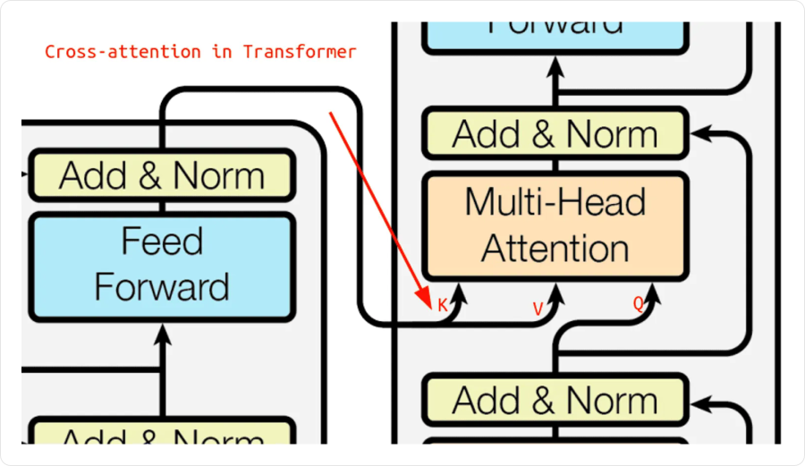

# Трансформеры

**Трансформер (Transformer)** обрабатывает последовательность через блоки внимания и полносвязных преобразований. Сначала разберём исходную схему для перевода: одна часть читает исходную фразу, другая постепенно строит перевод.

## Как читать схему целиком

В схеме две основные части:

- **Энкодер (encoder)** обрабатывает весь исходный вход и выдаёт его численные представления.
- **Декодер (decoder)** использует эти представления и уже полученную часть ответа, чтобы предсказать следующий элемент.

Отдельный элемент последовательности называется **токеном**: это может быть слово, часть слова или служебный маркер. На вход модели подаются эмбеддинги этих токенов. Уже полученная начальная часть ответа называется **префиксом**.


**Обе половины схемы читаются снизу вверх.** Слева проходит исходная последовательность, справа — префикс ответа. Стрелки слева направо передают результат энкодера в декодер.

### 1. Подготовить исходный вход

Снизу слева находятся **Inputs → Input Embedding**. Каждый токен исходной последовательности заменяется вектором одной и той же длины `d_model`. Если токенов `n`, получается матрица `n × d_model`: одна строка на токен.

Затем **Positional Encoding** добавляет информацию о положении. Иначе полное внимание само по себе не сообщит модели, какое слово стояло первым, а какое вторым. На схеме кружок `+` обозначает сложение вектора содержимого и вектора позиции.

### 2. Провести весь вход через N блоков энкодера

Над подготовленными векторами стоит большой блок с пометкой **`N×`**. Это **N последовательно соединённых блоков**, а не N независимых попыток получить ответ:

```text
Все входные токены → блок энкодера 1 → блок 2 → … → блок N
```

Внутри каждого блока:

1. **Multi-Head Attention**: каждая входная позиция собирает информацию из всех доступных позиций того же входа. Например, представление слова «иду» может учитывать слово «я».
2. **Add & Norm**: к результату прибавляют вход этой ветви и нормируют полученные признаки. Так сохраняется прямой путь для исходной информации.
3. **Feed Forward**: небольшая полносвязная сеть отдельно перерабатывает признаки каждого токена. Между токенами она информацию не переносит.
4. Ещё один **Add & Norm** завершает блок.

Все позиции обрабатываются внутри каждого блока совместно, а **сами блоки выполняются по очереди**. Обычно у каждого блока свой набор параметров.

После последнего блока остаётся `n` векторов длины `d_model`: по одному на исходный токен, уже с учётом контекста. Обозначим всю эту матрицу как **`E` — результат энкодера**.

**При генерации одного ответа энкодер выполняют один раз.** Исходная фраза не меняется, поэтому `E` сохраняют и используют на всех шагах построения ответа.

### 3. Подать начало ответа в декодер

Снизу справа находятся **Outputs (shifted right) → Output Embedding**. Это вход декодера: предыдущие токены ответа. Сначала ответа ещё нет, поэтому подают специальный маркер начала **`[BOS]`**.

Токены префикса тоже превращают в эмбеддинги и добавляют позиции. Надпись **shifted right**, «сдвинуто вправо», означает: входная позиция содержит предыдущий токен, а по её выходу нужно предсказать следующий.

```text
Известный префикс: [BOS], I
Нужно предсказать: следующий токен после I
```

### 4. Провести префикс через N блоков декодера

Справа пометка **`N×`** также обозначает глубину стека. На одном шаге получения нового токена данные проходят **все блоки от первого до последнего**:

```text
Префикс ответа → блок декодера 1 → блок 2 → … → блок N
```

В одном блоке декодера три преобразования:

1. **Masked Multi-Head Attention**: позиции ответа обмениваются информацией только с собой и предыдущими позициями. Каузальная маска запрещает читать будущие элементы ответа.
2. **Multi-Head Attention со стрелками от энкодера**, то есть **cross-attention**: текущие представления ответа собирают нужную информацию из `E`. Запросы `Q` получаются внутри декодера, ключи `K` и значения `V` — из результата энкодера.
3. **Feed Forward**: отдельно перерабатывает признаки каждой позиции ответа.

После каждого из трёх преобразований стоит **Add & Norm**. Все блоки декодера обращаются к **одному итоговому результату `E`**, но каждый использует собственные обучаемые проекции. Блок декодера 1 не обязан обращаться к блоку энкодера 1: стрелки идут от **выхода всего энкодера**.

На выходе последнего блока получается по вектору на каждую обработанную позицию префикса. **Для выбора следующего токена используем вектор последней позиции.**

### 5. Превратить последний вектор в следующий токен

На самом верху справа стоят **Linear → Softmax → Output Probabilities**:

1. **Linear** переводит последний вектор в набор чисел — **логитов**, по одному на каждый токен выходного словаря.
2. **Softmax** превращает логиты в вероятности вариантов продолжения.
3. По этим вероятностям выбирают один токен. В простейшем варианте — самый вероятный.

Этот токен добавляют к префиксу и снова выполняют декодер. Получается цикл:

```text
[BOS]         → N блоков декодера + Linear + Softmax → I
[BOS], I      → N блоков декодера + Linear + Softmax → go
[BOS], I, go  → N блоков декодера + Linear + Softmax → [EOS]
```

**`[EOS]` — маркер конца последовательности.** После него генерацию заканчивают. Также задают ограничение длины на случай, если модель не выдаст этот маркер.

### Что именно повторяется

| Часть | Сколько раз при генерации одного ответа |
|---|---|
| Все блоки энкодера | Один проход по исходному входу |
| Все блоки декодера | Один проход стека для каждого нового токена, включая `[EOS]` |
| Параметры декодера | Одни и те же на всех шагах генерации |
| Исходный результат `E` | Сохраняется и используется на всех шагах |

**N — число блоков в глубину, а не число слов.** Число блоков энкодера и декодера можно выбирать независимо; одинаковое `N` на исходной схеме — конкретный вариант архитектуры.

В прямой реализации декодер заново обрабатывает весь растущий префикс. Оптимизированная реализация сохраняет уже вычисленные ключи и значения прошлых позиций и проводит через стек только новый токен. Глубина стека и зависимость нового токена от предыдущих при этом сохраняются.

Описанный цикл относится к **генерации**. При обучении правильная выходная последовательность уже известна: её сдвинутые токены можно подать сразу и вычислить предсказания всех позиций параллельно, сохраняя каузальную маску.

## Полный пример: «я иду» → «I go»

Возьмём уже обученную модель с **двумя блоками энкодера и двумя блоками декодера**. Для простоты каждое слово считаем отдельным токеном, ширину представлений берём `d_model = 4`, а выходной словарь — `[I, go, stop, [EOS]]`.

Векторы на входе и выходные логиты ниже заданы как условный пример работы обученной сети. Проследим весь путь данных; вычисления внутри блоков разберём после примера.

### Шаг 1. Представить вход числами

Пусть эмбеддинги и позиционные добавки равны:

| Токен | Эмбеддинг | Позиция | Их сумма |
|---|---|---|---|
| `я` | `[1, 0, 0, 0]` | `[0, 0, 1, 0]` | `[1, 0, 1, 0]` |
| `иду` | `[0, 1, 0, 0]` | `[0, 0, 0, 1]` | `[0, 1, 0, 1]` |

Получается входная матрица `X` размера `2 × 4`. Позиции в этом примере условные; это не обязательная формула позиционного кодирования.

### Шаг 2. Один раз выполнить энкодер

```text
X, две строки по 4 числа
    → блок энкодера 1: внимание → Add & Norm → FFN → Add & Norm
    → блок энкодера 2: внимание → Add & Norm → FFN → Add & Norm
    → E, две строки по 4 числа
```

Обе строки проходят каждый блок. После первого они уже учитывают друг друга, после второго снова преобразуются. `E` содержит представления исходных позиций «я» и «иду». Это **численные признаки**, а не готовый перевод `I go`.

Сохраняем `E`. Для последующих трёх шагов энкодер больше не запускаем.

### Шаг 3. Получить первое слово

На вход декодера поступает только `[BOS]`:

```text
[BOS] → embedding + позиция
      → блок декодера 1 → блок декодера 2
      → последний вектор длины 4 → Linear → Softmax
```

В каждом блоке self-attention пока видит одну позицию `[BOS]`. Cross-attention при этом уже может читать **обе строки `E`**: вся исходная фраза известна.

Пусть Linear выдал логиты `[ln 8, 0, ln 0.5, ln 0.5]`. После экспоненты получаем `[8, 1, 0.5, 0.5]`; сумма равна `10`. Поэтому:

```text
Токены:        I     go    stop   [EOS]
Вероятности:  0.80  0.10  0.05   0.05
```

Выбираем `I`. Теперь ответ состоит из одного слова, а новый префикс — `[BOS], I`.

### Шаг 4. Получить второе слово

```text
[BOS], I → embedding + позиции
         → блок декодера 1 → блок декодера 2
         → вектор позиции I → Linear → Softmax
```

В self-attention позиция `I` может учитывать `[BOS]` и себя; позиция `[BOS]` не может читать последующее `I`. В cross-attention обе позиции обращаются к тому же `E`.

Для продолжения берём **последний вектор — на позиции `I`**. Пусть логиты равны `[ln 0.5, ln 8.5, ln 0.5, ln 0.5]`:

```text
Токены:        I     go    stop   [EOS]
Вероятности:  0.05  0.85  0.05   0.05
```

Выбираем `go`. Новый префикс — `[BOS], I, go`. Декодер использовал те же параметры, что и на предыдущем шаге; изменился вход.

### Шаг 5. Завершить ответ

```text
[BOS], I, go → embedding + позиции
             → блок декодера 1 → блок декодера 2
             → вектор позиции go → Linear → Softmax
```

Пусть логиты равны `[ln 0.2, ln 0.3, ln 0.5, ln 9]`:

```text
Токены:        I     go    stop   [EOS]
Вероятности:  0.02  0.03  0.05   0.90
```

Выбираем `[EOS]` и останавливаемся. Служебные `[BOS]` и `[EOS]` не включаем в итоговую фразу: **`I go`**.

В этом примере стек из двух блоков энкодера выполнен **один раз**, стек из двух блоков декодера — **три раза**: для `I`, `go` и `[EOS]`. На каждом шаге декодер заново определяет, какую информацию взять из исходной фразы и уже известного ответа.

## Внутри блока энкодера

Теперь разберём операции, которые на общей схеме были показаны отдельными прямоугольниками.

В каждом блоке два основных преобразования:

1. **Multi-head self-attention** смешивает информацию между позициями входа.
2. **Feed-forward network (FFN)** преобразует признаки каждой позиции отдельно.

После каждой ветви прибавляется её вход и применяется нормировка — **Add & Norm** в исходной схеме. Вход и выход блока имеют размер `n × d_model`; изменение признаков не меняет число исходных позиций.

## Что делает FFN

FFN — двухслойная полносвязная сеть с нелинейностью `φ`:

```text
FFN(x) = φ(xW₁ + b₁)W₂ + b₂

x: 1 × d_model
W₁: d_model × d_ff        b₁: d_ff
W₂: d_ff × d_model        b₂: d_model
```

Первый слой расширяет представление, второй возвращает исходную размерность. Частый выбор — `d_ff = 4d_model`, но это настройка архитектуры.

**Одни и те же веса FFN применяются ко всем позициям.** Разные строки здесь не смешиваются. Обмен между позициями делает внимание, а FFN нелинейно перерабатывает признаки внутри каждой строки.

Например, при `d_model = 8`, `d_ff = 32` путь одной позиции имеет размеры `8 → 32 → 8`. С учётом смещений FFN содержит `8·32 + 32 + 32·8 + 8 = 552` параметра, независимо от длины входа.

### ReLU и GELU

В исходном Transformer использовалась ReLU. Другой распространённый вариант — **GELU**:

```text
ReLU(x) = max(0, x)
GELU(x) = x · Φ(x)
```

`Φ(x)` — функция распределения стандартного нормального распределения: число от `0` до `1`. GELU плавно ослабляет отрицательные значения вместо жёсткого обнуления всей отрицательной половины.


По горизонтали — вход активации, по вертикали — выход. У GELU возможны небольшие отрицательные значения. Выбор активации — часть архитектуры, а не изменение механизма внимания.

## Остаточные связи и нормировка

**Residual connection** имеет вид `x + F(x)`. Она оставляет прямой путь для представления и градиента, а ветвь `F` учится добавлять поправку. Для сложения размеры должны совпадать — поэтому внимание и FFN возвращают `d_model` координат.

**LayerNorm** нормирует выбранные признаки **одной позиции**, а затем применяет обучаемые масштаб и сдвиг. В стандартном transformer-блоке статистики не усредняются по разным объектам или по всем временным шагам. В формулах обозначим LayerNorm сокращённо как `LN`.

### Post-LN и Pre-LN

Положение LayerNorm меняет путь прохождения градиента:

| Схема одной ветви | Формула | Где стоит нормировка |
|---|---|---|
| **Post-LN** | `y = LN(x + F(x))` | После сложения |
| **Pre-LN** | `y = x + F(LN(x))` | На входе преобразующей ветви |


Схемы читаются снизу вверх. В Pre-LN прямой путь не проходит через нормировку после каждого сложения. Это часто облегчает обучение глубоких стеков. В конце Pre-LN-стека обычно добавляют итоговую LayerNorm.

### Собираем блок энкодера

После определения преобразований и нормировки можно записать весь блок. Обозначим multi-head self-attention как `MHA`.

В варианте Post-LN:

```text
H = LN(X + MHA(X))
Y = LN(H + FFN(H))
```

`X` — вход блока, `H` — результат первой ветви со сложением и нормировкой, `Y` — выход блока. Все три матрицы имеют размер `n × d_model`. На общей схеме операцию «сложить и нормировать» подписывают **Add & Norm**. Для краткости dropout в формулах не показан.

В варианте Pre-LN:

```text
H = X + MHA(LN(X))
Y = H + FFN(LN(H))
```

Pre-LN и Post-LN — разные вычисления; переставлять нормировку в уже обученной модели без переобучения нельзя. Подходящая схема не отменяет выбора learning rate, инициализации и контроля градиентов.

## Внутри блока декодера

В схеме encoder–decoder каждый блок декодера содержит **три** ветви. Их порядок важен: сначала обработать известную часть ответа, затем дополнить её информацией из исходного входа, после — переработать признаки.

1. **Каузальное self-attention** обрабатывает известный префикс ответа.
2. **Cross-attention** обращается к представлениям исходного входа.
3. **FFN** преобразует признаки каждой выходной позиции.

Для варианта Post-LN, без записи dropout:

```text
H₁ = LN(D + MaskedSelfAttention(D))
H₂ = LN(H₁ + CrossAttention(Q из H₁, K и V из E))
Y  = LN(H₂ + FFN(H₂))
```

`D` — вход текущего блока декодера длины `m`, `E` — итоговый выход энкодера длины `n`. Запись «Q из H₁» означает применение обучаемой query-проекции к `H₁`; аналогично ключи и значения получаются проекциями `E`.



На рисунке стрелки `K` и `V` идут от энкодера, а `Q` — от представления внутри декодера. Запросы описывают, какая информация нужна для продолжения ответа; ключи и значения дают доступ к исходному входу.

Каузальная маска нужна **в self-attention декодера**: будущий ответ неизвестен. Cross-attention обычно видит весь исходный вход, поскольку в задаче перевода он уже целиком доступен. При потоковой обработке или прогнозировании доступность исходных позиций проверяют отдельно.

**Один проход декодера может выдать представления для всего известного префикса.** Последовательной остаётся генерация неизвестных новых элементов: сначала нужно выбрать следующий элемент, чтобы использовать его при следующем шаге.

## Из представления — в ответ

Стек блоков возвращает векторы, а не готовые слова, вероятности или цены. Формат ответа задаёт **выходная голова (head)**.

| Задача | Что делают с представлением |
|---|---|
| Предсказать следующий токен | Линейный слой в размер словаря, затем softmax |
| Классифицировать каждую позицию | Классификатор над каждой строкой |
| Классифицировать весь вход | Общий вектор, например среднее по позициям, затем классификатор |
| Предсказать число | Регрессионный выход над выбранным представлением |

Для словаря размера `Vocab`:

```text
logits = hWout + bout
Wout: d_model × Vocab
p = softmax(logits)
```

Это **softmax по вариантам ответа**, а softmax внутри внимания идёт **по ключам**. У них разные оси и разный смысл. Внимание «какую информацию взять» само по себе не выбирает следующий токен.

В бинарной задаче можно использовать один логит и sigmoid; в обычной регрессии ограничивающая выходная активация часто не требуется.

## Три семейства трансформеров

| Семейство | Какие блоки использует | Какой контекст доступен |
|---|---|---|
| **Encoder-only** — только энкодер | Self-attention и FFN | Обычно весь известный вход в обе стороны |
| **Decoder-only** — только каузальные блоки | Каузальное self-attention и FFN | Только префикс, доступный на текущей позиции |
| **Encoder–decoder** | Энкодер и декодер с cross-attention | Известный исходный вход и префикс ответа |

**Decoder-only не содержит обязательного cross-attention.** Название унаследовано от каузальной части исходного декодера; блок связи с энкодером там отсутствует.

Encoder-only удобен для получения контекстных признаков. Decoder-only естественно задаёт **авторегрессивную модель**: каждый следующий элемент предсказывается по предыдущим. Encoder–decoder разделяет чтение источника и построение ответа.

## Что определяет размер и стоимость

- **`d_model`** — ширина представления каждой позиции.
- **`d_ff`** — ширина промежуточного слоя FFN.
- **`h`** — число голов внимания.
- **`N`** — число блоков в стеке.
- **Длина входа и контекста** — сколько позиций обрабатывается за проход.

FFN стоит порядка `O(nd_model·d_ff)`, проекции внимания — `O(nd_model²)`, полные взаимодействия внимания — `O(n²d_model)`. Поэтому при коротком входе и широких слоях значительная часть времени может уходить на FFN. Квадратичная зависимость внимания не означает, что оно всегда самое дорогое место.

Число параметров блока не растёт с длиной входа, но затраты вычислений и память растут. Большой размер модели, длинный контекст и качественное обучение — разные свойства; одно не гарантирует другого.

## Связанные материалы

- [Яндекс Учебник — «Трансформеры»](https://contest.yandex.ru/tracks/ml/deep-learning-architectures/transformers)
- [Нейчев — неделя 6: Self-Attention и Transformer](https://github.com/neychev/made_nlp_course/tree/master/week06_SelfAttention_and_NMT_practice)
- [Vaswani et al. — Attention Is All You Need](https://arxiv.org/abs/1706.03762)
- [Мария Тихонова — миникурс, часть 1](https://www.youtube.com/watch?v=c0qR2NhqTxU)
- [Мария Тихонова — миникурс, часть 2, дополнительное видео](https://www.youtube.com/watch?v=MsHhjvIeJ7o)
- [Механизм внимания: Attention и Self-Attention](053-attention.md)
- [Трансформеры: позиции, BERT/GPT и генерация](055-transformer-positions-and-generation.md)

### Автор:

* [Олег](https://t.me/HocokTopok)
