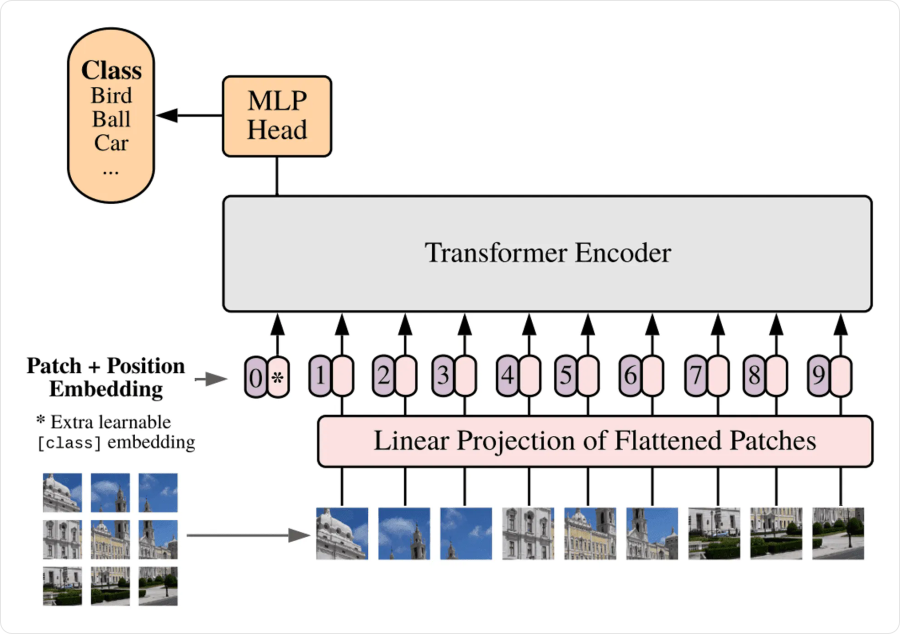
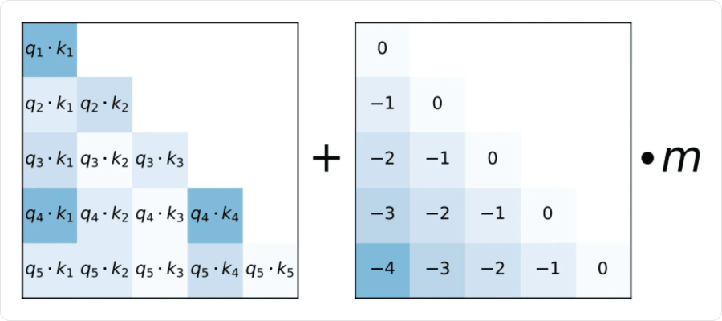

# Представления данных и позиции

Трансформер получает последовательность векторов. До первого блока нужно решить **два разных вопроса**: как представить содержимое каждого элемента и как сообщить его положение относительно остальных.

Для текста элементом может быть токен, для изображения — участок картинки, для временного ряда — измерение или окно наблюдений. Операции внимания одинаковы, но подготовка входа зависит от данных.

## Что такое embedding

**Эмбеддинг (embedding)** — векторное представление объекта или элемента данных. Обучаемый эмбеддинг подбирается так, чтобы его координаты помогали решать задачу.

Для конечного набора категорий можно завести таблицу:

```text
E: Vocab × d_model
embedding(id) = E[id]
```

Строка `id` — вектор соответствующей категории. Сам номер является адресом строки: близкие номера не означают похожего смысла.

| Элемент | Условный ID | Строка таблицы E |
|---|---|---|
| `A` | `0` | `[1.0, 0.0, 0.5, −0.5]` |
| `B` | `1` | `[0.2, 0.8, −0.1, 0.3]` |
| `C` | `2` | `[−0.4, 0.1, 0.7, 0.2]` |

Для последовательности `[B, A, B]` выбираются строки `[E[1], E[0], E[1]]`. Получаем матрицу `3 × 4`. Пока контекст и позиции не добавлены, оба вхождения `B` имеют одинаковые векторы.

### Связь с one-hot

Если `u` — one-hot строка длины `Vocab`, то `uE` выбирает нужную строку `E`. На практике полный one-hot создавать не требуется: достаточно взять строку по индексу.

One-hot обозначает категорию, но сам по себе не выражает сходство. Плотный обучаемый вектор позволяет совместно использовать признаки разных категорий. При этом **каждая координата не обязана иметь отдельное понятное название**.

Таблица обучается через обычный backpropagation. Похожесть векторов зависит от цели и данных: она не гарантирует совпадения объектов по любому интересующему нас свойству.

## Статические и контекстные представления

**Статическое представление** связывает с одной категорией один вектор. Например, слово «ключ» имеет один исходный вектор и в описании двери, и в описании источника воды.

**Контекстное представление** относится к конкретному вхождению. После слоёв внимания два вхождения слова могут получить разные векторы, поскольку окружение различается.

```text
Таблица embedding → одинаковый исходный вектор для одного ID
Transformer      → представление вхождения с учётом контекста
```

Размерность в обоих случаях может быть одной и той же. Контекстность появляется из вычислений модели, а не из увеличения номера или длины вектора.

### Как учатся word embeddings

Одна из идей — использовать **контексты встречаемости**: слова с похожим окружением могут иметь полезные для задачи близкие представления.

| Подход | Учебная задача |
|---|---|
| **CBOW** | По соседним словам предсказать центральное |
| **Skip-gram** | По центральному слову предсказать соседние |
| **Матричные методы** | Сжать статистики совместной встречаемости, например через SVD |

В skip-gram с полным softmax вероятность контекстного слова `c` для центрального `w` можно записать так:

```text
p(c | w) = exp(u_c · e_w) / Σᵥ exp(u_v · e_w)
```

`e_w` — входной вектор слова, `u_c` — выходной вектор кандидата. Полный знаменатель дорог при большом словаре. **Negative sampling** заменяет эту задачу различением реальных пар и нескольких случайно выбранных отрицательных пар; это отдельная обучающая цель, а не точное вычисление полного softmax.

Word2vec даёт статические векторы. В трансформере эмбеддинги можно обучать сразу по конечной задаче, без предварительного word2vec. Сходство контекстов также не равно тождеству смысла: например, антонимы часто встречаются в похожих окружениях.

## Вход не обязательно состоит из слов

### Численные последовательности

Для вектора признаков `fₜ` размерности `p` можно использовать линейную проекцию:

```text
xₜ = fₜWin + b
Win: p × d_model
```

Например, `8` признаков одного наблюдения преобразуются в `64` координаты. Одни и те же веса применяются к каждому шагу. Признаки предварительно приводят к осмысленным масштабам; параметры подготовки определяют по train.

Если элементом является окно из нескольких наблюдений, его признаки сначала собирают в один вектор или обрабатывают локальным блоком. Нужно явно понимать, **какой участок времени представляет одна позиция**.

### Изображения и patches

Изображение делят на непересекающиеся участки — **патчи (patches)**. Значения пикселей каждого патча разворачивают в вектор и проецируют в `d_model` координат.

```text
Изображение → патчи → векторы патчей → линейная проекция
            → позиции → Transformer Encoder
```



Рисунок читается снизу вверх. Каждый небольшой участок становится отдельным элементом последовательности; дополнительный class-токен используется для итоговой классификации.

Например, изображение `32 × 32 × 3` и патчи `8 × 8` дают `4 × 4 = 16` элементов. В одном патче `8·8·3 = 192` числа; проекция `192 → d_model` задаёт ширину представления. С class-токеном длина входа станет `17`.

## Почему нужно сообщать позиции

Рассмотрим полное self-attention **без позиционных признаков и без маски, зависящей от порядка**. Если переставить входные строки, выходные строки переставятся точно так же:

```text
F(PX) = P F(X)
```

`P` — матрица перестановки. Это **эквивариантность к перестановке**. Сеть не получает из такой обработки знания о том, кто был первым, а кто третьим. Симметричное усреднение выходов сделает общий результат инвариантным к порядку.

Для последовательностей порядок часто существенен: `[рост, падение]` и `[падение, рост]` описывают разную динамику. Поэтому модели нужна дополнительная информация о положении. Каузальная маска уже задаёт ограничения порядка, но не заменяет все способы представления расстояния между шагами.

## Абсолютные позиции

Простой способ — прибавить позиционный вектор к представлению содержимого:

```text
xₜ = eₜ + pₜ
```

Оба слагаемых имеют размер `d_model`. Это **сложение**, длина вектора не удваивается.

Например, для исходного `e_B = [0.2, 0.8]`, `p₀ = [0, 1]`, `p₂ = [1, 0]` получаем `[0.2, 1.8]` и `[1.2, 0.8]`: одинаковая категория различается по позиции.

### Фиксированное синусоидальное кодирование

Для чётной размерности `d` и нумерации с нуля:

```text
PE(pos, 2i)     = sin(pos / 10000^(2i/d))
PE(pos, 2i + 1) = cos(pos / 10000^(2i/d))
```

`pos` — позиция, `i = 0, …, d/2 − 1` — номер пары координат. Пары используют разные частоты: одни быстро меняются по позициям, другие медленно. Эти значения не обучаются.

При `d = 4`:

| Позиция | Позиционный вектор, округлённо |
|---|---|
| `0` | `[0, 1, 0, 1]` |
| `1` | `[0.8415, 0.5403, 0.0100, 0.99995]` |

Синус и косинус позволяют выразить сдвиг позиции через преобразование пары координат. Формулу можно вычислить для новой позиции, но это само по себе не гарантирует хорошего качества на длинах, которых не было в обучении.

### Обучаемая таблица позиций

Вместо фиксированной формулы заводят таблицу `P` размера `Lmax × d_model`. Модель учит каждую строку совместно с остальными параметрами.

Это гибко, но напрямую доступны только заведённые строки. Увеличить максимальную длину или изменить способ использования таблицы без проверки качества нельзя. Даже для формально поддерживаемой длины важно, встречались ли похожие условия при обучении.

## Относительные позиции

Иногда важнее знать, что наблюдение было **два шага назад**, чем его абсолютный номер. Относительные методы учитывают разность позиций в вычислении внимания.

Один из вариантов добавляет позиционный сдвиг к оценке:

```text
sᵢⱼ = (qᵢ · kⱼ) / √dk + b(i − j)
```

`b` зависит от относительного расстояния, иногда отдельно для каждой головы. Это пример семейства методов: относительное кодирование не обязано реализовываться только скалярной добавкой.

### ALiBi

**ALiBi (Attention with Linear Biases)** добавляет фиксированный линейный штраф за удалённость ключа от запроса. Для каузального внимания:

```text
sᵢⱼ = (qᵢ · kⱼ) / √dk − mᵣ(i − j), если j ≤ i
```

`mᵣ > 0` — заранее заданный наклон для головы `r`. Разные головы получают разные наклоны. Будущие ключи по-прежнему запрещаются каузальной маской.



Слева — оценки `qᵢ·kⱼ`, справа — позиционная добавка, умноженная на наклон головы. На диагонали расстояние равно нулю, ниже диагонали штраф увеличивается. В формуле выше отдельно показано масштабирование на `√dk`.

При `mᵣ = 0.5` ключи на расстоянии `0`, `1`, `2` получают добавки `0`, `−0.5`, `−1`. Штраф смещает предпочтение к близким позициям, но сильная совместимость содержимого может его перевесить.

ALiBi изменяет **оценки до softmax** и не требует прибавлять позиционный вектор к каждому embedding. Метод помогает переносить модель на другие длины в определённых условиях; качество на произвольной длине не гарантируется.

## Позиция, время и маска — разные вещи

| Информация | Что сообщает модели |
|---|---|
| **Порядковый номер** | Какое место элемент занимает в последовательности |
| **Время / расстояние** | Когда произошло событие и каков интервал между событиями |
| **Маска** | Какие элементы разрешено использовать при данном предсказании |

Для нерегулярных измерений расстояние в три позиции не означает одинакового промежутка времени. Можно добавить признаки временного интервала, календарного времени или относительного расстояния по времени.

Позиционное кодирование **не защищает от утечки**. При прогнозировании разрешённый контекст задают отдельно, а признаки времени и содержимого строят только из доступной на тот момент информации.

## Как получить один вектор из последовательности

- **Среднее по реальным позициям**: padding исключают, сумму делят на число настоящих элементов.
- **Специальная позиция**, например `[CLS]`: её представление обучают использовать для общей задачи.
- **Последняя реальная позиция**: в каузальной модели она может учитывать весь доступный префикс.

Выбор способа агрегации зависит от обучения. Любая последняя строка не становится автоматически хорошим представлением целого входа; выходы на padding брать вместо реальных позиций нельзя.

## Связанные материалы

- [Яндекс Учебник — «Трансформеры», кодирование позиций](https://contest.yandex.ru/tracks/ml/deep-learning-architectures/transformers#kodirovanie-pozicij)
- [Нейчев — неделя 2: Word Embeddings](https://github.com/neychev/made_nlp_course/tree/master/week02_word_embeddings)
- [Нейчев — неделя 6: Self-Attention и позиции](https://github.com/neychev/made_nlp_course/tree/master/week06_SelfAttention_and_NMT_practice)
- [Vaswani et al. — Attention Is All You Need](https://arxiv.org/abs/1706.03762)
- [Press et al. — ALiBi](https://arxiv.org/abs/2108.12409)
- [Механизм внимания: Attention и Self-Attention](053-attention.md)
- [Трансформеры](054-transformers.md)
- [Обучение и применение трансформеров](056-transformer-training-and-applications.md)

### Автор:

* [Олег](https://t.me/HocokTopok)
