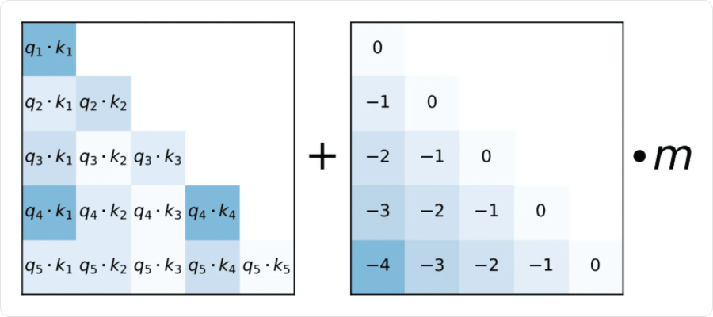
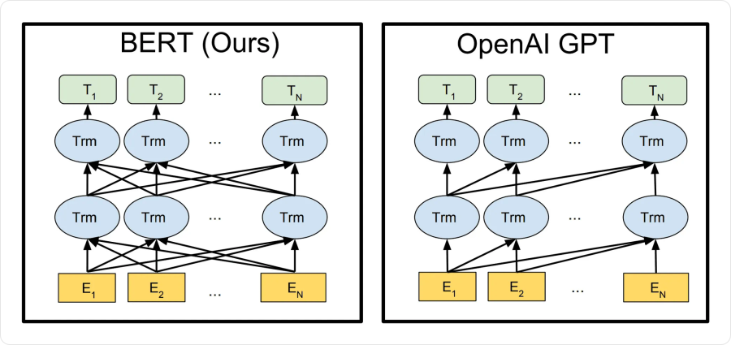
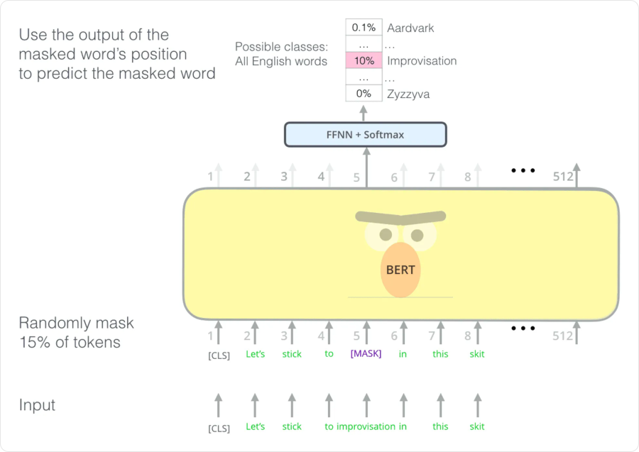
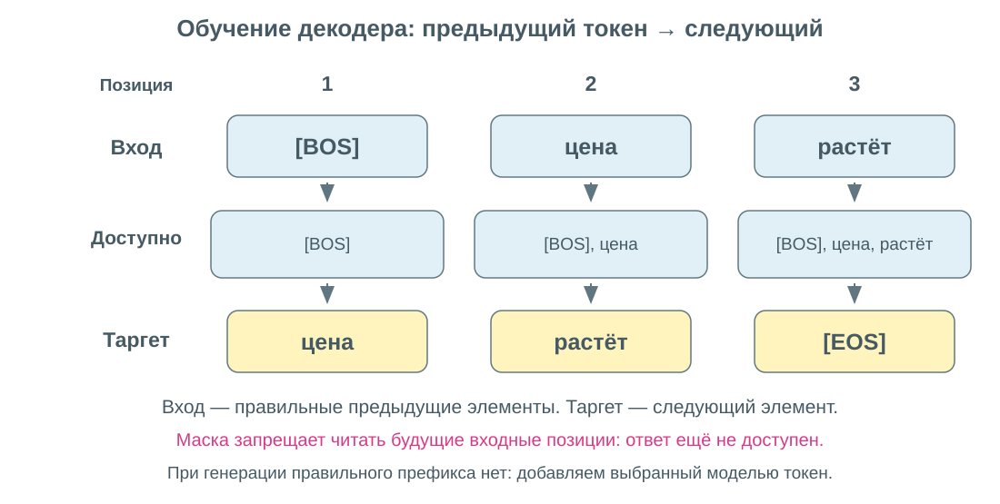
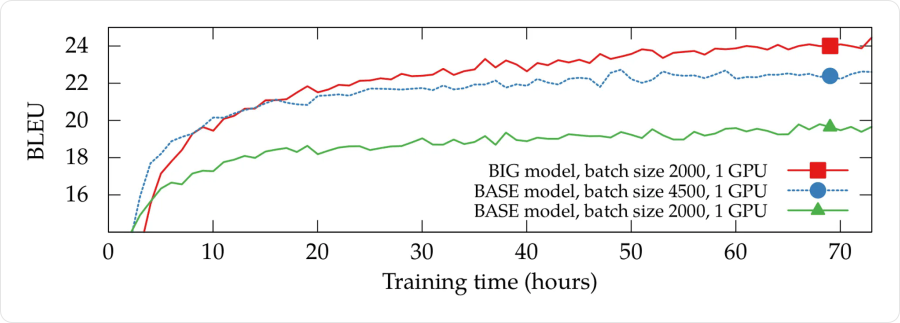
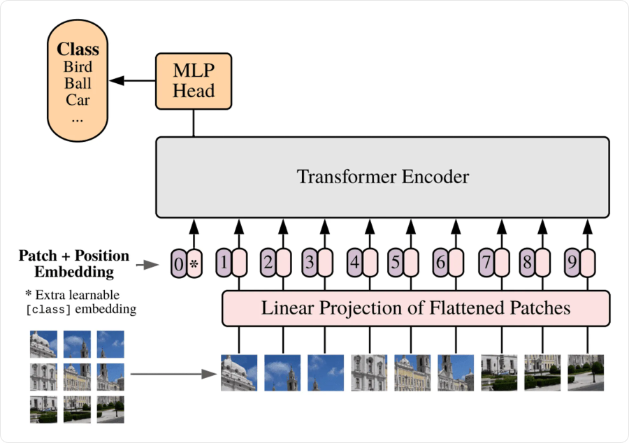
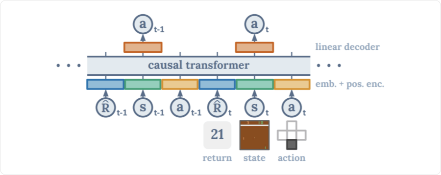

# Трансформеры: позиции, BERT/GPT и генерация

Устройство трансформера мы уже разобрали. Теперь ответим на три вопроса: **как сообщить модели порядок элементов, чему её обучать и как выбирать продолжение**.

## Как модель узнаёт порядок элементов

Эмбеддинг описывает содержимое элемента. Но одинаковое слово в начале и в конце последовательности получает один и тот же исходный вектор. Чтобы различать положения, добавляют **позиционную информацию**.

Например, `[рост, падение]` и `[падение, рост]` содержат одинаковые элементы, но описывают разную динамику. Полное внимание без позиционных признаков сравнивает содержимое векторов, не учитывая их порядковые номера.

### Абсолютные позиции

К эмбеддингу прибавляют вектор его позиции:

```text
xₜ = eₜ + pₜ
```

`eₜ` — эмбеддинг содержимого, `pₜ` — позиционный вектор. Оба имеют длину `d_model`; после сложения длина остаётся прежней.

Позиционные векторы можно получать двумя способами:

| Способ | Как устроен |
|---|---|
| **Фиксированная формула** | Координаты вычисляют через синус и косинус разных частот |
| **Обучаемая таблица** | Для каждой позиции заводят вектор и обучают его вместе с моделью |

В исходном Transformer использовалась формула:

```text
PE(pos, 2i)     = sin(pos / 10000^(2i/d))
PE(pos, 2i + 1) = cos(pos / 10000^(2i/d))
```

`pos` — номер позиции с нуля, `d` — чётная длина вектора, `i` — номер пары координат. Разные пары меняются с разной частотой. Например, при `d = 4` позиция `0` получает `[0, 1, 0, 1]`, позиция `1` — примерно `[0.8415, 0.5403, 0.0100, 0.99995]`.

### Относительные позиции и ALiBi

Другой подход учитывает **расстояние между запросом и ключом**. Например, для текущего наблюдения важно, что другое наблюдение было два шага назад.

В **ALiBi (Attention with Linear Biases)** к оценке внимания добавляют штраф за удалённость. Для каузального внимания:

```text
sᵢⱼ = (qᵢ · kⱼ) / √dk − mᵣ(i − j), если j ≤ i
```

`mᵣ > 0` — фиксированный наклон для головы `r`. Разные головы используют разные наклоны. Будущие позиции по-прежнему запрещаются маской.



Слева — оценки по содержимому, справа — добавка за расстояние. На диагонали штраф равен нулю. При `mᵣ = 0.5` расстояния `0`, `1`, `2` дают добавки `0`, `−0.5`, `−1`.

ALiBi меняет оценки **до softmax**, а не прибавляет вектор к эмбеддингу. Он задаёт предпочтение близким позициям; высокая совместимость содержимого может его перевесить.

Для нерегулярного временного ряда номер позиции и реальное время различаются: два соседних наблюдения могут быть разделены минутой или часом. Поэтому интервалы времени можно задавать отдельными признаками. **Позиции описывают порядок, а маска определяет, какие данные доступны.**

## BERT и GPT: две задачи обучения

**BERT** использует энкодер и видит весь известный вход. **GPT** использует каузальные блоки и предсказывает продолжение по предыдущим токенам.



На рисунке `E` — входные представления, `Trm` — блоки, `T` — выходные представления. Линии показывают, какие позиции могут обмениваться информацией.

| | BERT | GPT |
|---|---|---|
| **Что видит** | Контекст слева и справа | Только уже доступный префикс |
| **Основная задача** | Восстановить скрытый токен | Предсказать следующий токен |
| **Для чего удобен** | Классификация, поиск, контекстные признаки | Последовательная генерация |

### BERT: восстановить пропуск

Часть токенов скрывают или заменяют, а модель восстанавливает исходные значения по окружению:

```text
Исходно:  цена быстро выросла
На вход:  цена [MASK] выросла
Таргет:        быстро
```



Эта задача называется **masked language modeling (MLM)**. Классификатор выдаёт вероятности токенов словаря, а loss считают по выбранным для восстановления позициям. Слово справа можно использовать: модель восстанавливает пропуск в уже известном входе.

В исходном BERT была и задача **next sentence prediction**: определить, следует ли второй фрагмент за первым. Для общего решения использовали представление служебного токена `[CLS]`. Эта дополнительная задача не обязательна для всех моделей на основе энкодера.

### GPT: предсказать следующий токен

Вероятность последовательности раскладывается на вероятности её последовательных продолжений:

```text
p(y₁, …, yT) = ∏ₜ p(yₜ | y₁, …, yₜ₋₁)
```

При обучении правильный ответ уже известен. На вход подают его предыдущие токены — это **teacher forcing**. `[BOS]` обозначает начало, `[EOS]` — конец последовательности.



```text
Вход:   [BOS]   цена      растёт
Таргет: цена    растёт    [EOS]
```

**Сдвиг** не даёт положить правильный ответ в текущую входную позицию. **Каузальная маска** запрещает подсмотреть его в следующей позиции. Поэтому при обучении все потери можно считать параллельно, а при генерации новые токены получают последовательно.

### Что минимизирует модель

Для `N` учитываемых позиций используют среднюю кросс-энтропию:

```text
L = −(1/N) · Σₜ ln pₜ(yₜ)
```

`pₜ(yₜ)` — вероятность правильного токена. Чем она выше, тем меньше его вклад в loss. Добавленные пустые позиции, то есть **padding**, из суммы и числа `N` исключают.

Например, вероятности `[0.5, 0.25]` дают `L ≈ 1.040`. Для языковой модели также считают **perplexity**: `PPL = exp(L_NLL)`. В этом примере она равна `√8 ≈ 2.828`; меньше — лучше. Здесь `L_NLL` — loss по правильным токенам без дополнительных штрафов. PPL сравнивают на одинаковых данных и при одинаковой токенизации.

## Предобучение и дообучение

**Предобучение** учит общим закономерностям на большом наборе данных. Правильный скрытый или следующий токен берётся из самих данных — это **self-supervised learning**.

**Дообучение (fine-tuning)** адаптирует модель под задачу: например, классификацию или ответы на инструкции. Обновляться могут все параметры или выбранная часть.

**Примеры во входе (in-context learning)** помогают задать задачу без обновления весов. Это способ применения уже обученной модели.

## Как выбирать следующий токен

Модель выдаёт вероятности, а **стратегия декодирования** определяет выбор продолжения:

| Стратегия | Суть |
|---|---|
| **Greedy** | Взять самый вероятный токен |
| **Beam search** | Хранить несколько лучших цепочек и расширять их |
| **Sampling** | Случайно выбрать токен с учётом его вероятности |
| **Top-k** | Выбирать только среди `k` самых вероятных токенов |
| **Top-p** | Оставить минимальный набор самых вероятных токенов с суммарной вероятностью не меньше `p` |

Greedy выбирает лучший отдельный шаг, но может пропустить более вероятную полную цепочку. Beam search сравнивает несколько продолжений. При top-k и top-p оставшиеся вероятности нормируют заново и делают случайный выбор.

**Температура** регулирует случайность перед выбором:

```text
p = softmax(logits / T),     T > 0
```

Малое `T` усиливает предпочтение наиболее вероятных вариантов, большое делает распределение ровнее. Например, логиты `[ln 3, 0]` при `T = 1` дают `[0.75, 0.25]`, при `T = 0.5` — `[0.9, 0.1]`. При обычном greedy выбор не меняется: порядок логитов сохраняется.

Для ускорения генерации используют **KV-cache**: сохраняют ключи и значения прошлых позиций по слоям. Новому токену не приходится заново вычислять всю историю, но он по-прежнему обращается к её ключам и значениям.

## Что важно при обучении

- **Размер батча.** Считают не только последовательности, но и реальные токены: десять коротких и десять длинных входов дают разную нагрузку.
- **Аккумуляция градиентов.** Большой батч обрабатывают микробатчами, накапливают градиенты и только затем делают одно обновление весов. Для среднего loss учитывают общее число реальных позиций.
- **Оптимизатор и learning rate.** Часто используют Adam/AdamW и **warmup**: сначала learning rate растёт, затем снижается. Расписание отсчитывают по обновлениям параметров, а не по микробатчам.
- **Регуляризация.** Dropout случайно отключает часть значений при обучении, weight decay уменьшает веса. **Label smoothing** слегка смягчает one-hot таргеты, чтобы не требовать предельной уверенности.



По горизонтали — время, по вертикали — **BLEU**, метрика совпадения перевода с эталоном по фрагментам текста. График показывает, что размер батча влияет на результат; максимальный батч не является универсально лучшим выбором.

При очень больших батчах могут использовать **LAMB**, который дополнительно согласует масштаб обновлений с параметрами слоя. Для понимания общей схемы достаточно помнить: размер батча, оптимизатор и learning rate подбирают совместно.

## Те же блоки для других данных

### Изображения: Vision Transformer

**Vision Transformer (ViT)** делит изображение на участки — **патчи**. Каждый патч разворачивают в вектор пикселей, проецируют в `d_model` координат и добавляют позицию. Полученную последовательность обрабатывает энкодер.

Для классификации добавляют обучаемый **class-токен**: его итоговое представление передают классификатору.



Например, изображение `32 × 32 × 3` с патчами `8 × 8` даёт `16` патчей по `192` числа. После добавления class-токена во входе `17` позиций.

В **первой версии DALL-E** похожая идея использовалась для генерации: изображение представляли дискретными визуальными токенами и предсказывали их последовательно после текстового условия.

### Действия: Decision Transformer

**Decision Transformer** учится по записанным траекториям — последовательностям состояний среды, действий и наград. Он предсказывает действие по истории, текущему состоянию и желаемому результату.

Обозначения: `sₜ` — состояние, `aₜ` — действие, `R̂ₜ` — **return-to-go**, сумма оставшихся наград.



При обучении её вычисляют по записанной траектории. При применении задают желаемую сумму, а затем уменьшают её на полученные награды. Так модель выбирает действия с условием на поставленную цель.

### Временные ряды

Наблюдения или окна ряда проецируют в векторы, добавляют информацию о времени и подают в модель. Выход может быть классом, числом или несколькими будущими значениями.

При прогнозировании используются только доступные на этот момент данные. Для известного исторического окна допустим двунаправленный энкодер; неизвестное будущее нельзя включать ни во вход, ни в подготовку признаков.

## Связанные материалы

- [Яндекс Учебник — «Трансформеры»](https://contest.yandex.ru/tracks/ml/deep-learning-architectures/transformers)
- [Нейчев — неделя 3: Language Models и Seq2seq](https://github.com/neychev/made_nlp_course/tree/master/week03_lm_and_seq2seq)
- [Нейчев — неделя 5: перевод и генерация](https://github.com/neychev/made_nlp_course/tree/master/week05_machine_translation)
- [Нейчев — неделя 6: Self-Attention](https://github.com/neychev/made_nlp_course/tree/master/week06_SelfAttention_and_NMT_practice)
- [Girafe ML Course — Embeddings и Seq2seq](https://github.com/girafe-ai/ml-course/tree/master/week0_09_embeddings_and_seq2seq)
- [Мария Тихонова — миникурс, часть 1](https://www.youtube.com/watch?v=c0qR2NhqTxU)
- [Мария Тихонова — миникурс, часть 3, дополнительное видео](https://www.youtube.com/watch?v=U-OcsQqrcSo)
- [Мария Тихонова — миникурс, часть 4, дополнительное видео](https://www.youtube.com/watch?v=33HEt5xprgY)
- [Vaswani et al. — Attention Is All You Need](https://arxiv.org/abs/1706.03762)
- [Press et al. — ALiBi](https://arxiv.org/abs/2108.12409)
- [Devlin et al. — BERT](https://arxiv.org/abs/1810.04805)
- [Chen et al. — Decision Transformer](https://arxiv.org/abs/2106.01345)
- [Архитектуры нейронных сетей: CNN, RNN и LSTM](052-neural-network-architectures.md)
- [Механизм внимания: Attention и Self-Attention](053-attention.md)
- [Трансформеры](054-transformers.md)

### Автор:

* [Олег](https://t.me/HocokTopok)
