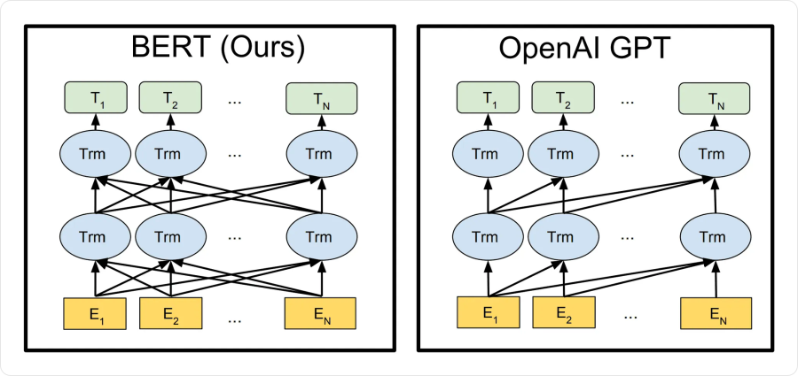
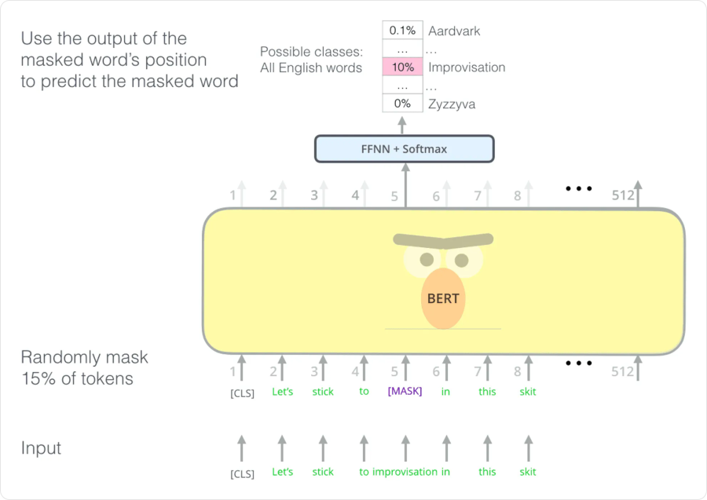
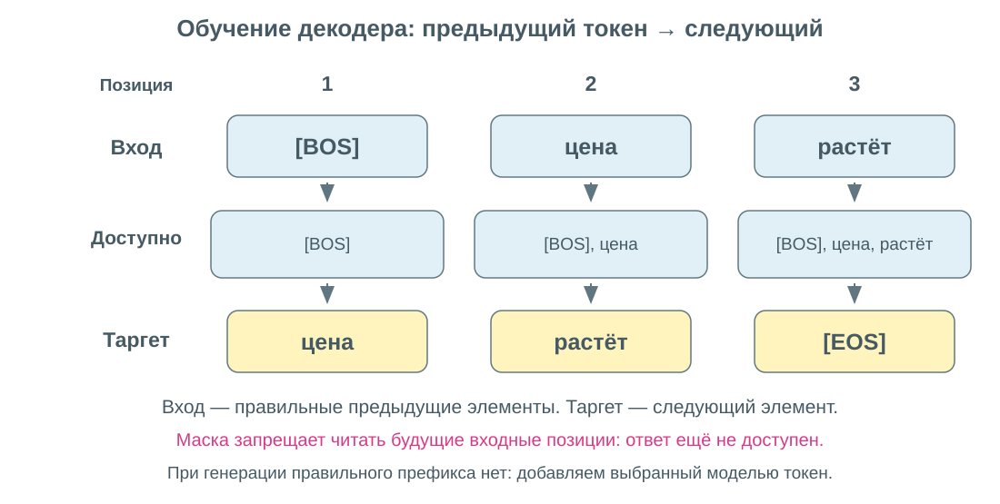
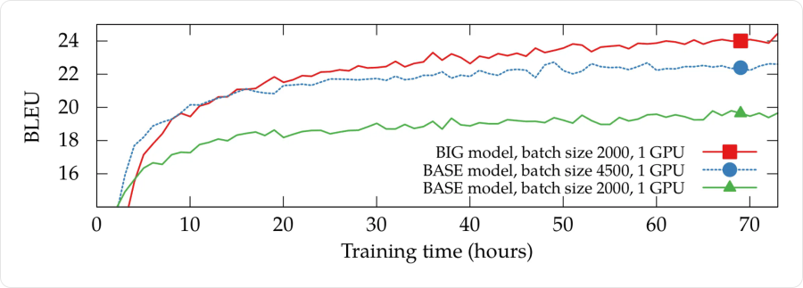
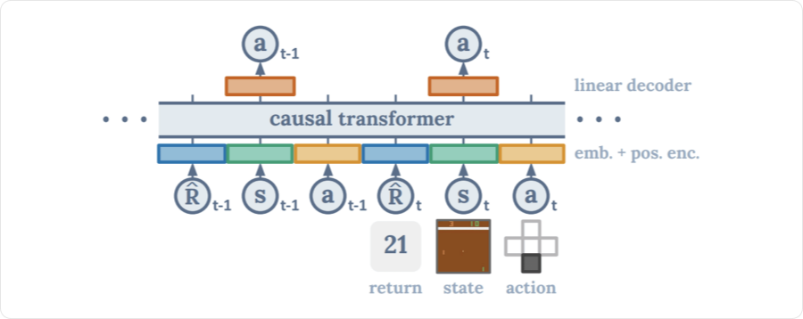

# Обучение и применение трансформеров

Архитектура определяет, **как модель обрабатывает вход**, а обучающая задача — **какие закономерности она должна выучить**. Одинаковые по устройству блоки можно использовать для восстановления скрытых элементов, предсказания следующего элемента, классификации или регрессии.

Сначала разберём BERT и GPT как два понятных примера выбора контекста и цели, затем — генерацию, обучение и применение к другим данным.

## BERT и GPT: разный доступ к контексту



На схеме `E` — входные представления, `Trm` — transformer-блоки, `T` — выходные представления. Линии между позициями показывают доступность контекста, а не готовые метки правильных ответов.

| Свойство | BERT | GPT |
|---|---|---|
| Семейство | Encoder-only | Decoder-only |
| Внимание | Двунаправленное по известному входу | Каузальное |
| Основная учебная задача | Восстанавливать скрытые токены | Предсказывать следующий токен |
| Типичное применение | Контекстные признаки, классификация, поиск | Авторегрессивная генерация |

У двунаправленного энкодера нет утечки, если **весь вход действительно известен** при применении. Для прогноза будущего по ряду нельзя выдавать ему реальные будущие наблюдения. При этом двунаправленно обработать уже известное историческое окно допустимо.

## Как обучается BERT

### Masked language modeling

Часть токенов во входе скрывают или заменяют. Модель должна восстановить исходные значения по оставшемуся контексту:

```text
Исходно:  цена быстро выросла
На вход:  цена [MASK] выросла
Таргет:        быстро
```



Выходной классификатор применяется к представлениям выбранных позиций. Loss считают относительно **исходных** токенов. Знание слова «выросла» здесь допустимо: задача заключается в восстановлении пропуска, а не в прогнозировании из одного прошлого.

В исходном BERT выбирали `15%` позиций: из выбранных `80%` заменяли на `[MASK]`, `10%` — случайным токеном, `10%` оставляли без изменения. Все выбранные позиции участвовали в восстановлении. Поэтому фраза «BERT всегда видит `[MASK]` на каждом предсказываемом месте» неточна.

### Next sentence prediction

Вторая задача **исходного BERT** — определить, следуют ли два фрагмента друг за другом в тексте или второй взят из другого места. Для общего решения использовалось представление `[CLS]`.

Это не обязательная часть всех моделей семейства BERT: в последующих вариантах цели предобучения менялись. Главное архитектурное свойство — доступ к двустороннему контексту известных входных позиций.

## Как обучается GPT

Авторегрессивная модель раскладывает вероятность последовательности на условные вероятности:

```text
p(y₁, …, yT) = ∏ₜ p(yₜ | y₁, …, yₜ₋₁)
```

Перед первым элементом можно поставить специальный маркер начала `[BOS]`. На каждом шаге задача — многоклассовая классификация по словарю. Для encoder–decoder добавляется условие на исходный вход `x`: `p(yₜ | x, y<t)`.

### Teacher forcing и сдвиг входа

**Teacher forcing** означает, что при обучении модели подают правильный предыдущий префикс, а не её собственные случайные предсказания.



```text
Вход декодера: [BOS]   цена      растёт
Таргет:        цена    растёт    [EOS]
```

На первой позиции модель видит `[BOS]` и предсказывает «цена». На второй — `[BOS], цена` и предсказывает «растёт». На третьей должна предсказать конец `[EOS]`.

**Сдвиг и каузальная маска нужны вместе.** Сдвиг не даёт положить правильный ответ прямо в текущий вход. Маска не позволяет взять его из следующей входной позиции.

Все три потери при обучении можно вычислить одновременно: правильные входы уже известны, а маска ограничивает связи. При генерации следующий выбранный токен ещё неизвестен, поэтому его приходится получать последовательно.

### Функция потерь

Для `N` учитываемых позиций:

```text
L = −(1/N) · Σₜ ln pₜ(yₜ)
```

`pₜ(yₜ)` — вероятность правильного токена в позиции `t`. Padding и другие позиции, не входящие в выбранную цель, исключаются и из суммы, и из `N`.

Например, если вероятности правильных ответов равны `[0.5, 0.25]`, то `L = −(ln 0.5 + ln 0.25)/2 ≈ 1.040`. Правильные ответы заданы данными; градиенты проходят через классификатор, блоки трансформера и входные представления.

## Предобучение и адаптация

**Предобучение (pretraining)** на большом наборе данных учит общим закономерностям. Метки часто строят из самих данных: скрытый токен или следующий токен уже известен. Это **self-supervised learning**.

**Дообучение (fine-tuning)** адаптирует модель под конкретную задачу. Например, к энкодеру добавляют классификатор, а генеративную модель обучают на парах «инструкция — ответ». Обновлять можно все параметры или выбранную часть.

**In-context learning** использует инструкцию и примеры во входе без обновления весов. Это другой способ применения модели, его не следует путать с дообучением.

После предобучения генеративная модель не обязана сразу хорошо выполнять инструкции. Специальное дообучение меняет её поведение, но авторегрессивное получение следующего токена может сохраниться.

## Как получается последовательность при генерации

1. Обрабатываем известный префикс.
2. Получаем логиты и распределение следующего токена.
3. Выбираем токен по заданному правилу.
4. Добавляем его к префиксу и повторяем.
5. Завершаем по `[EOS]` или заданному лимиту.

Правило выбора токена — **стратегия декодирования**. Оно не меняет уже обученные веса модели.

| Стратегия | Как выбирается продолжение |
|---|---|
| **Greedy** | Самый вероятный токен на каждом шаге |
| **Beam search** | Поддерживается несколько лучших частичных последовательностей |
| **Sampling** | Случайная выборка из распределения |
| **Top-k sampling** | Выборка после ограничения `k` наиболее вероятными вариантами |
| **Top-p sampling** | Выборка из наименьшего начального набора отсортированных вариантов с суммарной вероятностью не меньше `p` |

После ограничения top-k/top-p вероятности оставшихся вариантов нормируют заново.

### Почему greedy может ошибаться

Пусть первый шаг даёт `p(A) = 0.6`, `p(B) = 0.4`. После `A` лучший следующий токен имеет вероятность `0.5`, после `B` — `0.99`.

```text
Лучшая двухшаговая цепочка через A: 0.6 · 0.5 = 0.30
Лучшая двухшаговая цепочка через B: 0.4 · 0.99 = 0.396
```

Greedy выберет `A`, хотя лучшая полная цепочка идёт через `B`. Beam search с шириной `2` в этом примере сохранит оба первых варианта. В общем случае это тоже приближённый поиск, без гарантии глобального оптимума.

При сравнении цепочек обычно складывают логарифмы вероятностей. Необработанная сумма предпочитает короткие ответы, поэтому критерий завершения и нормировку по длине выбирают отдельно.

### Temperature

Температура меняет распределение перед выбором:

```text
p = softmax(logits / T),     T > 0
```

Малое `T` делает распределение более сосредоточенным, большое — более ровным. При `[ln 3, 0]` и `T = 1` получаем `[0.75, 0.25]`, при `T = 0.5` — `[0.9, 0.1]`.

Температура имеет значение при случайном выборе. При положительном `T` порядок логитов сохраняется, поэтому обычный greedy argmax не меняется. Более случайный ответ не становится автоматически более правильным.

### KV-cache

В каузальном трансформере старые позиции не зависят от нового продолжения. При генерации можно сохранять их **ключи и значения по слоям** и для нового токена вычислять только недостающую часть.

Это **KV-cache**: он сокращает повторные вычисления ценой памяти. Новый запрос всё равно обращается к доступным старым ключам и значениям, поэтому стоимость не становится независимой от длины контекста.

## Как измерять качество

**Perplexity** — экспонента средней отрицательной логарифмической вероятности правильных токенов:

```text
PPL = exp(L_NLL)
```

Логарифм в `L_NLL` натуральный. В примере с вероятностями `[0.5, 0.25]` perplexity равна `√8 ≈ 2.828`. Меньше — модель в среднем назначает больше вероятности правильному продолжению. Для этой метрики берут обычный NLL, без добавленного штрафа регуляризации или подмены таргетов label smoothing.

PPL корректно сравнивать при согласованных данных, токенизации и правилах учёта позиций. Это не процент правильных токенов и не полная оценка полезности сгенерированного ответа.

Для конкретной задачи нужны её метрики: accuracy/F1 для классификации, MAE/MSE для численного прогноза. В переводе используют, например, BLEU, который учитывает совпадения n-грамм и штраф за слишком короткий результат. Хороший перевод с другими формулировками может получить низкий BLEU.

## Особенности обучения

### Большие батчи и микробатчи

Для последовательностей полезно учитывать **число реальных токенов / позиций**, а не только число объектов. Два батча по `16` последовательностей могут сильно различаться по числу элементов и стоимости внимания.

**Аккумуляция градиентов** позволяет обработать эффективный батч частями:

```text
микробатч 1 → градиент ┐
микробатч 2 → градиент ├→ суммировать с нужным масштабом → один шаг оптимизатора
микробатч 3 → градиент ┘
```

Веса между микробатчами не обновляют. Если loss в микробатче `r` усреднён по `Nᵣ` позициям, то для среднего по всем `N = ΣNᵣ` его градиент входит с весом `Nᵣ/N`. Простое деление на число микробатчей подходит, когда число учитываемых позиций одинаково.

Распределённое обучение объединяет вычисления нескольких устройств. Аккумуляция работает и на одном устройстве, но требует нескольких проходов. Большой эффективный батч не делает каждую отдельную последовательность короче и не устраняет квадратичную стоимость её полного внимания.



По вертикали BLEU, по горизонтали время обучения. Кривые показывают важность настроек в конкретном эксперименте; из них не следует, что самый большой батч всегда лучше.

### Оптимизатор и learning rate

В исходном Transformer использовался **Adam**. Часто применяют Adam/AdamW вместе с **warmup**: сначала learning rate увеличивается от малого значения, затем снижается по расписанию.

Один из вариантов исходного расписания:

```text
ηₜ = d_model^(−1/2) · min(t^(−1/2), t · warmup_steps^(−3/2))
```

`ηₜ` — learning rate, `t ≥ 1` — номер **шага оптимизатора**, `warmup_steps` — число начальных шагов роста. При аккумуляции один микробатч не равен одному такому шагу. Это пример расписания, а не обязательная формула для всех трансформеров.

Для очень больших батчей существуют оптимизаторы вроде **LAMB**, которые дополнительно согласуют масштаб обновления с нормой параметров слоя. Они не являются обязательной заменой AdamW. Выбор оптимизатора и размера батча проверяют совместно; SGD не запрещён архитектурой, но его настройки нельзя механически переносить с другой модели.

### Регуляризация и устойчивость

- **Dropout** может применяться к представлениям, выходам ветвей и весам внимания при обучении. При предсказании его выключают; после dropout сумма весов внимания в отдельном проходе не обязана равняться `1`.
- **Weight decay** ограничивает рост весов; отличие AdamW от L2-штрафа разобрано в 051.
- **Label smoothing** заменяет жёсткую one-hot цель слегка сглаженной. Например, `q = (1 − ε)·one_hot(y) + ε/Vocab`.
- **Нормировки, инициализация и gradient clipping** помогают контролировать нестабильность, но не исправляют ошибочные маски или таргеты.

Большой батч иногда увеличивают по ходу обучения: ранние шаги делают чаще, поздние оценивают градиент по большему числу объектов. Это одна из стратегий, а не универсальное правило.

## Применение вне текстов

### Изображения

**Vision Transformer** получает последовательность патчей изображения, а затем строит контекстные представления через энкодер. Схема подготовки патчей приведена в 055.

У CNN локальность и общие фильтры явно встроены в архитектуру. Полное внимание ViT связывает все патчи; более слабые ограничения на связи часто требуют подходящих данных и режима обучения. Патчи и позиции при этом тоже являются заложенными в модель предположениями о структуре входа.

В **первой версии DALL-E** изображение представлялось дискретными визуальными токенами, а авторегрессивный трансформер предсказывал их после текстового условия. Здесь важна общая идея: элементы последовательности могут кодировать изображение. Другие модели с похожим назначением могут использовать другой механизм генерации.

### Действия и Decision Transformer



Здесь `sₜ` — состояние среды, `aₜ` — действие, `R̂ₜ` — **return-to-go**, сумма будущих наград от шага `t` до конца записанной траектории. Это не просто награда одного текущего шага.

При обучении return-to-go вычисляют по готовым траекториям. Модель учится предсказывать записанное действие по истории, состоянию и return-to-go. При применении задают **желаемую** оставшуюся награду, а после реального шага уменьшают её на полученную награду.

То есть известное при обучении целевое условие при применении заменяется поставленной целью. Реальные будущие награды модели заранее не сообщают. Высокая желаемая награда не гарантирует её достижение: возможности зависят от данных и выученного поведения.

### Временные ряды

Наблюдения или окна ряда проецируют в векторы, добавляют информацию о времени и подают в выбранную архитектуру. Выходная голова может предсказывать класс, число или несколько будущих значений.

Главная проверка — **что доступно в момент прогноза**. Правильная каузальная маска не спасает, если признаки, нормировка или обучающая выборка уже содержат информацию из будущего. Сравнивать трансформер стоит с простыми базовыми моделями на одинаковом временном разбиении.

## Связанные материалы

- [Яндекс Учебник — «Трансформеры»: BERT/GPT, обучение и другие модальности](https://contest.yandex.ru/tracks/ml/deep-learning-architectures/transformers)
- [Нейчев — неделя 3: Language Models и Seq2seq](https://github.com/neychev/made_nlp_course/tree/master/week03_lm_and_seq2seq)
- [Нейчев — неделя 5: перевод, генерация и оценка](https://github.com/neychev/made_nlp_course/tree/master/week05_machine_translation)
- [Нейчев — неделя 6: Self-Attention](https://github.com/neychev/made_nlp_course/tree/master/week06_SelfAttention_and_NMT_practice)
- [Girafe ML Course — Embeddings и Seq2seq](https://github.com/girafe-ai/ml-course/tree/master/week0_09_embeddings_and_seq2seq)
- [Мария Тихонова — миникурс, часть 1](https://www.youtube.com/watch?v=c0qR2NhqTxU)
- [Мария Тихонова — миникурс, часть 3, дополнительное видео](https://www.youtube.com/watch?v=U-OcsQqrcSo)
- [Мария Тихонова — миникурс, часть 4, дополнительное видео](https://www.youtube.com/watch?v=33HEt5xprgY)
- [Vaswani et al. — Attention Is All You Need](https://arxiv.org/abs/1706.03762)
- [You et al. — LAMB](https://arxiv.org/abs/1904.00962)
- [Devlin et al. — BERT](https://arxiv.org/abs/1810.04805)
- [Chen et al. — Decision Transformer](https://arxiv.org/abs/2106.01345)
- [Трансформеры](054-transformers.md)
- [Представления данных и позиции](055-representations-and-positions.md)
- [Оптимизаторы](051-optimizers.md)

### Автор:

* [Олег](https://t.me/HocokTopok)
